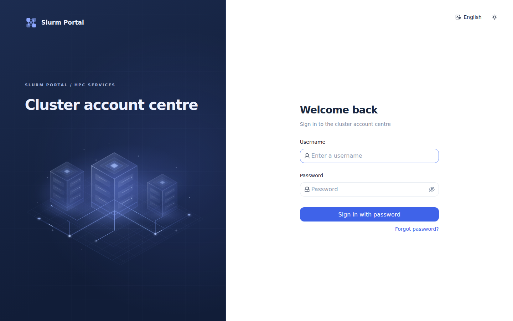
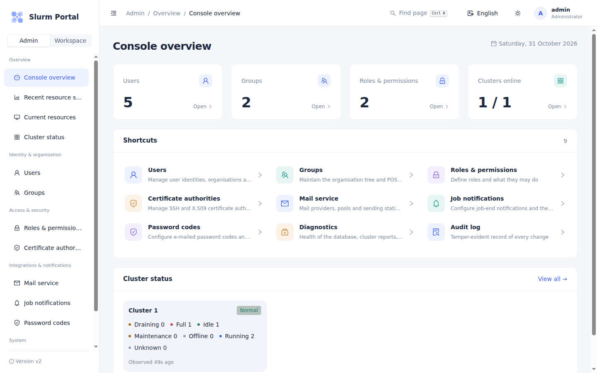
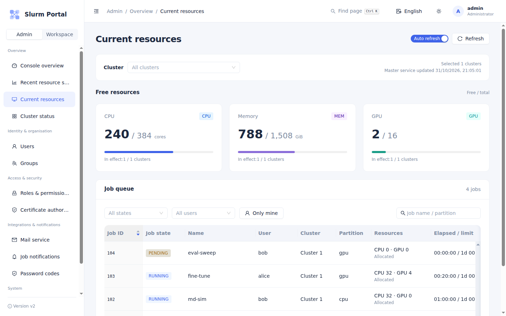
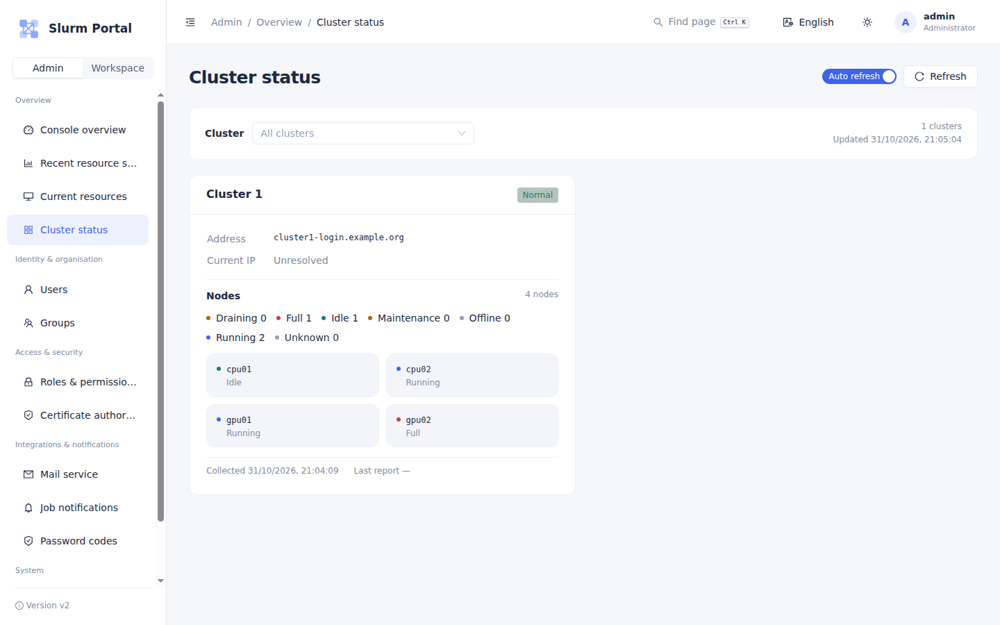
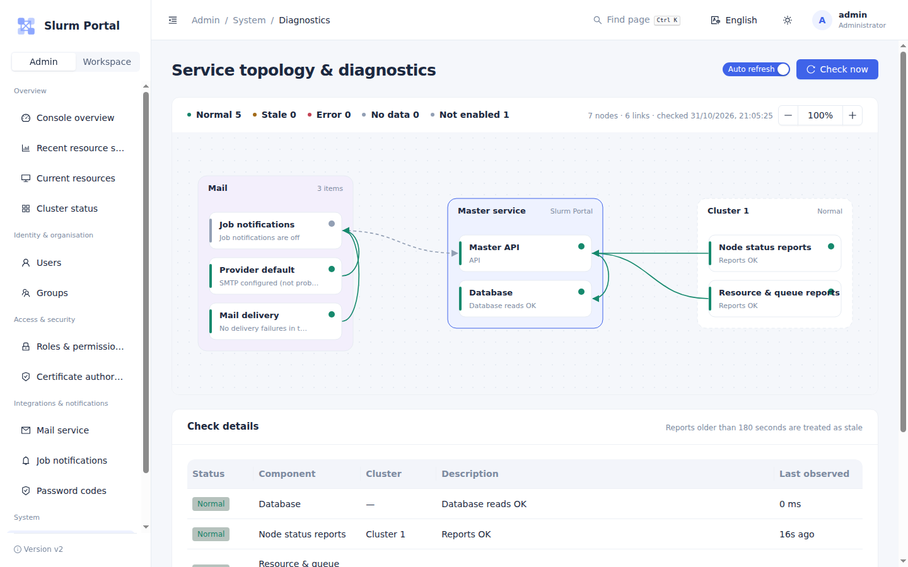
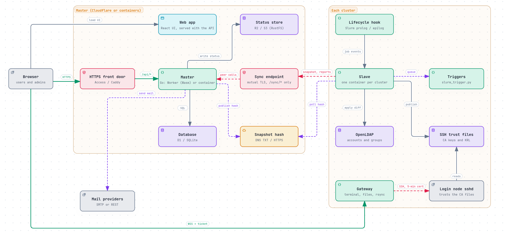

# Slurm Portal

[](https://ting-hiuyu.github.io/SlurmPortal/)
[](https://github.com/TING-HiuYu/SlurmPortal/actions/workflows/ci.yml)


[](LICENSE)

Slurm Portal is the account and access centre for Slurm HPC clusters. One web portal manages
the people who use several clusters: their accounts, groups, passwords and SSH certificates. A
small agent on each cluster keeps that cluster's OpenLDAP and SSH trust in step. Users also get
a browser terminal, file transfers between clusters, job e-mails and live cluster status.



## Advantage

- **One portal, every cluster.** Accounts, groups and SSH certificates are managed once and replicated to each cluster's own OpenLDAP. UIDs, GIDs and access stay consistent everywhere, and each cluster keeps working on its own if the portal is unreachable.
- **Runs serverless or self-hosted.** The same Go codebase runs as WebAssembly on Cloudflare Workers (D1, R2, Access) with no servers to maintain, or in Docker Compose on your own host.
- **Cheap and quiet.** Slaves check a tiny hash and download the snapshot only when it changes. Live cluster status is served straight from object storage, so an idle site costs next to nothing.


## What it does

- **Accounts and groups.** Users, POSIX groups, organisations and roles live in one place, and
  every cluster's OpenLDAP follows them. UIDs and GIDs are allocated once and stay the same
  everywhere.
- **SSH certificates.** The portal is a certificate authority. Users log in to the clusters
  with a key and a 30-day certificate the portal issues, instead of passwords, and revocation reaches every
  login node through a KRL.
- **Sign-in.** Users sign in with a password, GitHub (OAuth), or Cloudflare Access. Forgotten
  passwords are reset with an e-mailed code. Only one-way hashes are stored.
- **Web access.** A browser terminal, a file browser, and rsync transfers between clusters run
  through a gateway on each login node, using 5-minute certificates.
- **Status and usage.** It shows node states, free CPU, memory and GPU, the job queue, and 7-day
  GPU usage per user, for every cluster on one page.
- **Notifications.** Job-end, file-transfer and password-code e-mails go through SMTP or REST
  mail providers, with pools, quotas and per-provider counts.
- **Operations.** It provides a tamper-evident audit log, a diagnostics page that shows every
  dependency's health, and roles that cannot grant more than their holder has.

| Console overview | Current resources |
| --- | --- |
|  |  |
| **Cluster status** | **Service diagnostics** |
|  |  |

## How it fits together



- **Master** is the portal. It runs one of two ways:
  - **SaaS:** compiled to WebAssembly on a Cloudflare Worker, with D1, R2 and Cloudflare Access;
  - **containers:** natively in Docker Compose, with SQLite, an S3 store and Caddy for HTTPS.
- **Slave** runs once per cluster next to OpenLDAP, as a container. When the master's snapshot
  changes, the slave downloads it over mutual TLS. It then:
  - applies the difference to LDAP;
  - writes the SSH trust files that sshd reads;
  - runs local triggers, such as creating the user's Slurm account.
- **Gateway** runs on a login node and carries the browser terminal, files and transfers.
- **Lifecycle hook** runs from the Slurm controller's prolog and epilog and reports finished
  jobs for e-mail and GPU accounting.

Read [the architecture page](docs/dev/architecture.md) for the full picture, or open
the [interactive diagram](https://ting-hiuyu.github.io/SlurmPortal/architecture.html).

## Deploy

The [deployment wiki](docs/deploy/README.md) goes from bare Ubuntu 24.04 servers to a working
cluster: munge, Slurm, accounting, slurmrestd, OpenLDAP, sssd and NFS, then the portal. Already
running Slurm with LDAP? Go straight to the portal:

| | Guide |
| --- | --- |
| Master on Cloudflare (Worker, D1, R2, Access) | [Serverless master](docs/deploy/master-saas.md) |
| Master in containers (Docker Compose: master, SQLite, RustFS, Caddy) | [Container master](docs/deploy/master-container.md) |
| Slave on each cluster, for either master | [The slave](docs/deploy/slaves.md) |
| Web terminal, job e-mail, GPU usage | [Optional parts](docs/deploy/optional.md) |

## Try it on one machine

You need Docker with the Compose plugin. This starts a master, and a slave that writes to a demo
OpenLDAP:

```sh
git clone https://github.com/TING-HiuYu/SlurmPortal.git && cd SlurmPortal

cd deploy/compose/master
./init.sh localhost                      # prints the first admin's password
./add-cluster.sh cluster1 "Cluster 1"
docker compose up -d                     # then open https://localhost (accept Caddy's local CA)

cd ../slave
./init.sh
cp ../master/secrets/clusters/cluster1/* secrets/
openssl rand -base64 24 > secrets/ldap-password && chmod 600 secrets/*
```

In `deploy/compose/slave/slave.yml`, set these values, then run `docker compose --profile demo up -d`:

```yaml
master-url: https://localhost:8443
dns-name: ""
cluster-id: cluster1
tls:
  server-name: localhost
  ca-file: /etc/slurm-portal/secrets/master-ca.crt
ldap:
  url: ldap://127.0.0.1:1389
```

Accounts you create in the portal appear in the demo OpenLDAP within a minute.

## Develop

You need Go 1.26 and Node.js 22.

```sh
make check                               # gofmt, vet, Go tests, JS tests, web build, Wasm build
```

[The development guide](docs/dev/development.md) shows how to run each part locally and lists the code
conventions.

## Documentation

| Document | For |
| --- | --- |
| [Deployment](docs/deploy/README.md) | Choosing a master, and the three guides |
| [Architecture](docs/dev/architecture.md) | Components, request pipeline, sync protocol, storage |
| [Plugins](docs/dev/plugins.md) | The plugin system, every built-in plugin, writing a new one |
| [Project layout](docs/dev/project-layout.md) | What lives where in this repository |
| [Development](docs/dev/development.md) | Local setup, tests, conventions |
| [Security model](docs/dev/security.md) | Authentication, authorization, machine identity, secrets |
| [Operations](docs/deploy/operations.md) | Day-to-day tasks and troubleshooting |

## Acknowledgements

Slurm Portal began as a fork of [go-ldap-admin](https://github.com/eryajf/go-ldap-admin) by
[eryajf](https://github.com/eryajf) and its contributors. Its data model of users, groups and
roles, its LDAP layout, its role-based permissions and the first console design all come from
go-ldap-admin, and Slurm Portal still opens a go-ldap-admin database directly. The rewrite moved
it to Cloudflare Workers and containers and added the cluster side, but go-ldap-admin is the
bedrock it stands on. Thank you.

## License

[Apache License 2.0](LICENSE), the same as go-ldap-admin.
