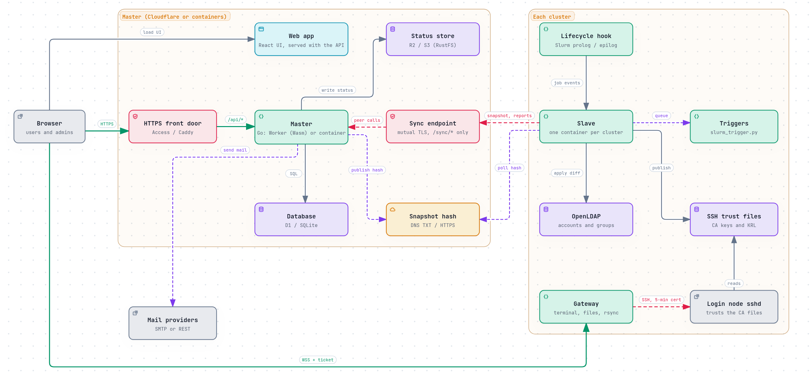
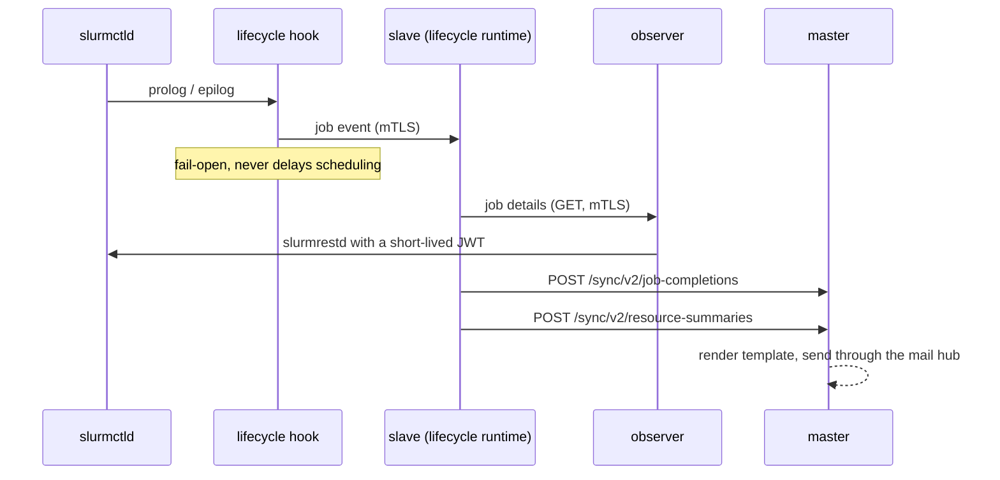
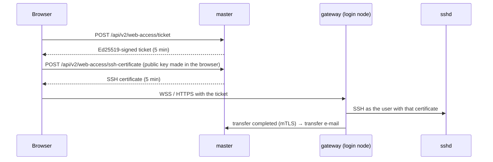

# Architecture

This page explains how Slurm Portal is put together: which programs exist, where they run, how
they talk to each other, and how a request travels through the master service. Read it before
changing anything that crosses a component boundary.

The diagram is also available as an interactive page: [architecture.html](architecture.html). Its
source is [diagrams/architecture.archify.json](diagrams/architecture.archify.json), rendered with
[Archify](https://github.com/tt-a1i/archify). Every box in it cites the file that implements it.

## Components

One Go module builds every program. They share the same packages, so the snapshot format, the
permission names and the configuration rules cannot drift apart.

| Program | Source | Runs on | Job |
| --- | --- | --- | --- |
| **master** | `cmd/worker` (WebAssembly) or `cmd/server` (native) | Cloudflare Worker + D1, or any host + SQLite | API, sign-in, identity, PKI, plugins, audit |
| **web app** | `web/` (React 19, Ant Design 6) | Static assets of the same Worker | The browser UI |
| **slave** | `cmd/slave` | One per cluster, next to OpenLDAP | Applies master's snapshot to LDAP, publishes SSH trust, runs triggers, reports status, hosts the lifecycle runtime |
| **gateway** | `cmd/gateway` | Each cluster's login node | Browser terminal, SFTP file browser, rsync transfers between clusters |
| **lifecycle hook** | `cmd/slurm-lifecycle-hook` | Slurm controller (prolog / epilog) | Reports job start and end to the slave without delaying scheduling |
| **observer** | `cmd/slurm-notify-observer` | Slurm controller | Read-only mTLS proxy to slurmrestd, so the slave never holds the Slurm JWT key |
| host bridge | `cmd/host-bridge` | Inside a containerised slave, and on the cluster host | Runs triggers on the host over SSH |
| tools | `cmd/migration-check`, `cmd/convert-passwords`, `slave -plan` | An operator's machine | Rehearse and verify a migration from v1 data |

## Master

### Where it runs

On Cloudflare, `deploy/worker/worker.js` is a thin JavaScript shell around the Go program:

- It loads `main.wasm` (built from `cmd/worker`) and hands Go the bindings Go cannot reach
  itself:
  - the D1 database (`d1-bridge.js`);
  - outgoing SMTP over `cloudflare:sockets` (`smtp-bridge.js`);
  - the verified client-certificate identity of machine callers (`edge.js`).
- Static files (the web app) are served by Workers Static Assets and never run the Worker. Only
  `/api/*`, `/sync/*` and `/healthz` do (`run_worker_first` in `wrangler.toml`).
- A cron trigger runs every 5 minutes. It renews certificates that are about to expire and
  republishes the snapshot hash (`App.Tick`).
- After any successful write, the Worker publishes the new snapshot hash at once (`App.Publish`).

`cmd/server` runs the same `internal/app` natively, with database/sql and SQLite. The container
deployment uses it ([deploy-container-master.md](deploy-container-master.md)):

- it serves the web app itself (`STATIC_DIR`);
- it serves the machine routes on a separate mutual-TLS listener (`SYNC_LISTEN`);
- it treats requests as HTTPS when a TLS proxy in front says so (`BEHIND_TLS_PROXY`);
- it ticks hourly and republishes after every write, as the Worker does.

### Request pipeline

`app.New` builds one `httpx.Router`. Every request passes the same middleware chain, in this
order:

1. `httpx.WithScope`: request ID and per-request state.
2. `telemetry.HTTPMiddleware`: a trace span per request, when a telemetry plugin is on.
3. `httpx.Recover`: a panic becomes a logged 500.
4. `httpx.SecurityHeaders`: nosniff, no framing, deny-all CSP, no-store.
5. `httpx.RateLimit`: per client IP.
6. `httpx.CORS`: only the configured origins.
7. Write tracking: remembers that the snapshot may have changed.
8. `audit.Middleware`: records every mutation, including denied ones, in the hash chain.

The router then authenticates the caller and checks the route's permission before the handler
runs:

- **Users** present a session token (`authn.JWT`).
- **Machines** present a client certificate (`authn.TLSPeer` natively, `authn.BridgePeer` on
  the Worker).
- Every route declares one permission: `Public`, `Authenticated`, `Peer` or
  `Policy(object, action)`. The router refuses to register a route without one. Role permissions
  are reloaded from the database every 10 seconds.

Errors leave handlers as `apperr.Error` values. Each has an HTTP status, a stable code and a
message, and is the only error shape a client sees.

### Modules and plugins

The core modules are always present:

| Package | Owns |
| --- | --- |
| `internal/domain/identity` | Users, groups, roles, POSIX UID/GID allocation, rank-based anti-escalation |
| `internal/domain/auth` | Password sign-in, token refresh and logout, password change, e-mailed reset codes |
| `internal/domain/pki` | X.509 and SSH CAs, issuing, rotating and revoking user certificates, CRLs |
| `internal/audit` | The append-only, hash-chained, size-bounded audit log |
| `internal/mail` | The mail hub: named providers (SMTP, REST, pools) and per-provider delivery counts |
| `internal/replication` | The snapshot that slaves apply, and its hash publisher |
| `internal/legacyimport` | One-time import of v1 settings and history |

Everything optional is a plugin: OAuth, Cloudflare Access, the status pages, notifications, web
access, diagnostics and telemetry. A plugin is compiled in, enabled by configuration, and gets
a `plugin.Host` with the router and the core modules. See [plugins.md](plugins.md).

### Storage

All SQL goes through `store.Store`. It has three methods: `Query`, `Exec`, and `Batch` (atomic:
all or none). There are two implementations:

- `store.SQL` wraps database/sql (SQLite natively).
- `store/d1` sends statements through the JavaScript bridge to D1.

`store/storetest` holds the conformance tests both must pass.

Migrations are plain SQL files in `migrations/`, embedded into the binary and applied in order at
start (`store.Migrate`). They are additive only, and statements in one file are separated by
`--;` lines. The first migration (`0000_legacy_base.sql`) is the go-ldap-admin v1 schema, so a v1
database can be opened directly.

D1 bills every row read and written, so queries are kept index-backed and small. The audit log
is bounded (`AUDIT_MAX_RECORDS`), and routine machine reports are audited only when they fail.

## Cluster sync

### The snapshot

`replication.Load` builds the **snapshot** from the database. It is everything a cluster needs:

- users and groups (with their LDAP DNs, UIDs, GIDs and password hashes);
- group memberships;
- the CAs to trust and their revocations;
- users' current certificates.

The snapshot hash is the SHA-256 of its JSON.

On Cloudflare, after each write, master publishes `v2:<hash>` to a DNS TXT record
(`SYNC_DNS_NAME`, e.g. `_sync.portal.example.org`), and the cron tick republishes it. Only the digest
enters DNS. A master without a DNS record (the container deployment) serves the same value at
`GET /sync/v2/snapshot-hash` to authenticated slaves instead.

### What a slave does

Each slave runs `slave.Replicator`:

1. Every `check-interval` (60 s by default) it reads the hash: from the TXT record when
   `dns-name` is set, otherwise from `/sync/v2/snapshot-hash`. If the hash matches the last
   applied one, nothing else happens. With DNS, a quiet cluster costs one DNS lookup a minute and
   no requests to master.
2. When the hash changes, it downloads `GET /sync/v2/snapshot` from the sync host with its
   client certificate.
3. It plans the difference against its local directory. It refuses to apply a plan that would:
   - delete more than `limits.max-user-deletions` users;
   - drop a trusted SSH CA (unless `limits.allow-ca-removal` is set).
4. It applies the plan to OpenLDAP. Master's base DN can be rewritten to a different local one.
   Entries master does not manage are left alone.
5. It writes a new immutable **trust generation** and atomically repoints the `current` link.
   sshd's `TrustedUserCAKeys` and `RevokedKeys` point at:
   - `current/ssh/trusted-user-ca-keys.pub`
   - `current/ssh/revoked.krl`
6. It writes one queue file per directory event that a trigger subscribes to, such as
   `user.created` or `membership.added`. It then runs each trigger's command in order. A failed
   delivery stays queued, and later ones wait. Triggers must be safe to repeat.

`slave -plan` runs steps 2–3 offline against a `slapcat` export and prints every write it would
make. Run it before a first sync.

### Reports back to master

Slaves also push reports over the same mTLS connection:

| Report | Path | Stored as |
| --- | --- | --- |
| Current status (nodes, resources, queue) | `PUT /sync/v2/current-status` | One R2 object per cluster |
| Node status | `POST /sync/v2/cluster-status` | Latest row per cluster in D1 |
| Resources and queue | `POST /sync/v2/resource-status` | Latest row per cluster in D1 |
| Job completions | `POST /sync/v2/job-completions` | Sent as job e-mails |
| GPU usage per finished job | `POST /sync/v2/resource-summaries` | D1, for the 7-day statistics |

Browsers read live status straight from R2. `GET /api/v2/current-status/links` returns
short-lived presigned URLs, so live status costs no Worker or D1 traffic.

## Job lifecycle

The runtime (`internal/lifecycle/runtime`) puts events on a bounded in-process bus
(`internal/lifecycle/eventbus`). Compiled-in listeners consume them:

- `jobdoneemail` forwards finished jobs to master;
- `resources` samples GPU use while a job runs and sends a summary when it ends.

## Web access

The gateway checks every request against master's public ticket keys. It never reads user files
itself: terminal, SFTP and rsync all run as the user over SSH. Gateways register with master
(`/sync/v2/web-access/register`), and a cluster's web features switch on from what its gateway
reports.

## Identity and permissions

- **Users** have a username, a UID, one main POSIX group (which sets home directory and shell
  presets) and any number of extra groups.
- **Groups** are either POSIX groups (with a GID and `memberUid`) or organisational groups
  (`groupOfUniqueNames`), arranged in a tree.
- **Roles** carry `(object, action)` permissions and a rank (`sort`; lower outranks higher).
  Nobody can edit a role or user that ranks at or above them, or grant a permission they do not
  hold. The UI menu comes from `GET /api/v2/me/access`, but the server checks every call.
- **Passwords** are stored only as one-way hashes: argon2id for the portal, and crypt SHA-512
  for LDAP. When a user sets a new password, both hashes are written. An empty LDAP hash leaves
  the directory's existing password alone.

## Where to go next

- [plugins.md](plugins.md): the plugin system and each plugin.
- [project-layout.md](project-layout.md): a map of the repository.
- [security.md](security.md): trust boundaries in more detail.
