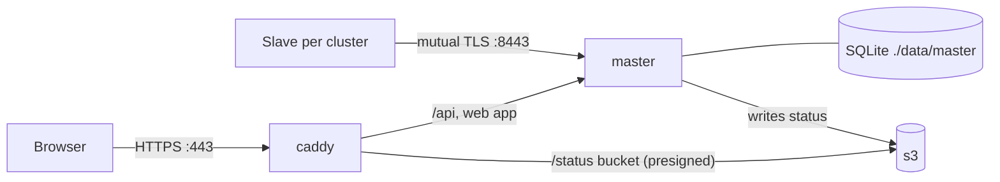

# Deploy the master in containers

This guide runs the Slurm Portal master on a machine you control, with Docker Compose. There is no
Cloudflare account to set up. Everything lives in [deploy/compose/master](../deploy/compose/master):

| Service | Image | Job |
| --- | --- | --- |
| `caddy` | `caddy:2.10.2-alpine` | HTTPS for browsers, with automatic certificates |
| `master` | built from [master.Dockerfile](../deploy/docker/master.Dockerfile) | The portal: API, web app, SQLite database in `./data/master` |
| `s3` | `rustfs/rustfs:1.0.3` | S3-compatible store for live cluster status |
| `s3-setup` | `amazon/aws-cli` | One-shot: creates the status bucket |



Each cluster then runs a slave container: [deploy-slaves.md](deploy-slaves.md).

## What you need

- A Linux host with Docker Engine and the Compose plugin, and this repository checked out.
- A DNS name for the portal pointing at the host (this guide uses `portal.example.org`).
  - Ports **80 and 443** open to your users. Caddy uses them to get a certificate from Let's
    Encrypt automatically.
  - Port **8443** open to the clusters only. Slaves connect there with client certificates.
- To try it on one machine first, use `localhost` as the name: Caddy then uses its own local CA,
  and your browser will ask you to accept it.

## 1. Set up

```sh
cd deploy/compose/master
./init.sh portal.example.org
```

`init.sh` does the one-time setup. It never replaces existing secrets.

| It creates | Holding |
| --- | --- |
| `.env` (mode 0600) | Generated secrets: session keys, `PKI_MASTER_KEY`, S3 keys, the first admin's password (printed once) |
| `secrets/certs/` | A private CA for the sync port, and the master's server certificate for `portal.example.org` |
| `data/` | Folders for the database, S3 objects and Caddy's certificates, owned by you |

The containers run as your user ID (`PORTAL_UID` in `.env`), so everything stays readable by you.

Give extra names or IP addresses to `init.sh` if slaves will reach the sync port by another name:
`./init.sh portal.example.org sync.example.org 192.0.2.10`.

## 2. Register the clusters

```sh
./add-cluster.sh cluster1 "Cluster 1"
./add-cluster.sh cluster2 "Cluster 2"
```

For each cluster, `add-cluster.sh`:

- issues a client certificate from the private CA;
- adds the cluster to `CLUSTERS` and its fingerprint to `SYNC_CLIENT_FINGERPRINTS` in `.env`;
- writes a bundle in `secrets/clusters/<id>/`: `client.crt`, `client.key`, `master-ca.crt` and a
  `README.txt` with the settings for that cluster's `slave.yml`.

Copy each bundle to its cluster (for example with `scp -r`); [deploy-slaves.md](deploy-slaves.md)
continues there.

## 3. Start

```sh
docker compose up -d
docker compose ps        # master shows (healthy) after a few seconds
```

The first build compiles the web app and the server, which takes a few minutes. Open
`https://portal.example.org` and sign in as `admin` with the password `init.sh` printed. Then delete
the `BOOTSTRAP_ADMIN_PASSWORD` line from `.env` and run `docker compose up -d` again.

Do the first configuration as in [the SaaS guide, step 5](deploy-saas-master.md#5-first-configuration-in-the-portal):

1. Create an SSH CA.
2. Create a POSIX group.
3. Add a mail provider.

## Settings

`.env` holds the settings. After editing it, run `docker compose up -d`.

| Setting | Meaning |
| --- | --- |
| `PORTAL_HOST` | The name users type; Caddy's certificate and the status links use it |
| `HTTP_PORT`, `HTTPS_PORT`, `SYNC_PORT` | Published ports (80, 443, 8443) |
| `LDAP_BASE_DN`, `LDAP_USER_DN` | The directory layout written to the clusters |
| `PLUGINS_ENABLED` | Features (see [plugins.md](plugins.md)). Cloudflare-only plugins (`cloudflare-access`, `telemetry-cloudflare`) do not apply here |
| `CLUSTERS`, `SYNC_CLIENT_FINGERPRINTS` | Maintained by `add-cluster.sh` |
| `AUDIT_MAX_RECORDS` | Size bound of the audit log |

The master also accepts every setting in [development.md](development.md#settings) as an
environment variable. Add them to `.env`.

### Differences from the SaaS master

- **Snapshot hash.** Slaves ask the master for it over the sync port instead of reading DNS. Set
  `dns-name: ""` in `slave.yml`.
- **Proxy trust.** The master trusts `X-Forwarded-Proto` from Caddy (`BEHIND_TLS_PROXY`). Its own
  HTTP port is not published, so only Caddy can reach it. Do not publish port 8080.
- **Status storage.** Live status is stored in the `s3` service. Browsers read it through Caddy at
  `https://portal.example.org/slurm-portal-status/…`, from the same origin, so no CORS setup is
  needed.

## Backups

Everything is under `deploy/compose/master/`:

| Path | Contents |
| --- | --- |
| `.env` and `secrets/` | Secrets and the sync CA. **Back these up; `PKI_MASTER_KEY` seals every CA.** |
| `data/master/` | The SQLite database (stop the master, or use `sqlite3 portal.db ".backup copy.db"`) |
| `data/s3/` | Live status only; it is rebuilt by the next reports |

## Updating

```sh
git pull
docker compose up -d --build
```

Migrations only add, so the previous image still runs against the updated database.
