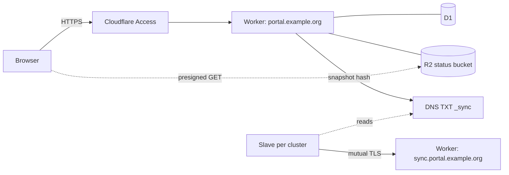

# Deploy the master on Cloudflare (SaaS)

This guide runs the Slurm Portal master on Cloudflare: a Worker for the API and web app, D1 for the
database, R2 for live cluster status, Cloudflare Access in front of the browser hostname, and a
mutual-TLS hostname for the clusters. There is no server to look after, and a quiet site costs very
little (see [Cost](#cost)). Each cluster then runs a slave container: [deploy-slaves.md](deploy-slaves.md).

If you would rather run everything on your own machine, use [deploy-container-master.md](deploy-container-master.md).



## What you need

- A Cloudflare account with a zone for your domain (this guide uses `example.org`), on a plan that
  includes Workers, D1, R2, Zero Trust (Access) and mTLS client certificates.
- Go 1.26, Node.js 22 and `npx wrangler@4` (log in once with `npx wrangler@4 login`).
- Two host names: one for people (`portal.example.org`) and one for the clusters
  (`sync.portal.example.org`).

## 1. Create the Cloudflare resources

```sh
cd deploy/worker
cp wrangler.example.toml wrangler.toml           # your copy; git ignores it

npx wrangler@4 d1 create slurm-portal            # put the database_id into wrangler.toml
npx wrangler@4 r2 bucket create slurm-portal-status
# Browsers read status objects directly from R2: allow your portal origin.
sed -i 's#https://portal.example.org#https://portal.your-domain#' r2-cors.json
npx wrangler@4 r2 bucket cors set slurm-portal-status --file r2-cors.json
```

Then, in the Cloudflare dashboard:

| What | Where | Notes |
| --- | --- | --- |
| R2 API tokens | R2 → Manage API tokens | Two tokens scoped to the bucket: **Object Read & Write** (the master writes status) and **Object Read only** (signs browser links). Keep the access key IDs and secrets for step 3 |
| Snapshot TXT record | DNS → Records | Create `_sync.portal.example.org`, type TXT, content `v2:0`. Note its record ID (DNS API, or the record's edit URL) |
| DNS API token | My Profile → API Tokens | **Zone → DNS → Edit** on your zone only. The master uses it to update the TXT record |
| Client certificates | SSL/TLS → Client Certificates | Add `sync.portal.example.org` under **Hosts**. Create one certificate per cluster (and per gateway); save each certificate and key |
| WAF rule | Security → WAF → Custom rules | Block `(http.host eq "sync.portal.example.org" and not cf.tls_client_auth.cert_verified)` |
| Access application | Zero Trust → Access → Applications | Self-hosted, domain `portal.example.org` only (never the sync host). Add your sign-in policy, and note the **AUD tag** and your team domain |

Each client certificate's fingerprint is what the master knows the cluster by:

```sh
openssl x509 -in cluster1.crt -outform DER | openssl dgst -sha256 -r | cut -d' ' -f1
```

## 2. Fill in wrangler.toml

Every `<placeholder>` in `wrangler.toml` must be replaced:

| Setting | Value |
| --- | --- |
| `routes` | Your two host names |
| `LDAP_BASE_DN`, `LDAP_USER_DN` | The directory layout the clusters' LDAP uses (a slave can rewrite the suffix if one cluster differs) |
| `SYNC_HOSTNAME`, `SYNC_DNS_NAME` | The sync host and the TXT record |
| `CLOUDFLARE_ZONE_ID`, `CLOUDFLARE_RECORD_ID` | The zone's ID (zone overview page) and the TXT record's ID |
| `SYNC_CLIENT_FINGERPRINTS` | Every cluster and gateway certificate fingerprint, comma-separated |
| `CLUSTERS` | One `{"id","name","fingerprint"}` per cluster; the id is what the cluster's slave uses as `cluster-id` |
| `PLUGINS_CONFIG` | Access team domain and AUD tag, your Cloudflare account ID, the bucket name |
| `[[d1_databases]]` | The `database_id` from step 1 |

Plugins are described in [plugins.md](plugins.md). Remove any you do not want from `PLUGINS_ENABLED`.

## 3. Set the secrets

```sh
cd deploy/worker
put() { printf '%s' "$2" | npx wrangler@4 secret put "$1" -c wrangler.toml; }
put JWT_KEYS "k1:$(openssl rand -base64 32)"
put JWT_ACTIVE_KID k1
put PKI_MASTER_KEY "$(openssl rand -base64 32)"        # also store it somewhere safe offline
put BOOTSTRAP_ADMIN_USERNAME admin
put BOOTSTRAP_ADMIN_PASSWORD "$(openssl rand -base64 18)"   # note it; delete the secret after first sign-in
put CLOUDFLARE_API_TOKEN '<DNS edit token>'
put PLUGIN_WEB_ACCESS_TICKET_KEY "$(openssl rand -base64 32)"
put PLUGIN_CURRENT_STATUS_R2_ACCESS_KEY_ID '<read & write key id>'
put PLUGIN_CURRENT_STATUS_R2_SECRET_ACCESS_KEY '<read & write secret>'
put PLUGIN_CURRENT_STATUS_R2_READ_ACCESS_KEY_ID '<read-only key id>'
put PLUGIN_CURRENT_STATUS_R2_READ_SECRET_ACCESS_KEY '<read-only secret>'
```

**`PKI_MASTER_KEY` seals every certificate authority and stored secret.** If you lose it, the CAs
cannot be opened again.

## 4. Build and deploy

```sh
cd deploy/worker
./build.sh                                     # Go → dist/main.wasm, and web/dist
npx wrangler@4 deploy -c wrangler.toml
```

Open `https://portal.example.org`, pass Access, and sign in as `admin` with the bootstrap password.
Then remove the bootstrap password: `npx wrangler@4 secret delete BOOTSTRAP_ADMIN_PASSWORD -c wrangler.toml`.

To check a deployment from a script (with an Access service token if Access is on):

```sh
BASE=https://portal.example.org ADMIN_PASSWORD=… CF_ACCESS_CLIENT_ID=… CF_ACCESS_CLIENT_SECRET=… node smoke.mjs
```

## 5. First configuration in the portal

1. **证书颁发机构 (Certificate authorities).** Create or import the SSH CA your clusters will trust.
2. **用户组 (Groups).** Create at least one POSIX group; every account needs a main POSIX group,
   which also sets its home directory and shell.
3. **邮件服务 (Mail service).** Add an SMTP or REST provider and send a test, then turn on the
   e-mails you want (job end, transfers, password codes).
4. **OAuth 连接器 (optional).** For GitHub sign-in, create a GitHub OAuth app with callback
   `https://portal.example.org/api/v2/oauth/callback/github`, store its secret as a Worker secret
   (`OAUTH_GITHUB_CLIENT_SECRET`), and run `node connector-github.mjs` (see the script's header).

## 6. Connect the clusters

For each cluster, follow [deploy-slaves.md](deploy-slaves.md) with:

| slave.yml | Value |
| --- | --- |
| `master-url` | `https://sync.portal.example.org` |
| `dns-name` | `_sync.portal.example.org` |
| `tls.server-name` | `sync.portal.example.org` |
| `tls.ca-file` | not set (Cloudflare's certificate is publicly trusted) |
| `cluster-id` | the id you gave the cluster in `CLUSTERS` |
| `secrets/client.crt`, `client.key` | the Cloudflare client certificate for this cluster |

## Updating

```sh
git pull
cd deploy/worker && ./build.sh && npx wrangler@4 deploy -c wrangler.toml
```

Migrations run when the new version first starts; they only add, so `npx wrangler@4 rollback`
returns to the previous version safely. Back up the database with
`npx wrangler@4 d1 export slurm-portal --remote --output backup.sql`.

## Cost

Cloudflare bills Worker requests and CPU, D1 rows read and written, and R2 operations. The design
keeps these small:

- The web app is served as static assets, which are not Worker requests.
- Slaves read the snapshot hash from DNS and download a snapshot only when it changed.
- Live status is one R2 object per cluster, read by browsers straight from R2.
- The audit log is bounded (`AUDIT_MAX_RECORDS`) and routine machine reports are not audited.
