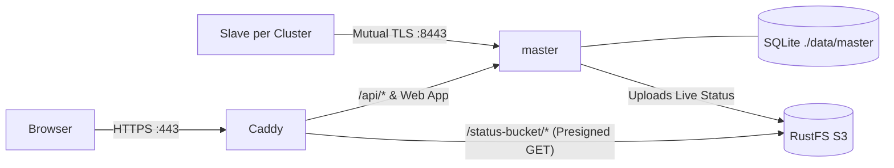

# Deploy the master in containers

This guide deploys the Slurm Portal master control plane on your own Linux server using Docker Compose—no Cloudflare account required. All configuration and helper scripts live in [`deploy/compose/master`](https://github.com/TING-HiuYu/SlurmPortal/tree/main/deploy/compose/master):

| Service | Image | Responsibility |
| --- | --- | --- |
| `caddy` | `caddy:2.10.2-alpine` | Terminates browser HTTPS on port `443` with automatic TLS certificates |
| `master` | Built from [`master.Dockerfile`](https://github.com/TING-HiuYu/SlurmPortal/blob/main/deploy/docker/master.Dockerfile) | Runs `cmd/server`: REST API, static React UI, SQLite database in `./data/master`, and mTLS sync listener on `:8443` |
| `s3` | `rustfs/rustfs:1.0.3` | S3-compatible object storage for live cluster status snapshots |
| `s3-setup` | `amazon/aws-cli` | One-shot initialization container that creates the status bucket |



Each cluster then connects using a slave agent ([Cluster Slave Agent](slaves.md)).

## What you need

- A Linux host with Docker Engine and the Docker Compose plugin installed, and this repository cloned.
- A DNS hostname pointing to the host (this guide uses `portal.example.org`):
  - Ports **`80/tcp` and `443/tcp`** reachable by users (Caddy uses them to obtain Let's Encrypt certificates automatically).
  - Port **`8443/tcp`** reachable by cluster slaves and Web Access Gateways for mutual-TLS sync traffic.
- For a local single-machine evaluation, pass `localhost` as the hostname: Caddy will generate a local self-signed CA certificate that you can accept in your browser.

## 1. Set up

Run `init.sh` with your portal hostname:

```sh
cd deploy/compose/master
./init.sh portal.example.org
```

`init.sh` performs idempotent first-time initialization and never overwrites existing secrets:

| Generated Path | Contents |
| --- | --- |
| `.env` (`0600`) | Randomly generated `JWT_KEYS`, `PKI_MASTER_KEY`, S3 credentials, and the bootstrap `admin` password (printed once to the terminal) |
| `secrets/certs/` | Private ECDSA P-256 sync CA (`ca.crt`, `ca.key`) and the master's `:8443` server certificate for `portal.example.org` |
| `data/` | Host bind-mount directories for SQLite (`data/master`), RustFS S3 (`data/s3`), and Caddy certificates, owned by your current UID |

Containers run under your host UID (`PORTAL_UID` in `.env`), keeping all database and secret files readable for backups without root privileges.

If cluster slaves reach the master via an internal hostname or IP address, pass those additional SANs to `init.sh`:
`./init.sh portal.example.org sync.internal.example.org 192.0.2.10`.

## 2. Register the clusters

Register each Slurm cluster you plan to connect:

```sh
./add-cluster.sh cluster1 "Cluster 1"
./add-cluster.sh cluster2 "Cluster 2"
```

For each cluster, `add-cluster.sh`:

- Issues a dedicated ECDSA P-256 client certificate signed by the private sync CA;
- Appends the cluster entry to `CLUSTERS` and its SHA-256 fingerprint to `SYNC_CLIENT_FINGERPRINTS` in `.env`;
- Creates a ready-to-copy credential bundle under `secrets/clusters/<id>/` containing `client.crt`, `client.key`, `master-ca.crt`, and a `README.txt` snippet for that cluster's `slave.yml`.

Copy each cluster's bundle directory to its controller host (`ctl`) via `scp -r`.

## 3. Start

Build and start the container stack:

```sh
docker compose up -d
docker compose ps        # master reports (healthy) after a few seconds
```

The initial build compiles both the React frontend and the Go server binary, taking 1–3 minutes. Once healthy, open `https://portal.example.org` and sign in as `admin` using the bootstrap password printed by `init.sh`. Then remove the `BOOTSTRAP_ADMIN_PASSWORD` line from `.env` and run `docker compose up -d` to recreate the container without the bootstrap secret.

Next, complete your [Initial Portal Setup](portal-setup.md) (or see [the SaaS guide, Step 5](master-saas.md#5-first-configuration-in-the-portal)):

1. Create an SSH Certificate Authority.
2. Create a primary POSIX group with home directory and shell presets.
3. Configure an email provider.

## Settings

All runtime configuration lives in `.env`. After editing `.env`, apply changes with `docker compose up -d`.

| Variable | Description |
| --- | --- |
| `PORTAL_HOST` | Public hostname served by Caddy and embedded into presigned status URLs |
| `HTTP_PORT`, `HTTPS_PORT`, `SYNC_PORT` | Host ports published by Docker (`80`, `443`, `8443`) |
| `PORTAL_URL` | Full public origin when `HTTPS_PORT` is not `443` (e.g., `https://portal.example.org:4443`) so presigned S3 links include the custom port |
| `LDAP_BASE_DN`, `LDAP_USER_DN` | Default LDAP directory suffix and user branch emitted in snapshots |
| `PLUGINS_ENABLED` | Active plugins (see [Plugins](../dev/plugins.md)); Cloudflare-specific plugins (`cloudflare-access`, `telemetry-cloudflare`) are omitted here |
| `CLUSTERS`, `SYNC_CLIENT_FINGERPRINTS` | Managed automatically by `add-cluster.sh` |
| `WEB_ACCESS_CONFIG`, `PLUGIN_WEB_ACCESS_TICKET_KEY` | Web Access Gateway definitions and ticket signing seed (see [Web Access Gateway](gateway.md) and [Optional Parts](optional.md#web-terminal-files-and-transfers)) |
| `AUDIT_MAX_RECORDS` | Maximum number of rows retained in `v2_audit_log` |

Any additional environment variable listed in [Development Settings](../dev/development.md#settings) can also be added to `.env`.

### Differences from the SaaS master

- **Snapshot hash discovery:** Instead of querying a DNS TXT record, slaves poll `GET /sync/v2/snapshot-hash` over mTLS on port `8443` (set `dns-name: ""` in `slave.yml`).
- **Reverse-proxy TLS trust:** `cmd/server` trusts `X-Forwarded-Proto: https` from Caddy (`BEHIND_TLS_PROXY=true`). Port `8080` is kept internal to the Docker network so external clients can only reach the server through Caddy.
- **Same-origin status storage:** Live status objects are stored in the local `s3` (RustFS) container and proxied by Caddy under `https://portal.example.org/slurm-portal-status/…`, eliminating the need for cross-origin CORS rules.

## Backups

All persistent data resides under `deploy/compose/master/`:

| Path | Contents & Backup Strategy |
| --- | --- |
| `.env` and `secrets/` | Encryption keys (`PKI_MASTER_KEY`, `JWT_KEYS`) and the mTLS sync CA. **Back these up securely offline.** |
| `data/master/` | SQLite database (`portal.db`). Back up online using `sqlite3 data/master/portal.db ".backup copy.db"` or while the container is stopped. |
| `data/s3/` | Ephemeral live cluster status objects (automatically regenerated by slaves within 60 seconds). |

## Updating

To upgrade to the latest release:

```sh
git pull
docker compose up -d --build
```

Schema migrations are strictly additive, so rolling back to the previous container image remains safe.
