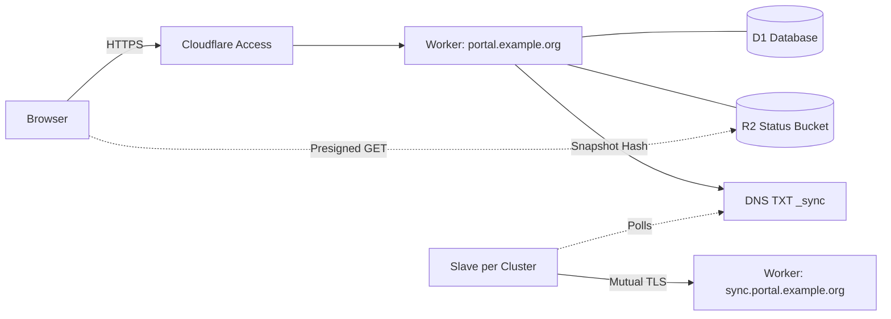

# Deploy the master on Cloudflare (SaaS)

This guide deploys the Slurm Portal master control plane on Cloudflare: a Cloudflare Worker serves the API and static React web app, D1 stores the relational database, R2 hosts live cluster status snapshots, Cloudflare Access protects the user-facing hostname, and a dedicated mutual-TLS hostname authenticates cluster agents. There are no servers to patch, and an idle deployment incurs near-zero cost (see [Cost](#cost)). Each cluster then runs a slave agent ([Cluster Slave Agent](slaves.md)).

If you prefer to self-host the control plane on your own infrastructure, follow [Container Master](master-container.md) instead.



## What you need

- A Cloudflare account managing your domain zone (this guide uses `example.org`) with Workers, D1, R2, Zero Trust (Access), and mTLS Client Certificates enabled.
- Go 1.26, Node.js 22, and `npx wrangler@4` (authenticate once with `npx wrangler@4 login`).
- Two DNS hostnames in your zone: one for users (`portal.example.org`) and one exclusively for machine agents (`sync.portal.example.org`).

## 1. Create the Cloudflare resources

Create the D1 database, the R2 status bucket, and the R2 CORS policy from `deploy/worker`:

```sh
cd deploy/worker
cp wrangler.example.toml wrangler.toml           # local config; ignored by git

npx wrangler@4 d1 create slurm-portal            # copy the returned database_id into wrangler.toml
npx wrangler@4 r2 bucket create slurm-portal-status
# Browsers read status objects directly from R2: allow your portal origin.
sed -i 's#https://portal.example.org#https://portal.your-domain#' r2-cors.json
npx wrangler@4 r2 bucket cors set slurm-portal-status --file r2-cors.json
```

Next, configure the remaining resources in the Cloudflare dashboard:

| Resource | Dashboard Location | Configuration Details |
| --- | --- | --- |
| R2 API Tokens | **R2 → Manage API Tokens** | Create two tokens scoped to `slurm-portal-status`: one with **Object Read & Write** (for the master to upload status) and one with **Object Read only** (for signing browser `GET` links). Save both access key IDs and secrets for Step 3. |
| Snapshot TXT Record | **DNS → Records** | Create a `TXT` record named `_sync.portal.example.org` with initial value `"v2:0"`. Record its **Record ID** (from the DNS API or dashboard audit log). |
| DNS Edit Token | **My Profile → API Tokens** | Create a token with **Zone → DNS → Edit** scoped to your zone so the Worker can update `_sync.portal.example.org`. |
| mTLS Client Certificates | **SSL/TLS → Client Certificates** | Enable mTLS on host `sync.portal.example.org`. Issue one client certificate per cluster slave (and per Web Access Gateway) and save each `.crt` and `.key` file. |
| mTLS WAF Rule | **Security → WAF → Custom rules** | Block requests matching `(http.host eq "sync.portal.example.org" and not cf.tls_client_auth.cert_verified)`. |
| Access Application | **Zero Trust → Access → Applications** | Create a Self-Hosted application for `portal.example.org` only (never include `sync.portal.example.org`). Configure your identity policy and record your **Team Domain** and **Application Audience (AUD) Tag**. |

Compute the lowercase SHA-256 fingerprint for each issued client certificate:

```sh
openssl x509 -in cluster1.crt -outform DER | openssl dgst -sha256 -r | cut -d' ' -f1
```

## 2. Fill in wrangler.toml

Replace every `<placeholder>` in `deploy/worker/wrangler.toml`:

| Key | Value |
| --- | --- |
| `routes` | Your browser hostname (`portal.example.org`) and sync hostname (`sync.portal.example.org`) |
| `LDAP_BASE_DN`, `LDAP_USER_DN` | Default LDAP suffix and user branch (individual slaves can rewrite suffixes if a cluster differs) |
| `SYNC_HOSTNAME`, `SYNC_DNS_NAME` | `sync.portal.example.org` and `_sync.portal.example.org` |
| `CLOUDFLARE_ZONE_ID`, `CLOUDFLARE_RECORD_ID` | Your Cloudflare Zone ID and the `_sync` TXT Record ID |
| `SYNC_CLIENT_FINGERPRINTS` | Comma-separated SHA-256 fingerprints of all slave and gateway client certificates |
| `CLUSTERS` | JSON array of `{"id","name","fingerprint"}` objects (each `id` must match `cluster-id` in that cluster's `slave.yml`) |
| `PLUGINS_CONFIG` | Cloudflare Access `team-domain` and `aud`, Cloudflare `account-id`, and R2 `bucket` name |
| `[[d1_databases]]` | The `database_id` returned by `wrangler d1 create` in Step 1 |

See [Plugins](../dev/plugins.md) for all available plugin settings. Remove any plugins you do not need from `PLUGINS_ENABLED`.

## 3. Set the secrets

Upload your cryptographic keys and API credentials as encrypted Worker secrets:

```sh
cd deploy/worker
put() { printf '%s' "$2" | npx wrangler@4 secret put "$1" -c wrangler.toml; }
put JWT_KEYS "k1:$(openssl rand -base64 32)"
put JWT_ACTIVE_KID k1
put PKI_MASTER_KEY "$(openssl rand -base64 32)"        # also store it somewhere safe offline
put BOOTSTRAP_ADMIN_USERNAME admin
put BOOTSTRAP_ADMIN_PASSWORD "$(openssl rand -base64 18)"   # note it; delete the secret after first sign-in
put CLOUDFLARE_API_TOKEN '<DNS edit token>'
put PLUGIN_WEB_ACCESS_TICKET_KEY "$(openssl rand -base64 32)"
put PLUGIN_CURRENT_STATUS_R2_ACCESS_KEY_ID '<read & write key id>'
put PLUGIN_CURRENT_STATUS_R2_SECRET_ACCESS_KEY '<read & write secret>'
put PLUGIN_CURRENT_STATUS_R2_READ_ACCESS_KEY_ID '<read-only key id>'
put PLUGIN_CURRENT_STATUS_R2_READ_SECRET_ACCESS_KEY '<read-only secret>'
```

:::warning
Store an offline backup of `PKI_MASTER_KEY`. It encrypts every CA private key and provider secret in D1; if lost, existing CAs cannot be decrypted.
:::

## 4. Build and deploy

Compile the Go WebAssembly binary and React bundle, then deploy to Cloudflare:

```sh
cd deploy/worker
./build.sh                                     # Go → dist/main.wasm, and web/dist
npx wrangler@4 deploy -c wrangler.toml
```

Open `https://portal.example.org`, authenticate through Cloudflare Access, and sign in to the portal as `admin` using the bootstrap password. Once signed in, delete the bootstrap password secret:
`npx wrangler@4 secret delete BOOTSTRAP_ADMIN_PASSWORD -c wrangler.toml`.

To run an automated smoke test from the command line (using a Cloudflare Access service token if Access is enabled):

```sh
BASE=https://portal.example.org ADMIN_PASSWORD=… CF_ACCESS_CLIENT_ID=… CF_ACCESS_CLIENT_SECRET=… node smoke.mjs
```

## 5. First configuration in the portal

Follow [Initial Portal Setup](portal-setup.md) to configure your new portal:

1. **Certificate authorities:** Generate or import the SSH CA that your clusters will trust.
2. **Groups:** Create at least one primary POSIX group with a default home directory root (`/home/<group>`) and login shell (`/bin/bash`).
3. **Mail service:** Configure an SMTP or REST email provider, send a test message, and enable job completion, transfer, and password-reset templates.
4. **OAuth connectors *(optional)*:** Register a GitHub OAuth app with callback `https://portal.example.org/api/v2/oauth/callback/github`, store `OAUTH_GITHUB_CLIENT_SECRET`, and configure your sign-in rules.

## 6. Connect the clusters

For each cluster, follow [Cluster Slave Agent](slaves.md) using these serverless connection settings in `slave.yml`:

| `slave.yml` Key | Value |
| --- | --- |
| `master-url` | `https://sync.portal.example.org` |
| `dns-name` | `_sync.portal.example.org` |
| `tls.server-name` | `sync.portal.example.org` |
| `tls.ca-file` | Omit (Cloudflare's edge certificate is trusted by system CAs) |
| `cluster-id` | The cluster `id` registered in `CLUSTERS` |
| `tls.cert-file`, `tls.key-file` | The Cloudflare mTLS client certificate and private key issued for this cluster |

## Updating

To upgrade the serverless master to a newer release:

```sh
git pull
cd deploy/worker && ./build.sh && npx wrangler@4 deploy -c wrangler.toml
```

Database migrations run automatically on the first request to the new Worker version. Because migrations are strictly additive, `npx wrangler@4 rollback` can safely revert to the previous Worker build at any time. Export database backups with:
`npx wrangler@4 d1 export slurm-portal --remote --output backup.sql`.

## Cost

Cloudflare bills based on Worker invocations, CPU time, D1 rows read/written, and R2 operations. Slurm Portal keeps each of these minimal:

- Static frontend assets are served by Workers Static Assets without invoking the Worker.
- Idle cluster slaves check the `_sync` DNS TXT record and only fetch `/sync/v2/snapshot` when state changes.
- Live cluster telemetry is stored as a single R2 object per cluster and fetched directly by browsers via presigned URLs.
- The audit table is bounded by `AUDIT_MAX_RECORDS`, and routine machine status reports do not generate audit rows on success.
