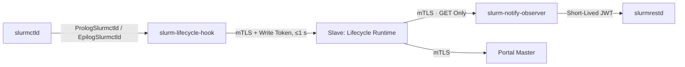

# Optional parts

Two optional cluster integrations extend the base slave deployment:

| Integration | Components | Target Host |
| --- | --- | --- |
| [Job Completion Emails & GPU Monitoring](#job-e-mail-and-gpu-usage) | `slurm-lifecycle-hook`, `slurm-notify-observer`, and the slave's lifecycle runtime | `ctl` |
| [Web Terminal, Files, and Transfers](#web-terminal-files-and-transfers) | `web-access-gateway` and Nginx reverse proxy (also available as a [dedicated guide](gateway.md)) | `login` |

Both integrations use the binaries compiled in [Cluster Slave Agent](slaves.md#1-build-the-programs) under `/root/SlurmPortal/bin` on `ctl`. Execute the commands in each section within a single `root` shell so the helper variables `C` and `fp` remain defined across steps.

## Job e-mail and GPU usage

When a Slurm job finishes, Slurm Portal can email a detailed summary to the job owner and record per-job GPU utilization for the 7-day analytics dashboard. Three components on `ctl` divide this work so `slurmctld` never blocks waiting on the portal:



| Component | System User | Credentials Held |
| --- | --- | --- |
| `slurm-lifecycle-hook` | `slurm` (invoked by `slurmctld`) | mTLS client certificate and the lifecycle runtime's local write token |
| Slave lifecycle runtime | `slurm-portal` (inside `cmd/slave`) | Callback server certificate and mTLS client certificate for the observer |
| `slurm-notify-observer` | `slurm` | The Slurm JWT signing key (`jwt_hs256.key`); the only component that talks to `slurmrestd` |

Prerequisites: **Slurm 26.05+** and [`slurmrestd`](slurmrestd.md) running on `ctl`.

### 1. Install the programs

Install the hook, observer, and Slurm prolog/epilog wrapper scripts on `ctl`:

```sh
cd /root/SlurmPortal
install -m 0755 bin/slurm-lifecycle-hook bin/slurm-notify-observer /usr/local/libexec/go-ldap-admin/
install -m 0755 deploy/lifecycle/prolog-slurmctld deploy/lifecycle/epilog-slurmctld /usr/local/libexec/go-ldap-admin/
```

### 2. Certificates

Generate a dedicated local CA on `ctl` so the hook, slave lifecycle runtime, and observer authenticate one another over mutual TLS:

```sh
sh deploy/certs/issue.sh init-ca /root/lifecycle-certs
sh deploy/certs/issue.sh master /root/lifecycle-certs 127.0.0.1 ctl
sh deploy/certs/issue.sh client /root/lifecycle-certs hook
sh deploy/certs/issue.sh client /root/lifecycle-certs slave
```

### 3. The observer

Configure and start `slurm-notify-observer` on `ctl` (it accepts read-only `GET` queries from the slave's client certificate and mints short-lived JWTs for local `slurmrestd`):

```sh
C=/root/lifecycle-certs
fp() { openssl x509 -in "$1" -outform DER | sha256sum | cut -d' ' -f1; }

install -d -m 0700 -o slurm -g slurm /etc/go-ldap-admin/observer
install -m 0600 -o slurm -g slurm $C/ca.crt $C/master.crt $C/master.key /etc/go-ldap-admin/observer/
cat > /etc/go-ldap-admin/job-notify-observer.yaml <<YAML
listen: 127.0.0.1:6830
server-tls:
  cert-file: /etc/go-ldap-admin/observer/master.crt
  key-file: /etc/go-ldap-admin/observer/master.key
  ca-file: /etc/go-ldap-admin/observer/ca.crt
  client-fingerprints: [$(fp $C/clients/slave.crt)]
upstream-url: http://127.0.0.1:6820
jwt-key-file: /var/lib/slurm/slurmctld/jwt_hs256.key
YAML
chown slurm:slurm /etc/go-ldap-admin/job-notify-observer.yaml
chmod 0600 /etc/go-ldap-admin/job-notify-observer.yaml
cp deploy/lifecycle/slurm-notify-observer.service /etc/systemd/system/
systemctl daemon-reload
systemctl enable --now slurm-notify-observer
```

### 4. The slave's lifecycle runtime

Create `/etc/slurm-portal/lifecycle.yaml`, enable it in `slave.yml`, and restart `slurm-portal-slave`:

```sh
install -d -m 0700 -o slurm-portal -g slurm-portal /etc/slurm-portal/lifecycle
install -m 0600 -o slurm-portal -g slurm-portal $C/ca.crt $C/master.crt $C/master.key \
  $C/clients/slave.crt $C/clients/slave.key /etc/slurm-portal/lifecycle/
cat > /etc/slurm-portal/lifecycle.yaml <<YAML
cluster-id: cluster1
listen: 127.0.0.1:6831
callback-tls:
  cert-file: /etc/slurm-portal/lifecycle/master.crt
  key-file: /etc/slurm-portal/lifecycle/master.key
  ca-file: /etc/slurm-portal/lifecycle/ca.crt
  client-fingerprints: [$(fp $C/clients/hook.crt)]
slurm-url: https://127.0.0.1:6830
slurm-tls:
  cert-file: /etc/slurm-portal/lifecycle/slave.crt
  key-file: /etc/slurm-portal/lifecycle/slave.key
  ca-file: /etc/slurm-portal/lifecycle/ca.crt
  server-name: ctl
tokens-file: /var/lib/slurm-portal/lifecycle-tokens.json
plugins:
  job-email: true
  resources:
    enabled: true
YAML
chown slurm-portal:slurm-portal /etc/slurm-portal/lifecycle.yaml
chmod 0600 /etc/slurm-portal/lifecycle.yaml
echo "lifecycle-file: /etc/slurm-portal/lifecycle.yaml" >> /etc/slurm-portal/slave.yml
systemctl restart slurm-portal-slave
```

On first startup, the slave generates `/var/lib/slurm-portal/lifecycle-tokens.json` containing a random write token for the hook.

If your cluster has GPU nodes, also configure `gres-indices-are-nvml` or `gpu-uuid-mapping` in `lifecycle.yaml` (see [Cluster Agents Reference](../dev/agents.md#runtime-configuration-lifecycle-file-in-the-slave)) so Slurm GRES device indices map accurately to physical NVML GPUs.

### 5. The hook

Extract the generated write token and create `/etc/go-ldap-admin/lifecycle-hook.yaml` on `ctl`:

```sh
install -d -m 0700 -o slurm -g slurm /etc/go-ldap-admin/hook
install -m 0600 -o slurm -g slurm $C/ca.crt $C/clients/hook.crt $C/clients/hook.key /etc/go-ldap-admin/hook/
python3 -c 'import json,sys; print(json.load(open(sys.argv[1]))["read_write"], end="")' \
  /var/lib/slurm-portal/lifecycle-tokens.json > /etc/go-ldap-admin/hook/token
chown slurm:slurm /etc/go-ldap-admin/hook/token
chmod 0600 /etc/go-ldap-admin/hook/token
cat > /etc/go-ldap-admin/lifecycle-hook.yaml <<YAML
url: https://127.0.0.1:6831
tls:
  cert-file: /etc/go-ldap-admin/hook/hook.crt
  key-file: /etc/go-ldap-admin/hook/hook.key
  ca-file: /etc/go-ldap-admin/hook/ca.crt
  server-name: ctl
write-token-file: /etc/go-ldap-admin/hook/token
YAML
chown slurm:slurm /etc/go-ldap-admin/lifecycle-hook.yaml
chmod 0600 /etc/go-ldap-admin/lifecycle-hook.yaml
```

Register the prolog and epilog hooks in `/etc/slurm/slurm.conf`, redistribute `slurm.conf` to all nodes, and reload `slurmctld`:

```ini
PrologSlurmctld=/usr/local/libexec/go-ldap-admin/prolog-slurmctld
EpilogSlurmctld=/usr/local/libexec/go-ldap-admin/epilog-slurmctld
```

```sh
for host in node1 login; do scp /etc/slurm/slurm.conf root@$host:/etc/slurm/; done
scontrol reconfigure
```

`slurm-lifecycle-hook` enforces a 1-second timeout and always exits `0`—even if the slave is stopped, Slurm job scheduling is never delayed. (If your cluster already uses custom `PrologSlurmctld` or `EpilogSlurmctld` scripts, invoke the hook binary from your existing scripts.)

### 6. In the portal

1. Under **Admin → Mail service**, configure an SMTP or REST email provider and send a test email.
2. Under **Admin → Job notifications**, enable notifications, select your mail provider, and customize the email template if desired.

Jobs that run for longer than **60 seconds** trigger a completion email when they finish.

### Check it works

Submit a job that runs for over 60 seconds as a portal user, or test the hook directly once a job completes:

```sh
sudo -u slurm SLURM_JOB_ID=<id> SLURM_JOB_SLUID=<sluid> \
  /usr/local/libexec/go-ldap-admin/slurm-lifecycle-hook --event ending   # prints nothing when accepted
```

Verify that the job appears on the **Recent resource summary** page, the user receives the completion email, and `POST /sync/v2/job-completions` is recorded in the master's **Audit log**.

| Symptom | What to Check |
| --- | --- |
| `lifecycle event was not accepted` | Confirm `lifecycle-file` is set in `slave.yml`, `/etc/go-ldap-admin/hook/token` matches `lifecycle-tokens.json`, and the hook certificate fingerprint is listed in `callback-tls.client-fingerprints` |
| `lifecycle hook configuration unavailable` | Verify `/etc/go-ldap-admin/lifecycle-hook.yaml` exists and is owned by `slurm:slurm` with mode `0600` |
| No resource summary or completion email | Check `journalctl -u slurm-notify-observer`, confirm `slurmrestd` responds on `v0.0.45`, and ensure the job ran for more than 60 seconds |

## Web terminal, files and transfers

The Web Access Gateway runs on `login` to provide an interactive browser terminal, SFTP file manager, and cross-cluster `rsync` transfers over SSH using 5-minute WebCrypto certificates. You can follow the steps below or read the dedicated [Web Access Gateway guide](gateway.md).

### 1. On the master

Issue a client certificate for the gateway, generate a ticket signing key (`PLUGIN_WEB_ACCESS_TICKET_KEY`), and enable the `web-access` plugin.

**Container master** (in `deploy/compose/master`):

```sh
sh ../../certs/issue.sh client secrets/certs cluster1-login
FP=$(openssl x509 -in secrets/certs/clients/cluster1-login.crt -outform DER | sha256sum | cut -d' ' -f1)
cat >> .env <<ENV
PLUGIN_WEB_ACCESS_TICKET_KEY=$(openssl rand -base64 32)
WEB_ACCESS_CONFIG={"ticket-key-id":"web-access-1","gateways":[{"fingerprint":"$FP","cluster-id":"cluster1","gateway-id":"cluster1-login","instance-id":"cluster1-login"}]}
ENV
sed -i "s/^PLUGINS_ENABLED=.*/&,web-access/" .env
sed -i "s/^SYNC_CLIENT_FINGERPRINTS=.*/&,$FP/" .env
docker compose up -d
```

Copy `secrets/certs/clients/cluster1-login.crt`, `cluster1-login.key`, and `secrets/certs/ca.crt` to `login`.

**Serverless master:** Issue a Cloudflare client certificate for the gateway, store `PLUGIN_WEB_ACCESS_TICKET_KEY` as a Worker secret (`openssl rand -base64 32`), add `web-access` to `PLUGINS_ENABLED`, and add the `web-access` object to `PLUGINS_CONFIG` with the gateway certificate's fingerprint.

Next, sign in to the portal as an administrator and fetch `GET /api/v2/web-access/keys` to copy the base64url public key (`x`) for `web-access-1`.

### 2. On the login node

Install the `gateway` binary, create the `web-access-gateway` service account, and place the mTLS credentials on `login`:

```sh
useradd --system --user-group --no-create-home --shell /usr/sbin/nologin web-access-gateway
install -d -m 0755 /usr/local/libexec/go-ldap-admin
install -m 0755 gateway /usr/local/libexec/go-ldap-admin/web-access-gateway   # built on ctl
# container master only: trust its private CA for the sync port
cp ca.crt /usr/local/share/ca-certificates/slurm-portal-sync-ca.crt && update-ca-certificates

D=/etc/go-ldap-admin/web-access-gateway
install -d -m 0750 -o root -g web-access-gateway $D
install -m 0640 -o root -g web-access-gateway cluster1-login.crt $D/master-client.crt.pem
install -m 0600 -o web-access-gateway -g web-access-gateway cluster1-login.key $D/master-client.key.pem
```

Place the upstream loopback TLS certificate and key in `$D/https.crt.pem` and `$D/https.key.pem` (owned by `web-access-gateway`, key mode `0600`), then write `/etc/go-ldap-admin/web-access-gateway.yaml`:

```yaml title="/etc/go-ldap-admin/web-access-gateway.yaml"
gateway_id: cluster1-login
instance_id: cluster1-login
cluster_id: cluster1
listen: "127.0.0.1:19934"
tls_certificate: /etc/go-ldap-admin/web-access-gateway/https.crt.pem
tls_key: /etc/go-ldap-admin/web-access-gateway/https.key.pem
callback_listen: "127.0.0.1:19935"
allowed_origins:
  - https://portal.example.org
ticket_public_keys:
  web-access-1: <the x value from /api/v2/web-access/keys>
user_ca_keys_file: /srv/slurm-portal-trust/current/ssh/trusted-user-ca-keys.pub
file_root: /home
clusters:
  - id: cluster1
    ssh_address: "127.0.0.1:22"
state_directory: /var/lib/go-ldap-admin-web-access-gateway
master_origin: https://portal.example.org:8443
master_client_certificate: /etc/go-ldap-admin/web-access-gateway/master-client.crt.pem
master_client_key: /etc/go-ldap-admin/web-access-gateway/master-client.key.pem
```

*(Set `master_origin: https://sync.portal.example.org` for a serverless master.)*

Enable and start the service:

```sh
chown web-access-gateway:web-access-gateway /etc/go-ldap-admin/web-access-gateway.yaml
chmod 0600 /etc/go-ldap-admin/web-access-gateway.yaml
cp /root/SlurmPortal/deploy/gateway/web-access-gateway.service /etc/systemd/system/
systemctl daemon-reload
systemctl enable --now web-access-gateway
curl -sk https://127.0.0.1:19934/readyz        # {"code":0,"data":{"status":"ready"}} once registered
```

**Nginx reverse proxy:** Configure Nginx on `login` (`https://login.example.org`) with a trusted TLS certificate and proxy to `https://127.0.0.1:19934` with WebSocket upgrade support using [`nginx.conf.example`](https://github.com/TING-HiuYu/SlurmPortal/blob/main/deploy/gateway/nginx.conf.example). Ensure the portal's origin is included in the Nginx CORS map.

### 3. In the portal

Open **Admin → Cluster web access** and configure `cluster1` with Gateway URL `https://login.example.org`, your SSH CA, target SSH address `127.0.0.1:22`, and the allowed RBAC roles. Once saved, the gateway status shows **Ready**, and users can open **Web terminal** and **File browser** from their workspace.

### Check it works

Sign in as a portal user, open **Web terminal**, and choose `cluster1` to launch an interactive shell in `/home/<group>/<user>`.

| Symptom | What to Check |
| --- | --- |
| `/readyz` reports `registration_unavailable` | The gateway cannot reach `master_origin`, or the master does not recognize its certificate fingerprint |
| `config_mismatch` | Gateway IDs in `web-access-gateway.yaml` do not match `WEB_ACCESS_CONFIG` / `PLUGINS_CONFIG` |
| Browser shows `"Failed to fetch"` | Nginx CORS map is missing the portal origin, or the browser does not trust `login.example.org`'s certificate |
| `credential_invalid` / `ticket_invalid` | The SSH CA selected in the portal is not in `user_ca_keys_file`, or the ticket key ID does not match |

## Next

Proceed to [End-to-End Verification](verify.md).
