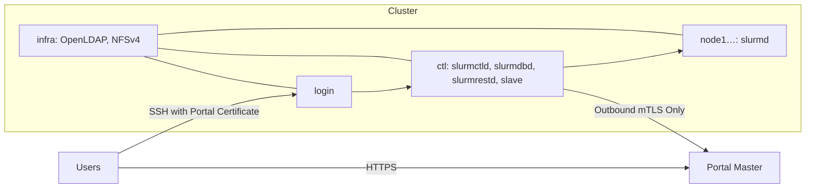

# Plan your site

This guide builds a complete, production-ready Slurm cluster on **Ubuntu 24.04 LTS** and connects it to Slurm Portal. If you already operate a Slurm cluster, you can skip directly to the components you need—most existing clusters start at [OpenLDAP](openldap.md) and [SSSD & SSH](sssd-ssh.md).

## The hosts

| Role | Hostname in This Guide | Services Hosted |
| --- | --- | --- |
| **Controller** | `ctl` | `munge`, `slurmctld`, `slurmdbd` + MariaDB, `slurmrestd`, the Slurm Portal **slave** agent, and `slurm-notify-observer` |
| **Infrastructure** | `infra` | OpenLDAP (`slapd`) and the NFSv4 server exporting `/home` and the SSH trust directory |
| **Compute Nodes** | `node1`, `node2`, … | `munge`, `slurmd`, and `sssd` |
| **Login Node** | `login` | `munge`, Slurm CLI clients, `sssd`, user-facing `sshd`, and the optional **Web Access Gateway** |

On smaller deployments, `infra` can be consolidated onto `ctl`. However, if you use the standard `slurm_trigger.py` script to provision home directories, `/home` on the host running the slave must be an active NFSv4 mount.



## Before you start

- **Operating System:** Fresh **Ubuntu 24.04 LTS** installation on every host, fully updated (`sudo apt update && sudo apt full-upgrade -y`).
- **Name Resolution:** Every cluster host must resolve the short hostname and FQDN (`*.example.org`) of every other host via internal DNS or an identical `/etc/hosts` file across all nodes:

  ```text title="/etc/hosts"
  10.0.0.10  ctl.example.org    ctl
  10.0.0.11  infra.example.org  infra
  10.0.0.21  node1.example.org  node1
  10.0.0.30  login.example.org  login
  ```

- **Time Synchronization:** System clocks must be synchronized via NTP (`timedatectl` should report `System clock synchronized: yes`). Both Munge credentials and short-lived SSH certificates rely on accurate clocks.
- **Administrative Access:** Root SSH access from `ctl` to all other cluster hosts so you can distribute keys, packages, and configuration files. Commands in this guide assume an interactive `root` shell (`sudo -i`).
- **Placeholder Values:** Throughout this guide, we use cluster ID `cluster1`, LDAP suffix `dc=example,dc=org`, and portal domain `portal.example.org`. Substitute your own values consistently.

## Network

| Source | Destination | Port | Purpose |
| --- | --- | --- | --- |
| All cluster hosts | `ctl` | `6817/tcp` | `slurmctld` controller communication |
| `ctl` and compute nodes | Compute nodes | `6818/tcp` | `slurmd` daemon communication |
| `ctl` | `ctl` (`127.0.0.1`) | `6819/tcp` | `slurmdbd` accounting daemon |
| All cluster hosts | `infra` | `389/tcp` (StartTLS) or `636/tcp` | OpenLDAP directory queries |
| All cluster hosts | `infra` | `2049/tcp` | NFSv4 shared `/home` and trust mount |
| Users | `login` | `22/tcp` (`443/tcp` optional) | User SSH logins (and optional Web Access Gateway) |
| `ctl`, `login` | Portal Master Sync Endpoint | `443/tcp` or `8443/tcp` | Outbound mTLS from slave and gateway |

The portal master never initiates inbound connections to your cluster. Only `login` needs to be reachable by end users.

## IDs

| UID / GID Range | Reserved For |
| --- | --- |
| `< 1000` | System service accounts (`munge`, `slurm-portal` = `990`; plus `slurm` = `64030`) |
| `1000`–`9999` | Local OS administrator accounts |
| `≥ 10000` | POSIX users and groups managed by Slurm Portal |

Slurm Portal allocates UIDs and GIDs monotonically starting at `10000` and never reuses them. The standard account trigger ignores UIDs below `10000`, ensuring local OS accounts are never modified.

## Choose a master

Choose your master deployment model before configuring the slave agent:

| Feature | [Serverless (Cloudflare)](master-saas.md) | [Container (Docker Compose)](master-container.md) |
| --- | --- | --- |
| Hosting environment | Cloudflare Workers, D1, R2, and Access | Any Linux server with Docker Engine |
| Maintenance responsibility | Cloudflare account and Worker secrets | Host OS updates, container upgrades, and disk backups |
| Snapshot change detection | Lightweight DNS `TXT` lookup every 60 s | Outbound mTLS `GET /sync/v2/snapshot-hash` every 60 s |

## The order

1. [Munge](munge.md): shared cluster authentication key.
2. [Slurm](slurm.md): controller and compute node daemons.
3. [Accounting](accounting.md): MariaDB and `slurmdbd`.
4. [slurmrestd](slurmrestd.md): JWT-authenticated REST API.
5. [OpenLDAP](openldap.md): cluster LDAP directory with TLS.
6. [SSSD & SSH](sssd-ssh.md): node identity lookups and SSH access policy.
7. [Shared Home & Trust](shared-home.md): NFSv4 exports for `/home` and SSH trust files.
8. Deploy the Master: [Serverless](master-saas.md) or [Container](master-container.md).
9. [Initial Portal Setup](portal-setup.md): SSH CA, POSIX group presets, mail service, and OAuth.
10. [Cluster Slave Agent](slaves.md) on `ctl`.
11. [Job Notifications & GPU Monitoring](optional.md) and [Web Access Gateway](gateway.md).
12. [End-to-End Verification](verify.md).
