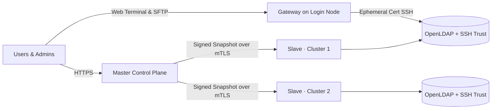

# Developer Wiki

This wiki explains the internal design and implementation of Slurm Portal: its binaries, the architectural layers an HTTP request traverses, the cluster replication protocol, the data model, and the cryptographic trust hierarchy. Read these pages before modifying any code that crosses component boundaries. If your goal is to deploy and operate a cluster rather than modify the codebase, head to the [Deployment Wiki](../deploy/README.md).

## What Slurm Portal Is

Slurm Portal is a centralized identity, access, and operations control plane for multi-cluster Slurm HPC environments. It serves as the single source of truth for:

- **POSIX accounts, groups, and organizational hierarchies** with globally consistent UIDs and GIDs;
- **Role-based access control (RBAC)** with rank-enforced anti-escalation rules;
- **One-way password hashes** (Argon2id for portal login, SHA-512 crypt for OpenLDAP);
- **SSH and X.509 Certificate Authorities**, user certificates, and revocation lists.

A central **master** service manages this state. On each cluster, a lightweight **slave** agent pulls signed snapshots over mutual TLS (mTLS) and reconciles the cluster's local OpenLDAP directory, SSH trust files, and Slurm accounting associations. Because each cluster retains a complete local directory and trust store, existing users can continue logging in and running jobs even if the master is temporarily unreachable.

Around this core, compiled-in plugins add GitHub OAuth and Cloudflare Access sign-in, job completion and file transfer emails, real-time cluster and queue telemetry, 7-day GPU utilization analytics, and an in-browser terminal and file manager powered by a **Web Access Gateway** on each login node.



## Reading Guide

| Goal | Recommended Starting Page |
| --- | --- |
| Understand the overall system and runtime topologies | [Architecture & Infrastructure](architecture.md) |
| Trace an HTTP request from the edge to the database | [Request Lifecycle](request-lifecycle.md) |
| Understand how identity changes propagate to clusters | [Sync Protocol](sync-protocol.md) |
| Dive into a specific architectural layer | [HTTP & Edge](layer-http.md) · [Identity & Access](layer-access.md) · [Domain Modules](layer-domain.md) · [Plugins](plugins.md) · [Data Model](data-model.md) · [Storage](layer-storage.md) |
| Work on cluster agents (slave, gateway, or Slurm hooks) | [Cluster Agents](agents.md) |
| Work on the React single-page application | [Web Application](web-app.md) |
| Review the threat model and cryptographic keys | [Security Model](security.md) · [Cryptography & Signing](cryptography.md) |
| Look up an HTTP endpoint | [API Reference](api-reference.md) |
| Navigate the repository structure | [Project Layout](project-layout.md) |
| Build, run, and test locally | [Development Guide](development.md) |

## Glossary

| Term | Definition |
| --- | --- |
| **Master** | The central control plane hosting the HTTP API, React web UI, and primary database. Runs either as a Cloudflare Worker (`cmd/worker`) or as a native container (`cmd/server`). |
| **Slave** | The daemon (`cmd/slave`) deployed on each cluster. Reconciles the master's snapshot into local OpenLDAP, publishes SSH trust generations, executes account triggers, and pushes cluster telemetry. |
| **Gateway** | The daemon (`cmd/gateway`) deployed on a login node to serve the browser terminal, SFTP file manager, and cross-cluster `rsync` transfers over SSH as the authenticated user. |
| **Lifecycle Hook** | A fast, fail-open binary (`cmd/slurm-lifecycle-hook`) invoked by Slurm's `PrologSlurmctld` and `EpilogSlurmctld` to notify the slave when a job starts or finishes. |
| **Observer** | A read-only mTLS proxy (`cmd/slurm-notify-observer`) on the Slurm controller that queries `slurmrestd` using short-lived JWTs so the slave never holds the Slurm JWT key. |
| **Snapshot** | A self-contained JSON document containing all users, groups, memberships, trusted CAs, revocations, and user certificates. Identified by its SHA-256 **snapshot hash**. |
| **Trust Generation** | An immutable, content-addressed directory of CA keys, CRLs, and SSH KRLs written by a slave; the `current` symlink atomically points to the active generation. |
| **Trigger** | An idempotent external command executed by the slave when users or group memberships change (for example, `slurm_trigger.py` to manage `sacctmgr` associations and NFSv4 home directories). |
| **Principal** | The authenticated identity attached to an HTTP request context—either a user with live database roles or a machine peer verified by client certificate fingerprint. |
| **Permission** | The access policy declared on an HTTP route: `Public`, `Authenticated`, `Peer` (mTLS), or `Policy(object, action)`. |
| **Rank** | A role's numeric `sort` priority (`1`–`999`, where `1` is the highest privilege). Callers can never modify users or roles ranked at or above their own best rank. |
| **Plugin** | A compiled-in feature module activated via `PLUGINS_ENABLED` and configured via `PLUGINS_CONFIG`. |
| **Sync Host** | The dedicated hostname (or mTLS port) that serves `/sync/*` machine endpoints and enforces client certificate authentication. |
| **Mail Hub** | The core email delivery service (`internal/mail`) through which plugins send templated notifications via named SMTP, REST, or pool providers. |

## Repository at a Glance

```text
cmd/          Entrypoints: worker (Wasm master), server (native master), slave, gateway, hook, observer, and CLI tools
internal/     Go packages organized by architectural layer
migrations/   Embedded, additive-only SQLite/D1 schema migrations applied in order at startup
web/          React 19 + Ant Design 6 single-page application
deploy/       Docker Compose stacks, Dockerfiles, Cloudflare Worker shell, and cluster helper scripts
docs/         Markdown source for the Developer and Deployment Wikis
site/         Docusaurus documentation website and Simplified Chinese translations
```

See [Project Layout](project-layout.md) for a package-by-package directory map.
