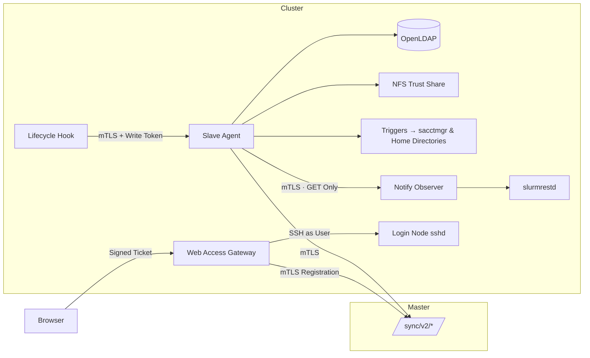
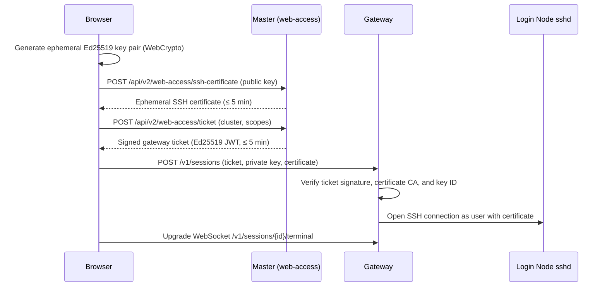

# Agents

The master control plane never initiates network connections into a cluster. Instead, lightweight **cluster agents** dial outbound to the master over mutual TLS (mTLS) and execute local operations on the cluster. This page documents each agent binary, its communication protocol, and its configuration options.

| Agent | Binary | Runs On | Required? |
| --- | --- | --- | --- |
| **Slave** | `cmd/slave` | One instance per cluster alongside OpenLDAP | Yes |
| **Host Bridge** | `cmd/host-bridge` | Inside a containerized slave | Only when running triggers from a container |
| **Web Access Gateway** | `cmd/gateway` | Each cluster's login node | Optional (for browser terminal, SFTP, and `rsync`) |
| **Lifecycle Hook** | `cmd/slurm-lifecycle-hook` | Slurm controller (`PrologSlurmctld` / `EpilogSlurmctld`) | Optional (for job completion emails and GPU tracking) |
| **Notify Observer** | `cmd/slurm-notify-observer` | Slurm controller | Optional (paired with the lifecycle hook) |



Every agent authenticates to the master using its own X.509 client certificate. The master identifies agents strictly by their SHA-256 certificate fingerprint (`CLUSTERS` and `web-access.gateways`), so a leaked configuration file without the corresponding private key cannot impersonate a cluster.

## Slave

The slave agent keeps a cluster synchronized with the master. In addition to running the replication loop described in [Sync Protocol](sync-protocol.md), it:

- Publishes atomic SSH and X.509 trust generations read by `sshd`;
- Executes persistent FIFO triggers when accounts or group memberships change;
- Collects and uploads live node, partition, and job queue status;
- Hosts the job lifecycle runtime (for job completion emails and per-job GPU usage), when enabled.

### Command

```sh
slave -config /etc/go-ldap-admin/slave.yml   # run continuously as a daemon
slave -once                                   # execute a single sync check and exit
slave -plan …                                 # offline dry-run rehearsal (see Sync Protocol)
```

The slave requires its configuration file and private keys to have mode `0600` (or stricter) and rejects unknown YAML keys at startup so configuration typos fail fast.

### Configuration reference

| Key | Default | Description |
| --- | --- | --- |
| `master-url` | — | Sync endpoint URL of the master (`https://sync.example.org` or `https://portal.example.org:8443`). Legacy alias `main-url` is also accepted. |
| `cluster-id` | — | Cluster identifier; must match the ID bound to this slave's certificate fingerprint on the master |
| `dns-name` | — | DNS TXT record holding the snapshot hash. Leave empty (`""`) to poll `GET /sync/v2/snapshot-hash` over mTLS instead |
| `dns-server` | System resolver | Optional custom DNS resolver (`IP` or `IP:port`) |
| `check-interval` | `60s` | Polling interval between sync checks |
| `check-timeout` | `10m` | Maximum duration for a single sync cycle, including LDAP writes and trigger execution |
| `dns-timeout` | `5s` | Timeout for DNS TXT lookups |
| `health-listen` | `127.0.0.1:8081` | Loopback address for `/healthz` and `/readyz` health probes |
| `state-dir` | — | Directory storing `applied.json`, the dirty marker, and the persistent trigger queue |
| `trust-dirs` | — | One or more target directories into which immutable trust generations are published |
| `trigger-file` | — | Path to the YAML trigger definition file |
| `source-base-dn` / `local-base-dn` / `local-group-dn` | — | Optional LDAP suffix rewriting rules (see [Sync Protocol](sync-protocol.md#what-a-slave-does-on-each-check)) |
| `limits.max-user-deletions` | `5` | Safety guard: aborts the sync if more than this many users would be deleted in one cycle |
| `limits.allow-ca-removal` | `false` | Safety guard: whether to allow removing a previously trusted SSH CA |
| `tls.cert-file`, `tls.key-file` | — | Client certificate and private key (`0600`) for mTLS to the master |
| `tls.ca-file`, `tls.server-name` | System CAs | Root CA bundle and expected TLS server name for verifying the master |
| `ldap.url`, `ldap.bind-dn`, `ldap.password-file` | — | Local OpenLDAP connection settings; non-loopback `ldap://` URLs require `ldaps://` or `start-tls: true` |
| `cluster-status`, `resource-status` | Disabled | Commands and polling intervals for legacy database-backed status reports |
| `current-status.enabled`, `.interval` | `false`, `1m` | Enables the unified live-status collector uploaded to R2 / S3 |
| `lifecycle-file` | — | Path to the YAML configuration enabling the in-process job lifecycle runtime |

See `deploy/slave/slave.yml.example` for a complete annotated configuration file.

### Health

| Endpoint | Behavior |
| --- | --- |
| `GET /healthz` | Returns `200 OK` while the daemon process is alive |
| `GET /readyz` | Returns `200 OK` after a clean sync; returns `503 Service Unavailable` if state is dirty or the most recent check failed |

Point systemdwatchdogs, container health checks, or external monitoring at `/readyz`.

### Host bridge

When the slave runs inside a container, it cannot invoke `sacctmgr` or set NFSv4 ACLs on the host directly. In containerized setups, the trigger invokes `cmd/host-bridge`, which connects to the host over SSH using a dedicated key and executes `slurm_trigger.py` there. Event payloads are piped over **standard input** rather than interpolated into a remote shell command string, preventing command injection even if a field contains shell metacharacters.

## Web-access gateway

The Web Access Gateway runs on a cluster's login node and powers the browser terminal, SFTP file manager, and cross-cluster `rsync` transfers. Every operation executes over a real SSH connection authenticated as the signed-in POSIX user, ensuring standard Unix permissions, disk quotas, and login auditing apply automatically.

### How a session opens



Before opening an SSH connection, the gateway verifies three cryptographic bindings:

- **The gateway ticket:** Must carry a valid Ed25519 signature from a key in `ticket_public_keys`, match this gateway's `cluster_id`, have a TTL of at most 5 minutes, and grant the required scope.
- **The SSH certificate:** Must be signed by a CA in `user_ca_keys`, match the ephemeral private key supplied in the request, have a validity window of at most 300 seconds, and include `permit-pty`.
- **The certificate Key ID:** Must follow `web-access/<cluster>/access/user:<id>/<serial>`, matching both the cluster ID and the user ID in the ticket.

The ephemeral private key lives only in process memory for the duration of the session and is never written to disk.

| Ticket Scope | Permitted Action |
| --- | --- |
| `session:create` | Create or close an SSH session |
| `terminal` | Attach to the interactive terminal WebSocket |
| `sftp` | Browse directories and request file download links |
| `transfer` | Start a background `rsync` transfer to another cluster |
| `transfer:read` | Poll transfer progress and read transfer logs |

### Endpoints

| Endpoint | Purpose |
| --- | --- |
| `GET /healthz`, `GET /readyz` | Liveness and readiness probes (`/readyz` fails if the last master registration is older than 180 s) |
| `POST /v1/sessions` | Establish a new user SSH session |
| `DELETE /v1/sessions/{id}` | Terminate an active session |
| `GET /v1/sessions/{id}/terminal` | Interactive `xterm-256color` terminal stream over WebSocket |
| `POST /v1/sessions/{id}/files/list` | List directory entries over SFTP |
| `POST /v1/sessions/{id}/files/download-ticket`, `GET /v1/downloads/{id}` | Issue and redeem a single-use file download token |
| `POST /v1/sessions/{id}/transfers`, `GET /v1/transfers/{id}[/logs]` | Start and monitor cross-cluster `rsync` transfers |
| `POST /v1/diagnostics`, `GET /v1/diagnostics/socket` | Connectivity probes used by the portal's **Diagnostics** page |

Requests containing unexpected query parameters or originating outside `allowed_origins` are rejected.

### Registration

On startup and periodically thereafter, the gateway calls `POST /sync/v2/web-access/register` over mTLS to report its gateway ID, instance ID, supported capabilities, and trusted SSH CA keys. The master records this heartbeat in `v2_gateway_registrations` and enables the cluster's web terminal and file browser in the UI only while the registration is fresh.

### Configuration reference

| Key | Default | Description |
| --- | --- | --- |
| `gateway_id`, `instance_id`, `cluster_id` | — | Gateway identifiers; `cluster_id` must match issued tickets and master config |
| `listen`, `tls_certificate`, `tls_key` | — | HTTPS listener address and TLS key pair (typically loopback behind Nginx) |
| `allowed_origins` | — | Allowed browser origins (the portal URL) |
| `ticket_public_keys` | — | Map of `kid: base64 Ed25519 public key` from `GET /api/v2/web-access/keys` |
| `user_ca_keys` / `user_ca_keys_file` | — | Trusted SSH user CA public keys |
| `clusters` | — | SSH target addresses (`id`, `ssh_address`) for local sessions and cross-cluster transfers |
| `file_root`, `state_directory` | — | Default starting path for SFTP browsing and local directory for transfer logs |
| `master_origin`, `master_client_certificate`, `master_client_key` | — | Sync endpoint and mTLS client credentials for registering with the master (`main_*` aliases are also accepted) |
| `callback_listen` | — | Loopback address where local `rsync` workers report completion |
| `max_sessions` | `128` | Maximum concurrent sessions across all users |
| `max_sessions_per_user` | `4` | Maximum concurrent sessions per user |
| `session_idle_seconds` | `1800` | Idle timeout (30 minutes) before an inactive session is closed |
| `max_transfers` | `128` | Maximum concurrent `rsync` transfers |
| `max_download_bytes` | `1 TiB` | Maximum file size for single-file SFTP downloads |

See `deploy/gateway/gateway.yaml.example` for a complete annotated example. Sending `SIGHUP` (`systemctl reload web-access-gateway`) reloads configuration and TLS certificates without dropping active terminal sessions.

## Lifecycle hook and observer

Job completion emails and per-job GPU utilization tracking are split across three components on the Slurm controller so that `slurmctld` never blocks waiting on external network calls:

| Component | Role | Security Boundary |
| --- | --- | --- |
| `slurm-lifecycle-hook` (`PrologSlurmctld` / `EpilogSlurmctld`) | Sends a lightweight `starting` or `ending` event with `SLURM_JOB_ID` to the slave over mTLS (1 s default timeout, 2 s max) and always exits `0` | Never queries Slurm, never sends email, and never blocks scheduling on failure |
| Lifecycle runtime (inside `cmd/slave`) | Queues events in memory, resolves job details via the observer, samples NVML GPU usage every 15 s while a job runs, and forwards completion summaries to the master | Never holds the privileged Slurm JWT signing key |
| `slurm-notify-observer` (runs as `slurm` on `ctl`) | Holds the Slurm JWT key and serves read-only `GET` requests from the slave by minting short-lived tokens for local `slurmrestd` | Rejects all write methods and unauthenticated callers |

The hook is strictly **fail-open**: if its configuration is missing, the slave is down, or the request times out, it logs a warning and exits `0` so jobs always start and finish normally.

### Hook configuration (`/etc/go-ldap-admin/lifecycle-hook.yaml`, `0600`)

| Key | Description |
| --- | --- |
| `url` | HTTPS URL of the slave's lifecycle callback listener |
| `tls.cert-file`, `tls.key-file` | Client certificate and private key for authenticating to the slave |
| `write-token-file` | Path to the shared local bearer token accepted by the slave's lifecycle listener |
| `timeout` | HTTP request timeout (default `1s`, maximum `2s`) |

### Runtime configuration (`lifecycle-file` in the slave)

| Key | Default | Description |
| --- | --- | --- |
| `cluster-id` | — | Lowercase cluster identifier matching the master |
| `listen`, `callback-tls` | — | IP:port and mTLS configuration for receiving calls from `slurm-lifecycle-hook` |
| `slurm-url`, `slurm-tls` | — | HTTPS URL and mTLS client credentials for querying `slurm-notify-observer` |
| `tokens-file` | — | Path to the JSON token file (auto-generated on first start if absent) |
| `plugins.job-email` | `false` | Enables job completion email reporting |
| `plugins.resources.enabled`, `.sample-interval-seconds` | `false`, `15` | Enables periodic NVML GPU sampling (`5`–`300` seconds) and per-job resource summaries |
| `gres-indices-are-nvml`, `gpu-uuid-mapping` | `false`, — | Controls how Slurm GRES indices map to physical NVML GPUs on heterogeneous nodes |
| `max-jobs` | `1000` | Maximum concurrent active jobs tracked in memory |
| `max-retained-report-bytes` | `64 MiB` | Memory cap for buffered reports awaiting master delivery |
| `resolve-workers` | `2` | Number of concurrent workers querying `slurm-notify-observer` |

For step-by-step installation instructions, see [Job Notifications & GPU Monitoring](../deploy/optional.md) and [Web Access Gateway](../deploy/gateway.md).

## Next steps

- [Sync Protocol](sync-protocol.md): how the slave reconciles LDAP and trust files.
- [Cryptography & Signing](cryptography.md): how mTLS identities, gateway tickets, and ephemeral SSH certificates work.
