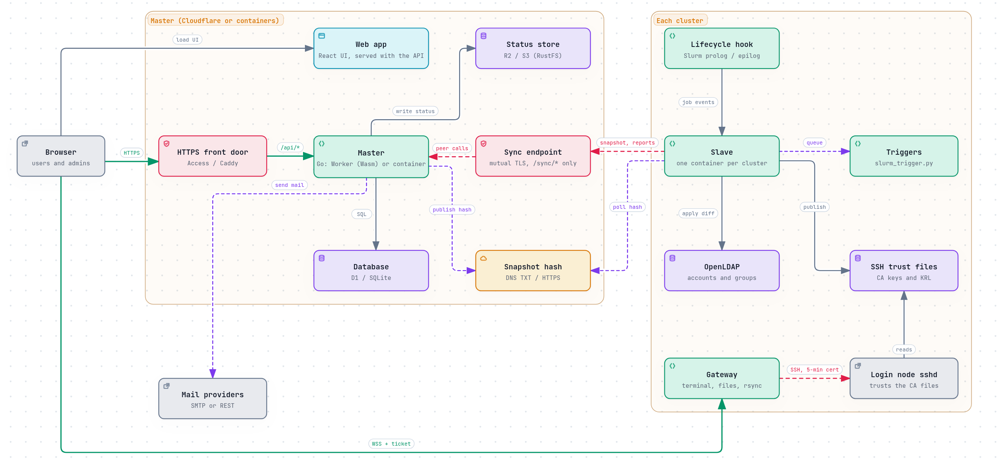
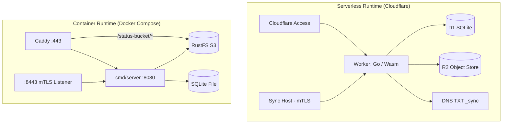
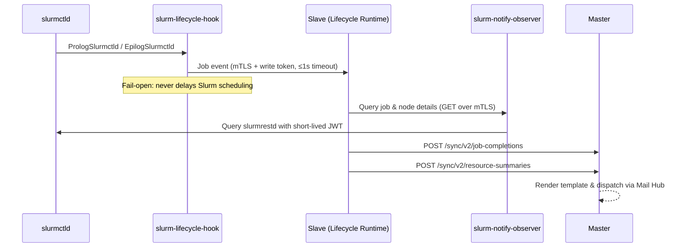
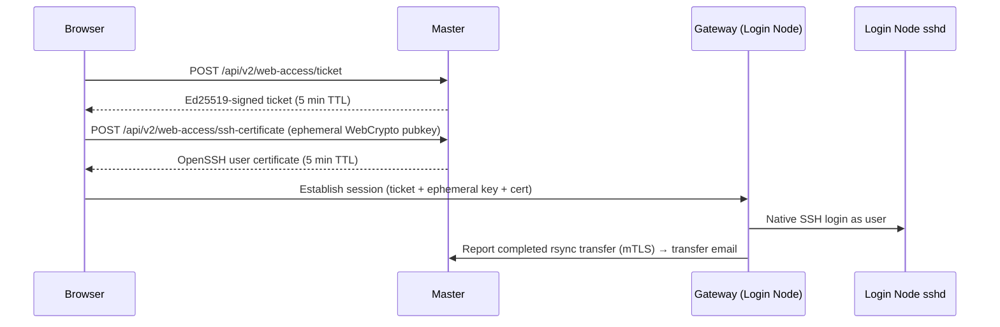

# Architecture

This page explains how Slurm Portal is structured: which binaries exist, where they run, how they communicate across network boundaries, and how requests flow through the master control plane.

An [interactive version of this architecture diagram](https://ting-hiuyu.github.io/SlurmPortal/architecture.html) is also available, generated from [diagrams/architecture.archify.json](../diagrams/architecture.archify.json) using [Archify](https://github.com/tt-a1i/archify). Each node in the interactive diagram links directly to the source files that implement it.

## Components

A single Go module builds every binary in the system. Sharing internal packages guarantees that snapshot schemas, permission identifiers, and validation rules never drift between the master and cluster agents.

| Component | Entrypoint | Runtime Location | Responsibility |
| --- | --- | --- | --- |
| **Master** | `cmd/worker` (Wasm) or `cmd/server` (native) | Cloudflare Worker + D1, or Linux host + SQLite | Control-plane HTTP API, authentication, identity management, PKI, plugins, and audit logging |
| **Web App** | `web/` (React 19, Ant Design 6) | Static assets served from the same origin as the master | Browser console for administrators and self-service workspace for users |
| **Slave** | `cmd/slave` | One instance per cluster alongside OpenLDAP | Reconciles master snapshots into OpenLDAP, writes SSH trust generations, executes triggers, pushes cluster telemetry, and hosts the job lifecycle runtime |
| **Gateway** | `cmd/gateway` | Each cluster's login node | Provides browser terminal sessions, SFTP file management, and cross-cluster `rsync` transfers over SSH |
| **Lifecycle Hook** | `cmd/slurm-lifecycle-hook` | Slurm controller (`PrologSlurmctld` / `EpilogSlurmctld`) | Sends fail-open job start/end notifications to the slave without blocking the Slurm scheduler |
| **Observer** | `cmd/slurm-notify-observer` | Slurm controller | Read-only mTLS proxy in front of `slurmrestd` so the slave never handles the Slurm JWT signing key |
| **Host Bridge** | `cmd/host-bridge` | Inside a containerized slave and on the cluster host | Executes account/storage triggers on the host over SSH when the slave runs inside a container |
| **Migration Tools** | `cmd/migration-check`, `cmd/convert-passwords`, `slave -plan` | Operator workstation | Validates v1 database upgrades, converts legacy passwords, and rehearses initial LDAP syncs offline |

## Master Control Plane

### Runtime Environments

On Cloudflare, `deploy/worker/worker.js` is a thin JavaScript host around the Go WebAssembly binary:

- It instantiates `main.wasm` (compiled from `cmd/worker`) and injects platform bindings that WebAssembly cannot access directly:
  - Cloudflare D1 SQL execution (`d1-bridge.js`);
  - Outbound SMTP connections via `cloudflare:sockets` (`smtp-bridge.js`);
  - Verified mTLS client-certificate fingerprints on the sync hostname (`edge.js`).
- Static frontend files (`web/dist`) are served directly by Cloudflare Workers Static Assets without invoking the Worker; only `/api/*`, `/sync/*`, and `/healthz` execute Worker code (`run_worker_first` in `wrangler.toml`).
- A 5-minute Cron Trigger invokes `App.Tick` to re-sign X.509 CRLs before expiration and ensure the published snapshot hash stays current.
- After any successful state mutation, `ctx.waitUntil` invokes `App.Publish` asynchronously so the updated snapshot hash is published immediately without adding latency to the HTTP response.

For self-hosted deployments, `cmd/server` runs the exact same `internal/app` package natively using `database/sql` and pure-Go SQLite ([Container Master](../deploy/master-container.md)):

- Serves the compiled React frontend directly from `STATIC_DIR` with SPA routing fallback;
- Exposes `/sync/*` machine routes on a dedicated mutual-TLS listener (`SYNC_LISTEN`, port `8443`);
- Honors `X-Forwarded-Proto: https` when deployed behind Caddy (`BEHIND_TLS_PROXY=true`);
- Runs an in-process background ticker to republish snapshot hashes and refresh CRLs.

## Infrastructure Comparison

Both deployment targets run the same `internal/app` core, exposing identical APIs and features; only the edge transport and storage drivers differ.

| Dimension | Serverless (Cloudflare) | Self-Hosted Containers (Docker Compose) |
| --- | --- | --- |
| Compute | Cloudflare Worker (`cmd/worker`, `GOOS=js GOARCH=wasm`) | `cmd/server` native Linux container |
| Relational Database | Cloudflare D1 | SQLite with WAL mode in `data/master/` |
| Live Status Object Store | Cloudflare R2 | RustFS (or any S3-compatible store), proxied by Caddy at `/<bucket>/` |
| Browser TLS & Edge Gate | Cloudflare Edge + optional Cloudflare Access | Caddy with automatic Let's Encrypt / local CA certificates |
| Machine Sync Endpoint | Dedicated `SYNC_HOSTNAME` with Cloudflare mTLS + WAF rule | Dedicated port `8443` with native Go mTLS (`SYNC_CLIENT_CA_FILE`) |
| Snapshot Hash Discovery | DNS TXT record (`_sync.<domain>`) | `GET /sync/v2/snapshot-hash` over mTLS |
| Scheduled Maintenance | Cloudflare Cron Trigger (every 5 minutes) | In-process Go ticker |
| Backup Strategy | `wrangler d1 export` + D1 Time Travel | File-level backup of `data/` and `secrets/` |

### Network Flows

| Source → Destination | Port | Protocol |
| --- | --- | --- |
| Browser → Portal Master | `443` | HTTPS |
| Browser → Live Status Objects (R2 / S3) | `443` | HTTPS (presigned `GET` URLs) |
| Browser → Web Access Gateway | `443` | HTTPS + WebSocket (`WSS`) |
| Slave / Gateway → Master Sync Endpoint | `443` (SaaS) / `8443` (Container) | HTTPS with mutual TLS client certificate |
| Slave → DNS Resolver | `53` | DNS `TXT` query (SaaS mode) |
| Slave → Cluster OpenLDAP | `389` (StartTLS) or `636` (LDAPS) | LDAP |
| Lifecycle Hook → Slave; Slave → Observer | Loopback / configured port | HTTPS with mutual TLS client certificate |
| Web Access Gateway → Login Node `sshd` | `22` | SSH |

The master never initiates inbound connections to any cluster. Clusters require only outbound HTTPS access to the master (plus inbound port `443` on the login node if you enable the browser terminal).

### Serverless Cost Optimization

Cloudflare bills by Worker requests, CPU time, D1 rows read/written, and R2 operations. Slurm Portal minimizes each metric by design:

- **Zero Worker invocations for static assets:** Workers Static Assets serve the React bundle free of charge.
- **Zero Worker invocations for idle clusters:** Slaves poll the `_sync` DNS TXT record every 60 seconds and only call the Worker when the snapshot SHA-256 hash changes.
- **Direct-to-object-storage telemetry:** Slaves write combined status JSON directly to R2 (`PUT /sync/v2/current-status`), and browsers read directly from R2 using 15-minute presigned URLs—bypassing D1 entirely.
- **Selective audit logging:** Routine machine heartbeat/status reports (`Routine: true`) are written to the audit log only if they fail.
- **Indexed, bounded queries:** Every recurring query uses covering or partial indexes, and the audit table is capped by `AUDIT_MAX_RECORDS` (see [Storage Layer](layer-storage.md#cost-aware-queries)).

## Inside the Master

See [Request Lifecycle](request-lifecycle.md) for a step-by-step trace of an HTTP request.

### Request Pipeline

`app.New` constructs a single `httpx.Router` wrapped by an ordered middleware stack:

1. `httpx.WithScope`: assigns or preserves `X-Request-Id` and initializes per-request metadata.
2. `telemetry.HTTPMiddleware`: records an OpenTelemetry span per request when a telemetry plugin is enabled.
3. `httpx.Recover`: catches panics, logs the stack trace with the request ID, and returns HTTP `500`.
4. `httpx.SecurityHeaders`: sets `X-Content-Type-Options: nosniff`, `X-Frame-Options: DENY`, `Referrer-Policy: no-referrer`, `Cache-Control: no-store`, and a restrictive Content Security Policy.
5. `httpx.RateLimit`: enforces a per-IP token bucket rate limit.
6. `httpx.CORS`: validates cross-origin requests against `CORS_ORIGINS`.
7. **Write tracker**: records when a non-`GET` mutation outside `/sync/` succeeds so the snapshot hash is republished.
8. `audit.Middleware`: appends a tamper-evident record to the SHA-256 hash chain for all mutations (including denied or failed attempts).

Before invoking the route handler, the router authenticates the caller and evaluates the route's mandatory permission:

- **Human users** authenticate with an HS256 Bearer session token (`authn.JWT`).
- **Machine peers** authenticate with an mTLS client certificate (`authn.TLSPeer` natively, `authn.BridgePeer` on Cloudflare).
- Every route must declare `Public()`, `Authenticated()`, `Peer()`, or `Policy(object, action)`. Registering a route without a permission causes a startup panic. Role permissions are cached in memory and refreshed from the database at most every 10 seconds.

Handlers return structured `apperr.Error` values containing an HTTP status code, a machine-readable error code, and a safe client message.

### Core Modules and Plugins

Core domain modules are always active:

| Package | Responsibility |
| --- | --- |
| `internal/domain/identity` | Users, POSIX/organizational groups, roles, UID/GID allocation, and rank-based anti-escalation |
| `internal/domain/auth` | Password login, session token refresh/revocation, password changes, and email verification codes |
| `internal/domain/pki` | SSH and X.509 Certificate Authorities, certificate issuance/rotation/revocation, and CRL signing |
| `internal/audit` | Append-only, SHA-256 hash-chained, size-bounded audit log |
| `internal/mail` | Mail hub supporting named SMTP, HTTP REST, and load-balanced pool providers with daily delivery counters |
| `internal/replication` | Snapshot builder, double-read consistency check, and DNS/HTTP hash publisher |
| `internal/legacyimport` | One-time migration of legacy `go-ldap-admin` v1 settings and GPU job history |

All optional capabilities—GitHub OAuth, Cloudflare Access, live cluster/resource status, GPU usage monitoring, job completion emails, Web Access Gateway management, diagnostics, and telemetry—are implemented as compiled-in plugins that receive a `plugin.Host`. See [Plugins](plugins.md) and [Data Model](data-model.md).

### Storage Abstraction

All database access goes through the `store.Store` interface (`Query`, `Exec`, and atomic `Batch`), backed by two implementations:

- `store.SQL`: wraps standard `database/sql` with `modernc.org/sqlite` (pure Go, no CGo).
- `store/d1`: bridges SQL queries and atomic batches across the WebAssembly boundary to Cloudflare D1.

Both implementations must pass the shared `store/storetest` conformance suite. Schema migrations live in `migrations/0000_*.sql` through `0016_*.sql`, embedded into the binary and applied automatically on startup. Because `0000_legacy_base.sql` matches the `go-ldap-admin` v1 schema, the v2 master can open and upgrade a v1 database in place.

## Cluster Synchronization

Whenever identity or PKI data changes, the master compiles a canonical **snapshot** (users, groups, memberships, CAs, revocations, and certificates) and publishes its SHA-256 digest. Each cluster's slave agent checks that digest once a minute; when a change is detected, it downloads the snapshot over mTLS, validates safety guards, applies minimal LDAP diffs, writes a new immutable SSH trust generation, and executes queued triggers.

See [Sync Protocol](sync-protocol.md) for the complete state machine and safety guards.

## Job Lifecycle & GPU Telemetry Pipeline

The slave's lifecycle runtime (`internal/lifecycle/runtime`) ingests prolog/epilog events into a bounded in-memory event bus (`internal/lifecycle/eventbus`), where two subscribers process them:

- `jobdoneemail`: resolves finished job metadata via the observer and forwards completion reports to the master for email delivery.
- `resources`: periodically samples NVML GPU utilization while a job is running and submits a per-job resource summary when the job finishes.

## Web Access Architecture

The Web Access Gateway verifies every browser request against the master's Ed25519 public ticket keys. It never accesses the filesystem as a privileged daemon: terminal shells, SFTP operations, and `rsync` transfers all execute over a standard SSH connection authenticated as the end user.

## Next Steps

- [Request Lifecycle](request-lifecycle.md): trace a request through every layer in detail.
- [Sync Protocol](sync-protocol.md): learn how clusters replicate master snapshots safely.
- [Data Model](data-model.md): explore the relational schema and entity invariants.
- [Cluster Agents](agents.md): inspect the slave, gateway, lifecycle hook, and observer.
- [Security Model](security.md): review trust boundaries and threat mitigations.
