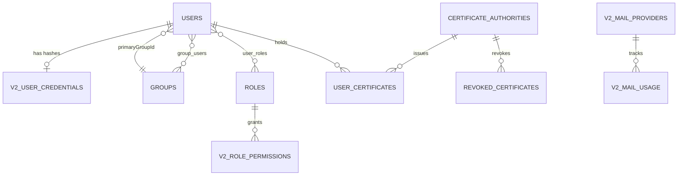

# Layer: data model & schema

Slurm Portal persists all control-plane state in a single SQLite-compatible relational database (Cloudflare D1 in serverless mode, or local SQLite in container mode). This page documents the entity relationships, schema conventions, POSIX ID invariants, and how the v2 schema extends the legacy `go-ldap-admin` v1 tables without breaking backward compatibility.

**Packages:** `migrations`, `internal/domain/*`, `internal/store`.

## Entity relationship overview

## Schema organization

Migrations live in `migrations/0000_legacy_base.sql` through `0016_*.sql` and are applied in numerical order at startup (`store.Migrate`):

- **Legacy compatibility base (`0000_legacy_base.sql`):** Preserves the core table names (`users`, `groups`, `group_users`, `roles`, `user_roles`, `certificate_authorities`, `user_certificates`, `revoked_certificates`, `oauth_connectors`) from `go-ldap-admin` v1 so an existing v1 database can be opened and upgraded in place.
- **Additive v2 migrations (`0001`–`0016`):** Introduce `v2_*` tables and new columns (`primary_group_id`, `home_root`, `default_shell`, etc.) using strictly additive DDL statements so rolling back the binary to the previous release remains safe.

## Identity & RBAC tables

| Table | Primary Key | Key Columns & Invariants |
| --- | --- | --- |
| `users` | `id` | `username` (unique POSIX name), `uid_number` (unique ≥ 10000), `primary_group_id` (references a `posixGroup`), `home_directory`, `login_shell`, `user_dn`, `status` (`1` = active, `2` = disabled), `source` (`platform`, `oauth`, `cloudflare-access`) |
| `groups` | `id` | `group_name`, `group_dn`, `group_type` (`cn` or `ou`), `group_class` (`posixGroup` or `groupOfUniqueNames`), `gid_number` (unique for POSIX groups), `parent_id` (tree hierarchy), `home_root`, `default_shell` |
| `group_users` | `(group_id, user_id)` | Join table linking users to both their primary POSIX group, supplementary POSIX groups, and organizational units |
| `roles` | `id` | `keyword` (unique policy subject), `name`, `sort` (numeric rank `1`–`999`, where `1` is highest privilege), `status` |
| `user_roles` | `(user_id, role_id)` | Many-to-many assignment of roles to users |
| `v2_role_permissions` | `(role, object, action)` | Explicit `(object, action)` permission grants evaluated by `authz.Casbin` |
| `posix_id_counters` | `kind` (`uid` / `gid`) | Monotonically increasing allocator starting at `10000`; IDs are never reused after user or group deletion |

## Authentication & credential tables

| Table | Primary Key | Purpose |
| --- | --- | --- |
| `v2_user_credentials` | `user_id` | Stores `app_hash` (Argon2id PHC string for portal login) and `ldap_hash` (`{CRYPT}$6$` SHA-512 crypt for OpenLDAP). An empty `ldap_hash` instructs slaves to preserve any existing `userPassword` in LDAP. |
| `v2_revoked_tokens` | `jti` | Revoked JWT session token IDs, retained until their `expires_at` timestamp and pruned during periodic ticks. |
| `v2_password_resets` | `user_id` | Active 6-digit password reset codes stored as HMAC-SHA256 digests with `expires_at`, `resend_after`, and `attempts` counters. |
| `oauth_connectors` | `id` | GitHub OAuth connector settings, sealed client secrets, and ordered JSON access rules. |
| `oauth_states` | `state_hash` | Short-lived SHA-256 hashes of OAuth CSRF state tokens (10-minute TTL). |

## PKI & certificate tables

| Table | Primary Key | Purpose |
| --- | --- | --- |
| `certificate_authorities` | `id` | SSH and X.509 CAs. `private_key_enc` holds the AES-256-GCM sealed CA private key (`PKI_MASTER_KEY` with CA identity as AAD). For X.509 CAs, `crl_pem` and `crl_next_update` store the latest signed CRL. |
| `user_certificates` | `id` | Issued 30-day SSH and 1-year X.509 user certificates (`ca_id`, `user_id`, `serial_number`, `public_key`, `cert_data`, `expires_at`, `revoked_at`). Private keys are never stored. |
| `revoked_certificates` | `(ca_id, serial_number)` | Revoked certificate serials with `revoked_at` and `reason` (`revoked`, `superseded`, `user_deactivated`). Exported in every cluster snapshot to build OpenSSH KRLs and X.509 CRLs. |

## Operations, mail, and plugin tables

| Table | Primary Key | Purpose |
| --- | --- | --- |
| `v2_audit_log` | `seq` | Append-only audit log with `actor_id`, `actor`, `action`, `target`, `outcome`, `status`, `request_id`, `trace_id`, `prev_hash`, and `hash` (SHA-256 chain). Bounded by `AUDIT_MAX_RECORDS`. |
| `v2_sync_state` | `key` | Tracks the last published snapshot hash (`published_hash`) so DNS TXT records are updated only when state actually changes. |
| `v2_mail_providers` | `name` | Named email providers (`smtp`, `rest`, `pool`) with JSON configuration and `secretbox`-encrypted credentials. |
| `v2_mail_usage`, `v2_mail_pool_usage` | `(day, provider, purpose)` | Daily delivery counters per provider, pool member, and notification purpose. |
| `v2_notification_config`, `v2_password_mail_config` | `id` (`1`) | Singleton configuration and customizable HTML templates for job completion and password verification emails. |
| `v2_job_notifications` | `(cluster_id, job_id)` | Deduplication and delivery log for completed Slurm job emails. |
| `v2_cluster_reports` | `(cluster_id, kind)` | Latest node status (`cluster-status`) and resource/queue report (`resource-status`) per cluster. |
| `v2_resource_summaries` | `(cluster_id, job_id)` | Per-job GPU utilization summaries powering the 7-day resource monitor charts. |
| `v2_web_access_config` | `cluster_id` | Per-cluster Web Access Gateway endpoint, SSH CA selection, target SSH host/port, Allowed roles, and transfer email template. |
| `v2_gateway_registrations` | `gateway_id` | Heartbeat timestamp, instance ID, trusted CA fingerprints, and advertised capabilities from each login-node gateway. |
| `v2_transfer_events` | `id` | Completed cross-cluster `rsync` file transfer records. |

## Next steps

- [Storage Layer](layer-storage.md): how `store.Store` executes queries and atomic batches across SQLite and Cloudflare D1.
- [Sync Protocol](sync-protocol.md): how these tables are serialized into a cluster snapshot.
