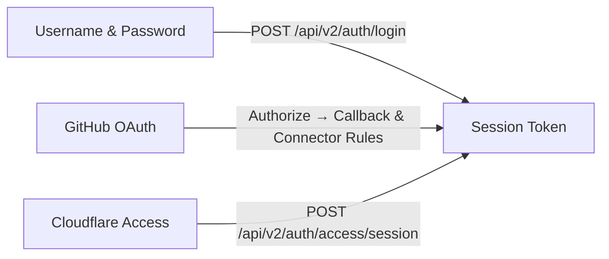

# Layer: identity & access

This layer answers two fundamental questions for every incoming HTTP request: **who is calling** (authentication) and **whether they are permitted to perform the action** (authorization). It also enforces strict rank-based anti-escalation rules so no administrator can grant privileges higher than their own.

**Packages:** `internal/authn`, `internal/authz`, `internal/domain/identity`, `internal/domain/auth`, and the `oauth` and `cloudflare-access` plugins.

## Principals

An authenticated caller is represented as an `authn.Principal` attached to the request context:

| Field | Description |
| --- | --- |
| `UserID`, `Username` | Database user ID and username (`0` and `peer:<fingerprint>` for machine callers) |
| `Roles` | Active role keywords, reloaded fresh from the database on every request |
| `Source` | Authentication method: `password`, `oauth`, `cloudflare-access`, or `peer-mtls` for machines |
| `TokenID` | Session token ID (`jti`) for user sessions, or the SHA-256 certificate fingerprint for machines |

Handlers inspect the caller via `authn.FromContext(r.Context())`.

## Authentication

### Users: session tokens

Regardless of how a user signs in, successful authentication issues an `authn.JWT` session token:

| Property | Value |
| --- | --- |
| Token format | JWT signed with `HS256` |
| Standard claims | `iss` (`AUTH_ISSUER`), `aud` (`AUTH_AUDIENCE`), `sub` (user ID), `jti` (token ID), `iat`, `nbf`, `exp`, `src` (sign-in source) |
| Lifetime | `auth.token-ttl` (default `12h`, maximum `168h`) |
| Key management | `JWT_KEYS` (`kid1:base64,kid2:base64`); new tokens are signed with `JWT_ACTIVE_KID` while remaining keys continue verifying older tokens |
| Transport | Sent in the `Authorization` header as a Bearer token; cached in `localStorage` by the web app |

On every authenticated request, `JWT.Authenticate`:

1. Verifies the `HS256` signature, issuer, audience, and expiration timestamp;
2. Checks the token's `jti` against the revocation table (`v2_revoked_tokens`, populated on logout and token refresh);
3. Loads the user's **current** account status and assigned roles from the database (`identity.Directory.LoadPrincipal`).

Because step 3 queries live database state, disabling an account or removing a role takes effect on the very next request rather than waiting for token expiration.

### Ways to sign in



- **Local Password (`domain/auth`):** Constant-time Argon2id verification, with a dummy Argon2id check for unknown usernames to prevent timing enumeration. Brute-force attempts are rate-limited (5 failed attempts within 15 minutes block the caller). Requires HTTPS.
- **GitHub OAuth (`plugins/oauth`):** Each connector defines an ordered list of access rules (everyone, email/username glob, or verified GitHub organization membership). The first matching rule determines whether sign-in is permitted and which primary POSIX group, supplementary groups, and RBAC roles a newly provisioned user receives.
- **Cloudflare Access (`plugins/cfaccess`):** Verifies the Cloudflare Access JWT against the team's JWKS endpoint (cached for 5 minutes) and application `aud` tag, then maps the caller to a portal user by email address.

### Machines: client certificates

Cluster slaves and Web Access Gateways never use user session tokens. Routes marked with `authz.Peer()` authenticate callers via mutual TLS:

- **On Cloudflare (`authn.BridgePeer`):** Trusts only the client-certificate SHA-256 fingerprint verified by Cloudflare on `SYNC_HOSTNAME` and passed across the Worker bridge—never from an HTTP header.
- **In containers (`authn.TLSPeer`):** Extracts the verified leaf certificate from the Go TLS connection on `SYNC_LISTEN` (`:8443`) and verifies that its fingerprint appears in `SYNC_CLIENT_FINGERPRINTS`.

Plugins then map the verified fingerprint to a specific cluster (`CLUSTERS`) or gateway (`web-access.gateways`), ignoring any cluster ID supplied in the request payload.

## Authorization

### Permissions on routes

| Route Permission | Who Is Permitted |
| --- | --- |
| `authz.Public()` | Unauthenticated and authenticated callers alike |
| `authz.Authenticated()` | Any active signed-in user |
| `authz.Peer()` | A machine agent presenting a verified mTLS client certificate |
| `authz.Policy(object, action)` | A signed-in user whose active roles grant `object:action` |

Policy objects represent logical domains rather than URL paths: `user`, `group`, `role`, `pki`, `mail`, `notification`, `oauth`, `web-access`, `audit`, `diagnostics`, and `resource-monitor`. Actions are `read`, `create`, `update`, and `delete` (with `*` matching all objects or actions).

### Role policies

Permission grants are stored in `v2_role_permissions` (`role, object, action`) and evaluated by `authz.Casbin` using the following model:

```ini
[request_definition]
r = sub, obj, act
[policy_definition]
p = sub, obj, act
[policy_effect]
e = some(where (p.eft == allow))
[matchers]
m = r.sub == p.sub && (r.obj == p.obj || p.obj == "*") && (r.act == p.act || p.act == "*")
```

Access is granted if **any** of the caller's active roles matches the requested `(object, action)`. `authz.Refreshing` reloads the policy table at most once every 10 seconds so policy updates propagate across Worker isolates without querying the policy table on every request. When upgrading a `go-ldap-admin` v1 database, `authz.ImportLegacy` migrates existing `casbin_rule` entries once.

### Ranks: no escalation

Every role carries a numeric rank (`sort`, `1`–`999`, where lower numbers outrank higher numbers and `1` is the super-administrator). All identity mutations enforce strict anti-escalation rules via `Service.actor`:

| Operation | Anti-Escalation Rule |
| --- | --- |
| Edit, disable, or delete a user | Caller's best (lowest numeric) rank must be strictly higher than the target user's best rank |
| Create, edit, or delete a role | Target role's rank must be strictly below the caller's best rank |
| Assign roles to a user | Caller may only assign roles ranked strictly below their own best rank |
| Grant permissions to a role | Caller may only grant `object:action` pairs they personally hold, and may never grant `*` unless they hold rank `1` |

This ensures a delegated group administrator can manage users and roles within their scope without ever escalating their own privileges or modifying peers and super-administrators.

### What the browser sees

`GET /api/v2/me/access` returns the list of enabled plugins and the caller's effective permissions so the React frontend can hide unauthorized menu items. Server-side route guards still enforce every permission check independently.

## Passwords

| Property | Specification |
| --- | --- |
| Portal authentication hash | Argon2id (2 passes, 19 MiB memory, 1 thread, random salt, PHC string format) |
| OpenLDAP password hash | `{CRYPT}$6$…` (SHA-512 crypt, 100,000 rounds), written to `userPassword` by cluster slaves |
| Password length | 10–128 characters |
| Self-service reset code | 6-digit numeric email code stored as an HMAC; 10-minute TTL, 1-minute resend cooldown, max 5 attempts |
| Database storage | `v2_user_credentials` (`app_hash`, `ldap_hash`); plaintext or reversible passwords are never stored |

An empty `ldap_hash` instructs cluster slaves to leave any pre-existing `userPassword` attribute in OpenLDAP untouched, allowing accounts imported from legacy directories to keep their existing LDAP passwords until the user sets a new password in the portal.

## Next steps

- [Cryptography & Signing](cryptography.md): complete summary of keys, ciphers, and rotation procedures.
- [Domain Modules](layer-domain.md): users, groups, roles, PKI, mail, and audit implementation.
