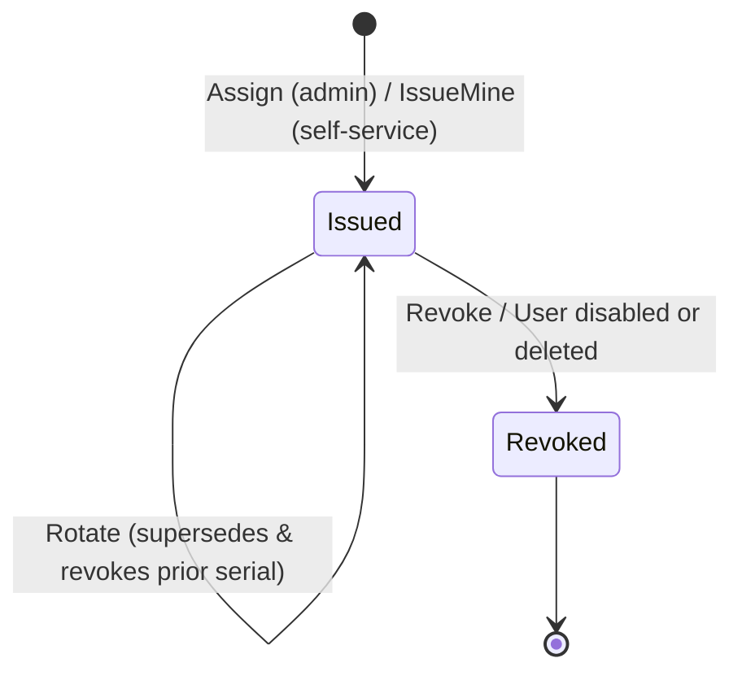

# Layer: domain modules

Core domain modules implement the business logic that is always active regardless of which plugins are enabled: POSIX identity management, password authentication, SSH/X.509 certificate authorities, the email delivery hub, and the tamper-evident audit log. Plugins interact with these modules through `plugin.Host`.

| Package | Responsibility |
| --- | --- |
| `internal/domain/identity` | Users, POSIX and organizational groups, roles, UID/GID allocation, and rank-based anti-escalation |
| `internal/domain/auth` | Password login, session token refresh/logout, password updates, and email reset codes |
| `internal/domain/pki` | SSH and X.509 Certificate Authorities, user certificate lifecycle, and revocation lists |
| `internal/mail` | Mail hub: named providers (`smtp`, `rest`, `pool`), template rendering, and delivery metrics |
| `internal/audit` | Append-only SHA-256 hash-chained audit trail |
| `internal/legacyimport` | One-time migration of legacy `go-ldap-admin` v1 configuration and history |

## Identity

### Users

Each user account has a validated POSIX username (up to 50 characters), a numeric UID, exactly one **primary POSIX group**, any number of supplementary groups, and one or more RBAC roles. Profile metadata (display name, email, mobile number, employee/student ID, postal address) maps directly to standard LDAP attributes.

- **Monotonic UID and GID allocation:** Allocated from `posix_id_counters` starting at `10000` and never reused or reassigned once issued, ensuring file ownership on shared NFS storage never collides. Administrators may also supply an explicit UID/GID at creation time.
- **Primary group presets:** A POSIX group can define a default home directory root (`homeRoot`) and login shell (`defaultShell`). New users assigned to that primary group automatically receive `<homeRoot>/<username>` and that shell; otherwise `directory.default-shell` is used.
- **Account lifecycle (`active` / `disabled`):** Disabling or deleting a user atomically revokes all of their active SSH and X.509 certificates within the same database batch via the `OnDeactivate` hook registered by the PKI module.
- **Account provenance:** Accounts are marked either `platform` (created directly in the portal) or with the external identity provider (`oauth`, `cloudflare-access`) that provisioned them.

### Groups

| Group Kind | LDAP `objectClass` | Purpose |
| --- | --- | --- |
| POSIX Group (`groupClass: posixGroup`) | `posixGroup` (`gidNumber` + `memberUid`) | Unix filesystem permissions and primary group assignment |
| Organizational Unit (`groupClass: groupOfUniqueNames`) | `groupOfUniqueNames` (`uniqueMember`) | Hierarchical department/lab tree linked via `parentId` |

`groupType` selects the LDAP RDN attribute (`cn` or `ou`). Membership updates run atomically via `POST /api/v2/groups/{id}/members`. A user's primary POSIX group is always included in their group memberships and cannot be removed without reassigning their primary group first.

### Roles

Each role defines a policy keyword, display name, numeric rank (`sort`), and status. Role permissions are stored in `v2_role_permissions`. See [Identity & Access Layer: Ranks](layer-access.md#ranks-no-escalation) for the anti-escalation rules enforced on every write.

## Auth

`internal/domain/auth` manages password authentication and session lifecycle:

| Flow | Endpoint | Notes |
| --- | --- | --- |
| Sign in | `POST /api/v2/auth/login` | Constant-time Argon2id check; brute-force throttled; requires HTTPS |
| Token refresh | `POST /api/v2/auth/refresh` | Issues a fresh session token and revokes the previous `jti` |
| Sign out | `POST /api/v2/auth/logout` | Adds the current token's `jti` to `v2_revoked_tokens` until its expiration time |
| Change password | `PUT /api/v2/me/password` | Authenticates using either the current password or a 6-digit email code |
| Self-service reset | `…/password-reset/request` → `…/confirm` | Sends a 6-digit email code stored as an HMAC derived from the active JWT key |
| Admin password reset | `POST /api/v2/users/{id}/password-reset` | Generates a random temporary password and returns it once |

Whenever a password is set or updated, `password.Derive` computes both the portal hash (Argon2id) and the LDAP hash (`{CRYPT}$6$` SHA-512 crypt) and writes them to `v2_user_credentials`.

## PKI

Slurm Portal includes a built-in Certificate Authority subsystem for both SSH and X.509 credentials.

### Certificate authorities

| CA Type | Creation Modes | Purpose |
| --- | --- | --- |
| SSH (`ssh`) | Generated in-portal (Ed25519) or imported | Signs 30-day OpenSSH user certificates (and 5-minute web-session certificates); public key is published to `TrustedUserCAKeys` on every cluster |
| X.509 (`x509`) | Imported (PEM certificate + private key) | Signs 1-year client certificates; signed CRLs are published to every cluster |

CA private keys are encrypted at rest with AES-256-GCM under `PKI_MASTER_KEY`, binding the CA's identity as AEAD additional authenticated data (AAD) so a ciphertext cannot be transplanted to another row. Private keys never leave the master and are never returned by `GET /api/v2/pki/cas`.

### User certificates

| Property | SSH User Certificate | X.509 User Certificate |
| --- | --- | --- |
| Key algorithm | Ed25519 key pair generated by the master | ECDSA P-256 key pair generated by the master |
| Validity period | 30 days | 1 year (clamped to the issuing CA's expiration) |
| Subject identity | Key ID and principal set to `username` | Subject `CN = username`, Extended Key Usage `clientAuth` |
| Private key delivery | Returned once in the issuance response; never stored | Returned once in the issuance response; never stored |
| Revocation mechanism | Serial recorded in `revoked_certificates` and compiled into `ssh/revoked.krl` by each slave | Serial added to the CA's X.509 CRL (48 h validity, re-signed automatically when < 12 h remain) |

Certificate issuance, rotation, and revocation execute inside a single `store.Batch` so state is never partially written. Interactive browser terminal sessions use separate 5-minute ephemeral SSH certificates issued by the `web-access` plugin for WebCrypto keys generated in the user's browser.

## Mail hub

Plugins never connect to SMTP servers directly; instead, they call `h.Mail.Send(ctx, providerName, mail.Message{…})` (where `""` selects the default provider).

| Provider Type | Package | Transport Mechanism |
| --- | --- | --- |
| `smtp` | `internal/mail` | SMTP with STARTTLS or implicit TLS (uses `cloudflare:sockets` via `smtp-bridge.js` on Cloudflare Workers) |
| `rest` | `internal/mail` | Arbitrary HTTP mail APIs configured via a cURL-style request template with `{{ … }}` placeholders and sealed secrets |
| `pool` | `plugins/mailpool` | Routes across multiple providers using priority daily quotas, round-robin, or weighted selection with automatic failover |

- Provider credentials and API tokens are sealed at rest with `PKI_MASTER_KEY` (`internal/secretbox`) and redacted in API responses.
- Every delivery attempt is recorded per day, provider, and purpose in `v2_mail_usage`.
- **Template engine (`mail.Template`):** Supports `{{ path.to.value }}` interpolation with automatic HTML escaping in message bodies. Each notification feature declares its allowed variable roots, and template validation rejects unknown roots at save time.

## Audit

Every state-changing HTTP request is logged in `v2_audit_log`, whether it succeeded or was rejected.

| Column / Field | Description |
| --- | --- |
| `seq`, `time` | Monotonic sequence number and UTC timestamp |
| `actorId`, `actor` | Authenticated user ID and username (or `peer:<name>` for machines) |
| `action` | HTTP method and route pattern (e.g., `POST /api/v2/users`) |
| `target` | Logical target entity set via `httpx.SetTarget` (e.g., `user:alice`) |
| `outcome`, `status` | Outcome (`success`, `denied`, `error`) and HTTP status code |
| `requestId`, `traceId` | Correlation IDs for logs and OpenTelemetry traces |
| `prevHash`, `hash` | SHA-256 hash chain covering all record fields plus the preceding record's `hash` |

- **Online integrity verification:** `GET /api/v2/audit/verify` walks the chain from the oldest retained record to the newest and reports the first record whose `prevHash` link or SHA-256 digest does not match.
- **Bounded storage:** When `AUDIT_MAX_RECORDS` is set, inserting a new record trims entries older than the cap in the same operation so database size stays bounded.
- **Noise suppression:** Read-only `GET` requests (unless explicitly marked audited) and successful `Routine` machine heartbeats are omitted.

## Legacy import

When started against a `go-ldap-admin` v1 database, `legacyimport.Run` performs a one-time idempotent migration of:

- Legacy web-access cluster settings;
- Legacy job notification settings (imported in a disabled state until the operator configures a v2 mail provider);
- Historical GPU job summaries.

Core users, groups, roles, CAs, and certificates are queried directly from the original v1 tables defined in `migrations/0000_legacy_base.sql`.

## Next steps

- [Plugins](plugins.md): optional feature modules built on `plugin.Host`.
- [Data Model](data-model.md): complete table schema and entity relationships.
- [Storage Layer](layer-storage.md): how `store.Store` bridges SQLite and Cloudflare D1.
