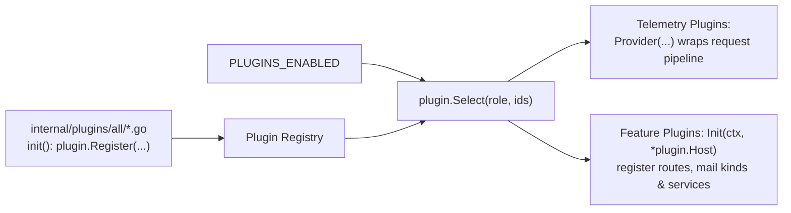

# Plugins

Everything in the master beyond the core domain modules (identity, authentication, PKI, audit, and the mail hub) is implemented as a plugin. This page explains how the plugin architecture works, documents every built-in plugin, and shows how to write a new one.

## How the plugin system works

Plugins are **compiled into the binary and activated by configuration**—no dynamic shared libraries are loaded at runtime.



1. **Compile-time registration:** Each file in `internal/plugins/all/` imports one plugin package behind an opt-out build tag (such as `//go:build !no_oauth`) and registers it from `init()` via `plugin.Register`. To compile a minimal binary without a specific plugin, pass its build tag:
   `go build -tags no_oauth ./cmd/server`.
2. **Runtime selection:** `PLUGINS_ENABLED` lists the plugin IDs to activate in startup order. `plugin.Select` fails fast at startup if an ID is unknown, duplicated, or incompatible with the current `SYSTEM_ROLE` (`standalone`, `master`, `slave`, or `gateway`).
3. **Strict configuration decoding:** `PLUGINS_CONFIG` provides a JSON or YAML map keyed by plugin ID. Each plugin decodes its own section via `Host.Decode`, which rejects unknown keys. Secrets are never placed in `PLUGINS_CONFIG`; plugins read secrets from environment variables prefixed with `PLUGIN_` or `OAUTH_` (the only prefixes forwarded into the Cloudflare Worker Wasm environment), or reference them via `env:VAR_NAME`.
4. **Ordered initialization and teardown:** Telemetry plugins initialize first so their tracing provider wraps the entire HTTP middleware stack. Feature plugins then run `Init(ctx, *plugin.Host)` in order. On shutdown, `Close` runs in reverse order.

### What a plugin receives

`plugin.Host` (`internal/plugin/plugin.go`) provides controlled access to the master's core capabilities:

| Field | Purpose |
| --- | --- |
| `Router` | Register HTTP routes (every route must declare an explicit `authz.Permission`) |
| `Store` | Database interface (`store.Store` over D1 or SQLite) |
| `Identity`, `PKI`, `Tokens`, `Audit` | Core domain services |
| `Mail` | Send emails via a named provider or register a new mail provider driver (such as `pool`) |
| `Secrets` | Encrypt and decrypt database-stored credentials using `PKI_MASTER_KEY` (`internal/secretbox`) |
| `Clusters` | Registered clusters and their expected mTLS client-certificate SHA-256 fingerprints |
| `Services` | In-process service registry allowing plugins to expose interfaces to one another without tight coupling |
| `Getenv`, `Decode`, `Origins`, `Telemetry`, `Role` | Environment lookup, config decoder, allowed CORS origins, tracer/meter, and active process role |

`Host.Services` decouples cross-plugin dependencies from startup order. For example, `current-status` registers a `Reader` interface for the latest R2 status object, and `diagnostics` looks up that interface at request time when assembling its health topology.

### Rules every plugin follows

- Every route must declare `authz.Public()`, `Authenticated()`, `Peer()`, or `Policy(object, action)`. Machine endpoints belong under `/sync/v2/`, and browser/admin endpoints belong under `/api/v2/`.
- Periodic machine reports must set `Routine: true` so successful heartbeats do not bloat the audit log or consume unnecessary D1 writes.
- Database schema additions belong in a new numbered file in `migrations/00NN_<name>.sql`. Never modify an existing migration file.
- Outbound emails must go through `Host.Mail` so deliveries are tracked per provider and purpose.

## Built-in plugins

All built-in plugins run on `master` (and `standalone`).

| Plugin ID | Package | Capabilities Added | `PLUGINS_CONFIG` Keys | Secrets |
| --- | --- | --- | --- | --- |
| `oauth` | `plugins/oauth` | GitHub OAuth sign-in. Each connector evaluates ordered access rules (everyone, email/username glob, or GitHub organization membership) to permit sign-in and assign default POSIX groups and RBAC roles | `frontend-origin` | Per-connector client secret: `env:OAUTH_…` or sealed in database |
| `cloudflare-access` | `plugins/cfaccess` | Exchanges a verified Cloudflare Access JWT for a portal session token (`POST /api/v2/auth/access/session`) | `team-domain`, `applications[]` (`origin`, `path-prefix`, `aud`) | — |
| `cluster-status` | `plugins/clusterstatus` | Receives node state reports from slaves and serves the **Cluster status** view | `stale-seconds` | — |
| `resource-status` | `plugins/resourcestatus` | Receives partition capacity, free resources, and job queues from slaves | `stale-seconds` | — |
| `current-status` | `plugins/currentstatus` | Stores a unified live-status JSON object per cluster in R2/S3 and issues short-lived presigned `GET` URLs to browsers | `account-id` (R2) or `endpoint` (S3), `public-endpoint`, `bucket`, `stale-seconds`, `link-seconds` | `PLUGIN_CURRENT_STATUS_R2_*` (read-write and read-only S3 keys) |
| `resource-monitor` | `plugins/resourcemonitor` | Stores per-job GPU usage summaries and serves 7-day site-wide and per-user GPU utilization charts | — | — |
| `job-notification` | `plugins/jobnotification` | Sends job completion emails with customizable HTML templates, live preview, and test delivery | Stored in database (**Job notifications** page) | — |
| `mail-pool` | `plugins/mailpool` | Registers the `pool` mail provider driver: distributes emails across member providers by priority daily quotas, round-robin, or weights with automatic failover | Stored in database (**Mail service** page) | — |
| `web-access` | `plugins/webaccess` | Issues Ed25519 gateway tickets and 5-minute WebCrypto SSH certificates, tracks gateway registrations, and sends file transfer completion emails | `ticket-key-id`, `gateways[]` (`fingerprint`, `cluster-id`, `gateway-id`, `instance-id`) | `PLUGIN_WEB_ACCESS_TICKET_KEY` |
| `diagnostics` | `plugins/diagnostics` | Serves a read-only dependency health topology covering the database, cluster sync agents, gateways, and mail providers | `stale-seconds` | — |
| `telemetry-otel` | `plugins/otel` | Exports OpenTelemetry traces and metrics over OTLP/HTTP JSON | `endpoint`, `headers`, `service-name`, `timeout`, `max-spans` | Header values via `env:NAME` |
| `telemetry-cloudflare` | `plugins/cftelemetry` | Emits structured JSON trace/metric log lines and optional Cloudflare Workers Analytics Engine data points | `max-spans`, `analytics-engine` | — |

### Example

```sh
PLUGINS_ENABLED=oauth,cloudflare-access,current-status,cluster-status,resource-status,resource-monitor,job-notification,mail-pool,web-access,diagnostics
PLUGINS_CONFIG='{
  "cloudflare-access": {"team-domain": "example.cloudflareaccess.com",
                        "applications": [{"origin": "https://portal.example.org", "path-prefix": "/", "aud": "…"}]},
  "current-status":    {"account-id": "…", "bucket": "slurm-portal-status"},
  "web-access":        {"ticket-key-id": "web-access-v2",
                        "gateways": [{"fingerprint": "…", "cluster-id": "cluster1", "gateway-id": "cluster1-login", "instance-id": "cluster1-login"}]}
}'
```

See `deploy/worker/wrangler.example.toml` for a complete serverless configuration, and `deploy/compose/master/` (`.env` and `compose.yaml`) for the container equivalent.

## Slave-side collectors

Several telemetry features have two halves: a **master plugin** that stores and serves data, and a **slave collector** that gathers it on the cluster. Slave collectors are configured in `slave.yml`:

| `slave.yml` Section | Package | Data Collected |
| --- | --- | --- |
| `cluster-status` | `plugins/clusterstatus` (`Collector`) | Node states via `scontrol show nodes` |
| `resource-status` | `plugins/resourcestatus` (`Collector`) | Node capacity and active job queue via `scontrol` and `squeue` |
| `current-status` | `plugins/currentstatus` (`Collector`) | Combined node, capacity, and queue snapshot uploaded to R2 / S3 |
| `lifecycle-file` | `internal/lifecycle/*` | Job start/end events from `slurm-lifecycle-hook` for completion emails and NVML GPU sampling |

## Writing a plugin

1. Create `internal/plugins/<name>/plugin.go`:

   ```go
   // Package hello adds a greeting endpoint.
   package hello

   const ID = "hello"

   // Config is this plugin's section of PLUGINS_CONFIG.
   type Config struct {
   	Greeting string `yaml:"greeting"`
   }

   // Plugin is the hello plugin.
   type Plugin struct{}

   func (Plugin) ID() string                  { return ID }
   func (Plugin) Roles() []plugin.Role        { return []plugin.Role{plugin.RoleStandalone, plugin.RoleMaster} }
   func (Plugin) Close(context.Context) error { return nil }

   func (Plugin) Init(_ context.Context, h *plugin.Host) error {
   	cfg := Config{Greeting: "hello"}
   	if err := h.Decode(&cfg); err != nil {
   		return err
   	}
   	h.Router.Handle(httpx.Route{Method: http.MethodGet, Path: "/api/v2/hello", Permission: authz.Authenticated(),
   		Handler: func(w http.ResponseWriter, r *http.Request) error {
   			httpx.WriteJSON(w, http.StatusOK, map[string]string{"greeting": cfg.Greeting})
   			return nil
   		}})
   	return nil
   }
   ```

2. Register it in `internal/plugins/all/hello.go`:

   ```go
   //go:build !no_hello

   package all

   import (
   	"github.com/TING-HiuYu/SlurmPortal/internal/plugin"
   	"github.com/TING-HiuYu/SlurmPortal/internal/plugins/hello"
   )

   func init() { plugin.Register(hello.Plugin{}) }
   ```

3. Add any new database tables in `migrations/00NN_hello.sql`.
4. If the plugin adds a UI view, register the route in `web/src/routes.jsx` with `meta: { plugin: "hello" }` so the sidebar menu displays it only when the plugin is enabled and the user holds the required permission.
5. Write unit tests alongside the package using `internal/testutil` for an in-memory migrated database.
6. Document the new routes in `tools/apidoc/descriptions.go` and run `go run ./tools/apidoc`.
