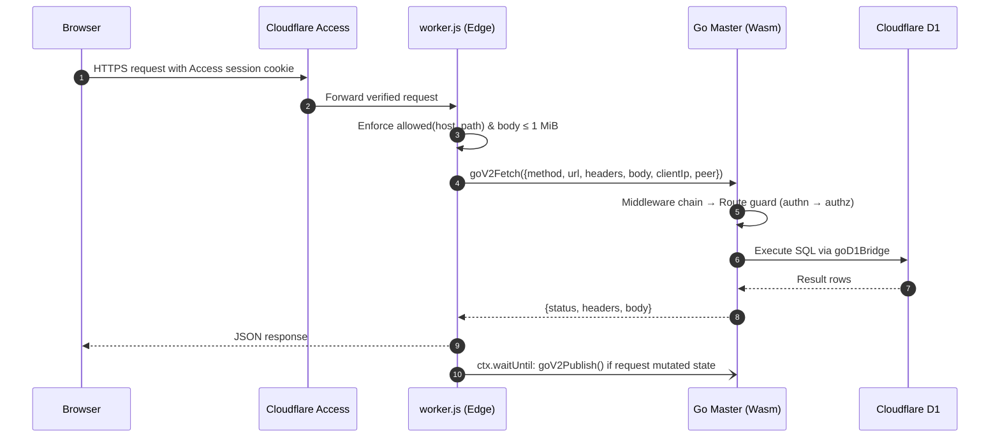

# Request lifecycle

This page traces a single HTTP request from the network edge to the database and back across both supported runtimes. Each architectural layer has a dedicated deep-dive page linked below.

## The short version

1. **Network Edge:** Validates host-based routing rules, enforces request size limits, and dispatches the request to the Go application:
   - On Cloudflare, via the Worker host script `deploy/worker/worker.js`;
   - In containers, via Caddy and `cmd/server`.
2. **Middleware Chain:** Attaches a request ID, OpenTelemetry tracing span, panic recovery handler, security headers, per-IP token-bucket rate limiter, CORS policy, write-tracking hook, and audit logger.
3. **Router & Route Guard:** Matches the HTTP method and path pattern, authenticates the caller (`Principal`), and verifies the route's required permission.
4. **Domain / Plugin Handler:** Decodes and validates the JSON payload, enforces business invariants (such as role rank anti-escalation), and reads or mutates state through `store.Store`.
5. **Response & Snapshot Publication:** Serializes a structured JSON response (`{"data": …}` or `{"error": …}`). If the request mutated state, the master asynchronously publishes the updated snapshot hash so cluster slaves pick up the change.

## On Cloudflare (SaaS)



| Stage | Implementation | Behavior |
| --- | --- | --- |
| Host separation | `deploy/worker/edge.js` (`allowed()`) | `/sync/*` routes are served exclusively on `SYNC_HOSTNAME`; browser and API routes are blocked on `SYNC_HOSTNAME`. Mismatched host requests return HTTP `404`. |
| Payload size limit | `deploy/worker/worker.js` | Rejects request bodies larger than 1 MiB with HTTP `413` before crossing into WebAssembly. |
| Isolate cold start | `deploy/worker/worker.js` (`boot()`) | The first request to a fresh Worker isolate boots the Go Wasm binary, applies pending schema migrations, initializes plugins, and loads RBAC policies. Concurrent requests await initialization; a stalled boot is retried after 5 seconds. |
| Machine peer identity | `deploy/worker/edge.js` (`verifiedPeer()`) | On `SYNC_HOSTNAME`, extracts Cloudflare's verified mTLS client-certificate SHA-256 fingerprint and passes it to Go as `peer` (consumed exclusively by `authn.BridgePeer`). |
| Client IP extraction | `deploy/worker/worker.js` | Passes `CF-Connecting-IP` to Go for per-IP rate limiting and audit logging. |
| Post-write publication | `deploy/worker/worker.js` | When `goV2TakeWrites()` indicates a successful write, schedules `goV2Publish()` inside `ctx.waitUntil` so the DNS TXT record updates without delaying the client response. |

## In containers

```mermaid
sequenceDiagram
    autonumber
    participant B as Browser
    participant C as Caddy (HTTPS :443)
    participant S as cmd/server (:8080)
    participant D as SQLite
    B->>C: HTTPS request
    C->>S: HTTP + X-Forwarded-Proto: https
    S->>S: behindProxy marks TLS; withStatic serves UI or forwards /api/*
    S->>S: Middleware chain → Route guard
    S->>D: SQL query / batch (database/sql)
    S-->>C: JSON response
    C-->>B: HTTPS response
```

Cluster agents do not connect through Caddy. Instead, slaves and gateways connect directly to `cmd/server`'s dedicated mutual-TLS listener (`SYNC_LISTEN`, port `8443`), which exposes only `/sync/*` and `/healthz`. State writes set a dirty flag that a 5-second background ticker in `cmd/server/main.go` checks to republish the snapshot hash.

## Inside Go

### 1. Middleware chain

Registered in `internal/app/app.go` (outermost first). See [HTTP & Edge Layer](layer-http.md) for full details.

| Order | Middleware | Purpose |
| --- | --- | --- |
| 1 | `httpx.WithScope` | Preserves a valid incoming `X-Request-Id` or generates a new UUID; allocates the per-request scope used by downstream layers. |
| 2 | `telemetry.HTTPMiddleware` | Starts an OpenTelemetry span named after the matched route when a telemetry plugin is active. |
| 3 | `httpx.Recover` | Catches unexpected panics, logs the stack trace with the request ID, and returns HTTP `500`. |
| 4 | `httpx.SecurityHeaders` | Adds `X-Content-Type-Options: nosniff`, `X-Frame-Options: DENY`, `Referrer-Policy: no-referrer`, `Cache-Control: no-store`, and `Content-Security-Policy: default-src 'none'; frame-ancestors 'none'`. |
| 5 | `httpx.RateLimit` | Enforces a per-IP token bucket (default: 20 req/s, burst 200). |
| 6 | `httpx.CORS` | Allows only origins explicitly listed in `CORS_ORIGINS`. |
| 7 | Write tracker | Flags successful non-`GET` requests outside `/sync/` so the snapshot hash is republished. |
| 8 | `audit.Middleware` | Appends a hash-chained audit entry after handler execution for all state-changing routes—whether allowed or denied. |

### 2. Route guard

`httpx.Router.guard` (`internal/httpx/router.go`) wraps every registered route handler. See [Identity & Access Layer](layer-access.md).

```mermaid
flowchart TD
    R[Route Matched] --> P{Route Permission}
    P -->|Public| H[Execute Handler]
    P -->|Authenticated / Policy| U[authn.JWT: Verify Session Token & Load Live Roles]
    P -->|Peer (Machine)| M[Peer Authenticator: Verify Client Certificate]
    U -->|Missing / Expired / Revoked / Disabled| E401[401 Unauthenticated]
    M -->|Missing or Untrusted Certificate| E401
    U --> Q{Requires Policy?}
    Q -->|No| H
    Q -->|Yes| Z[authz: Does any active role grant object:action?]
    Z -->|No| E403[403 Forbidden]
    Z -->|Yes| H
```

`Router.Handle` panics at startup if a route is registered without an explicit `Permission`, making it impossible to ship an unprotected endpoint by oversight.

### 3. Handler and modules

Handlers live in core domain modules or plugins (see [Domain Modules](layer-domain.md) and [Plugins](plugins.md)). Every handler follows four rules:

- Decodes request bodies strictly via `httpx.DecodeJSONLimit` (rejecting unknown JSON fields and oversized payloads);
- Enforces domain invariants such as role rank anti-escalation and primary group membership;
- Persists state through `store.Store`, grouping multi-statement mutations into an atomic `store.Batch`;
- Returns structured `apperr.Error` values for all expected error conditions.

### 4. Storage

`store.Store` provides a unified SQL interface across Cloudflare D1 and native SQLite. See [Data Model](data-model.md) and [Storage Layer](layer-storage.md).

### 5. Response

`httpx.WriteJSON` serializes successful responses as `{"data": …}`. `httpx.WriteError` translates errors into `{"error": {"code", "message", "requestId"}}` with the appropriate HTTP status code. Internal `5xx` causes are logged server-side with the `requestId` and never leaked to clients.

## Machine requests

Cluster slaves and Web Access Gateways call `/sync/*` endpoints over mutual TLS. The route guard authenticates them via the peer authenticator (`authn.BridgePeer` or `authn.TLSPeer`) rather than user session tokens. Each plugin then maps the verified client-certificate SHA-256 fingerprint to a configured cluster or gateway ID (`CLUSTERS`, `web-access.gateways`), ignoring any self-reported identity in the request body. High-frequency status reports are marked `Routine: true` so they only write to the audit log when an error occurs.

## Next steps

- [HTTP & Edge Layer](layer-http.md)
- [Identity & Access Layer](layer-access.md)
- [Sync Protocol](sync-protocol.md): what happens after a new snapshot hash is published.
