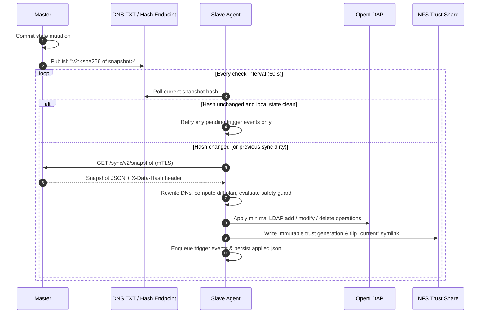

# Sync protocol

This page details how identity and certificate updates on the master propagate to every cluster: how snapshots are constructed and hashed, how slaves poll and reconcile changes, and how built-in safety guards prevent accidental mass deletions or lockouts.

**Packages:** `internal/replication` (master side) and `internal/slave` (cluster agent side).

## Overview



## The snapshot

`replication.Load` assembles a complete, self-contained snapshot from the master database containing everything a cluster requires:

| Field | Contents |
| --- | --- |
| `version` | Protocol schema version (`2`) |
| `baseDn` | Source LDAP base suffix configured on the master (`LDAP_BASE_DN`) |
| `users` | User ID, username, DN, display names, email, job number, mobile, POSIX UID/GID, home directory, login shell, postal address, department IDs, and `{CRYPT}$6$` LDAP password hash |
| `groups` | Group ID, name, DN, RDN attribute (`cn` or `ou`), object class (`posixGroup` or `groupOfUniqueNames`), GID, and parent group ID |
| `memberships` | `(groupId, userId)` membership pairs |
| `cas` | Enabled Certificate Authorities: SSH public keys, X.509 certificates, and signed X.509 CRLs |
| `sshRevocations` | Revoked SSH certificate serial numbers grouped by CA, used to compile OpenSSH KRLs |
| `userCertificates` | Active X.509 user certificates published to LDAP as `userCertificate;binary` |

**Consistent hashing.** The snapshot hash is the SHA-256 digest of its canonical JSON serialization (`Snapshot.Hash`). Because Cloudflare D1 does not support multi-query read transactions, `replication.Load` reads the full state twice back-to-back and verifies that the resulting hashes match—ensuring a snapshot captured concurrently with a write never contains a torn state.

## Publishing the hash

| Deployment Mode | How Slaves Discover the Current Hash |
| --- | --- |
| Cloudflare (SaaS) | `replication.DNSPublisher` updates a single DNS TXT record (`SYNC_DNS_NAME`) with `v2:<hash>` via the Cloudflare API whenever the digest differs from `v2_sync_state`. Slaves query DNS directly. |
| Containers | No DNS record is required. Slaves set `dns-name: ""` in `slave.yml` and poll `GET /sync/v2/snapshot-hash` over mutual TLS. |

The master publishes after every state mutation and during each periodic tick. When DNS polling is used, an idle cluster performs only one lightweight DNS lookup per minute and zero HTTPS requests to the master.

## What a slave does on each check

`slave.Replicator.Check` (`internal/slave/replicator.go`) executes the following state machine on each cycle:

1. **Check the target hash:** Reads the remote hash from DNS or `/sync/v2/snapshot-hash`. If it matches the locally applied hash and the previous sync completed cleanly, the slave skips straight to step 11 to flush any pending triggers.
2. **Download and verify the snapshot:** Calls `GET /sync/v2/snapshot` (bounded to 64 MiB), computes the SHA-256 of the body, and verifies that it matches the `X-Data-Hash` response header.
3. **Rewrite LDAP DNs:** If the cluster uses a different directory suffix than the master, rewrites `source-base-dn` → `local-base-dn` and optionally relocates groups under `local-group-dn`.
4. **Mark local state dirty:** Writes a dirty marker before touching LDAP or the filesystem so an interrupted sync is re-run in full on the next cycle.
5. **Baseline on first sync:** On a slave's very first run (when no `applied.json` exists), inspects the live OpenLDAP directory and trust files to synthesize a baseline of master-managed entries. Pre-existing local accounts and existing `userPassword` attributes (when the portal's `ldap_hash` is empty) are left untouched, avoiding spurious modifications or trigger storms during adoption.
6. **Evaluate safety guards:** `slave.Guard` aborts the sync before any write if the plan would:
   - Delete more than `limits.max-user-deletions` users in a single cycle (default: `5`);
   - Remove a currently trusted SSH CA, unless `limits.allow-ca-removal: true` is explicitly set.
7. **Reconcile OpenLDAP:** Applies the minimal set of LDAP adds, attribute modifications, password/certificate updates, membership updates (`memberUid` for `posixGroup`, `uniqueMember` for `groupOfUniqueNames`), and deletions. Unmanaged LDAP entries and the slave's own bind DN are never modified.
8. **Publish trust files:** Writes a new immutable trust generation into every configured `trust-dirs` path (see below).
9. **Enqueue trigger events:** Computes semantic diff events between the previous applied snapshot and the new snapshot and writes them to the persistent trigger queue.
10. **Persist state:** Atomically writes `applied.json` (containing the new snapshot and hash) and clears the dirty marker.
11. **Execute triggers:** Processes queued trigger events sequentially in FIFO order.

If any step fails, the dirty marker remains set, `/readyz` returns HTTP `503`, and the next check cycle retries cleanly.

### Offline rehearsal

Running `slave -plan` executes steps 2–6 offline against a database backup (or snapshot JSON) and a `slapcat` LDIF export without touching LDAP. It outputs a JSON report detailing every planned LDAP write, login-impacting operation (`loginOps`), and whether the safety guard passes (`"safe": true`). Always run `-plan` before connecting a slave to an existing cluster directory.

## Trust files

`slave.PublishTrust` writes an immutable, content-addressed **generation** directory named after the SHA-256 of its contents, then atomically flips the `current` symlink via `os.Rename`:

```text
<trust-dir>/
  current -> 3f9a…                        # atomic symlink to the active generation
  3f9a…/
    ca-bundle.pem                         # Trusted X.509 CA certificates
    crl/ca-<id>.pem                       # Signed X.509 CRL per CA
    ssh/trusted-user-ca-keys.pub          # Referenced by sshd TrustedUserCAKeys
    ssh/revoked.krl                       # Referenced by sshd RevokedKeys (compiled via ssh-keygen -k)
```

Because `sshd` reads paths through `current/…`, it never observes a partially written CA list or KRL. Rolling back to a prior trust state is a single `ln -sfn <old-gen> current` command.

## Triggers

The slave translates snapshot diffs into structured lifecycle events:

| Event Type | Trigger Condition |
| --- | --- |
| `user.created`, `user.updated`, `user.deleted` | A managed user account was added, modified, or removed |
| `group.created`, `group.updated`, `group.deleted` | A managed group was added, modified, or removed |
| `membership.added`, `membership.removed` | A user was added to or removed from a group |

Each trigger configured in `trigger-file` subscribes to a subset of events and invokes an external command, passing the event payload as JSON in place of `%DATA%`.

- **Persistent FIFO queue:** Each `(event, trigger)` pair is persisted as a file in the slave's state directory and executed strictly in order.
- **Head-of-line retry on failure:** If a trigger command fails, it remains at the head of the queue and blocks subsequent events until the underlying issue is resolved—guaranteeing that account creation and group membership changes never execute out of order. Trigger scripts must therefore be idempotent.
- **`currentUserOnly` filtering:** Optionally skips queued events for accounts that have already been deleted or renamed in the latest snapshot.

`deploy/triggers/slurm_trigger.py` is the standard production trigger: it provisions Slurm accounting associations (`sacctmgr`) and initializes NFSv4 home directories (`/home/<group>/<user>`).

## Status reports

Using the same mTLS client identity, the slave also pushes cluster telemetry back to the master:

| Telemetry Report | Endpoint | Master Storage |
| --- | --- | --- |
| Combined live status (nodes, resources, job queue) | `PUT /sync/v2/current-status` | Single JSON object per cluster in R2 / S3 |
| Node health summary | `POST /sync/v2/cluster-status` | Latest row per cluster in `v2_cluster_reports` |
| Partition capacity & queue summary | `POST /sync/v2/resource-status` | Latest row per cluster in `v2_cluster_reports` |
| Completed job notification | `POST /sync/v2/job-completions` | Dispatched via the Mail Hub and logged in `v2_job_notifications` |
| Per-job GPU utilization summary | `POST /sync/v2/resource-summaries` | Stored in `v2_resource_summaries` for 7-day analytics |

The master determines which cluster submitted a report strictly from the verified mTLS client-certificate fingerprint.

## Next steps

- [Cluster Agents](agents.md): slave CLI flags, configuration keys, and health endpoints.
- [Cryptography & Signing](cryptography.md): how mTLS certificates, SSH CAs, and KRLs are signed.
