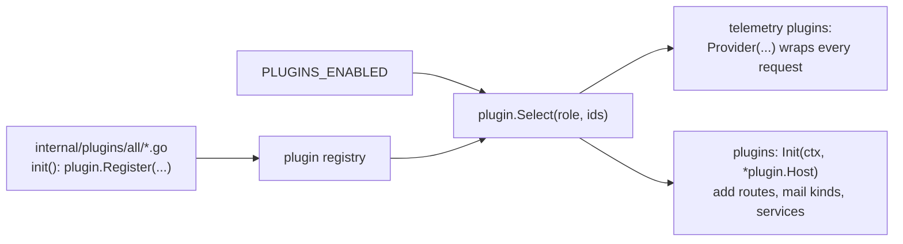

# Plugins

Everything in master beyond the core (accounts, sign-in, PKI, audit, mail hub) is a plugin. This
page explains how plugins are built, configured and wired. It also lists each built-in plugin
and shows how to add one.

## How the plugin system works

Plugins are **compiled in, then enabled by configuration**. Nothing is loaded at run time.



1. **Registration.** Each file in `internal/plugins/all/` imports one plugin package behind a
   build tag, such as `//go:build !no_oauth`, and registers it from `init()` with
   `plugin.Register`. To build a binary without a plugin, add its tag:
   `go build -tags no_oauth ./cmd/server`.
2. **Selection.** `PLUGINS_ENABLED` lists the plugin IDs to start, in order. `plugin.Select`
   fails at start if an ID is unknown, listed twice, or does not support the process role
   (`standalone`, `master`, `slave` or `gateway`).
3. **Configuration.** `PLUGINS_CONFIG` is JSON or YAML keyed by plugin ID. Each plugin decodes
   only its own section with `Host.Decode`, which rejects unknown keys. Secrets do not belong in
   it. A plugin reads them from environment variables named `PLUGIN_*` or `OAUTH_*`; only those
   prefixes reach Go on the Worker. A config value can also say `env:NAME` to point at one.
4. **Start.** Telemetry plugins start first, so their provider wraps every request. Then each
   plugin's `Init` runs with a `plugin.Host`. At shutdown, `Close` runs in reverse order.

### What a plugin receives

`plugin.Host` (`internal/plugin/plugin.go`) holds:

| Field | Use |
| --- | --- |
| `Router` | Add routes; each one declares its permission |
| `Store` | The database (D1 or SQLite) |
| `Identity`, `PKI`, `Tokens`, `Audit` | Core modules |
| `Mail` | Send mail through a named provider, or register a provider kind |
| `Secrets` | Seal and open secrets stored in the database |
| `Clusters` | Configured clusters and their client-certificate fingerprints |
| `Services` | Helpers that plugins offer each other, looked up per request |
| `Getenv`, `Decode`, `Origins`, `Telemetry`, `Role` | Environment, config, CORS origins, tracing, process role |

`Services` lets plugins cooperate without depending on start order. For example,
`current-status` provides a `Reader` of the latest R2 snapshot, and `diagnostics` looks it up
when it builds a report.

### Rules every plugin follows

- Every route declares `authz.Public()`, `Authenticated()`, `Peer()` or
  `Policy(object, action)`. Machine routes live under `/sync/`, browser routes under `/api/v2/`.
- Mark periodic machine reports with `Routine: true`. They are then audited only when they fail,
  which keeps the audit log and D1 writes small.
- Schema changes go in a new numbered file in `migrations/`. Never edit an applied one.
- Send mail only through `Host.Mail`, so every message is counted per provider and purpose.

## Built-in plugins

All built-in plugins run on `master` (and `standalone`).

| ID | Package | Adds | Settings (`PLUGINS_CONFIG`) | Secrets |
| --- | --- | --- | --- | --- |
| `oauth` | `plugins/oauth` | GitHub sign-in. Each connector has ordered rules (anyone, e-mail or username glob, GitHub organisation) that decide who may sign in and which groups a new account joins | `frontend-origin` | Client secret per connector: `env:OAUTH_…` or sealed in D1 |
| `cloudflare-access` | `plugins/cfaccess` | Sign-in with the Cloudflare Access identity (`/api/v2/auth/access/session`) | `team-domain`, `applications[]` (`origin`, `path-prefix`, `aud`) | – |
| `cluster-status` | `plugins/clusterstatus` | Node states pushed by slaves; the 集群状态 page | `stale-seconds` | – |
| `resource-status` | `plugins/resourcestatus` | Capacity, free resources and the job queue pushed by slaves | `stale-seconds` | – |
| `current-status` | `plugins/currentstatus` | One R2 object per cluster, written from slave reports and read by browsers through presigned links | `account-id` (R2) or `endpoint` (any S3), `public-endpoint`, `bucket`, `stale-seconds`, `link-seconds` | `PLUGIN_CURRENT_STATUS_R2_*` (write and read-only keys) |
| `resource-monitor` | `plugins/resourcemonitor` | Per-job GPU summaries and 7-day statistics, for everyone and per user | – | – |
| `job-notification` | `plugins/jobnotification` | Job-end e-mail: template, preview, test and sending | Stored in D1 (admin page) | – |
| `mail-pool` | `plugins/mailpool` | The "pool" provider kind: spreads mail over member providers by priority quotas, round-robin or weights, with failover | Stored in D1 (邮件服务 page) | – |
| `web-access` | `plugins/webaccess` | Gateway tickets, temporary SSH certificates, gateway registration and transfer e-mail | `ticket-key-id`, `gateways[]` (`fingerprint`, `cluster-id`, `gateway-id`, `instance-id`) | `PLUGIN_WEB_ACCESS_TICKET_KEY` |
| `diagnostics` | `plugins/diagnostics` | Read-only health of every dependency (database, slave reports, gateways, mail) | `stale-seconds` | – |
| `telemetry-otel` | `plugins/otel` | Traces and metrics as OTLP/HTTP JSON | `endpoint`, `headers`, `service-name`, `timeout`, `max-spans` | Header values as `env:NAME` |
| `telemetry-cloudflare` | `plugins/cftelemetry` | Traces and metrics as JSON log lines, with optional Analytics Engine points | `max-spans`, `analytics-engine` | – |

### Example

```sh
PLUGINS_ENABLED=oauth,cloudflare-access,current-status,cluster-status,resource-status,resource-monitor,job-notification,mail-pool,web-access,diagnostics
PLUGINS_CONFIG='{
  "cloudflare-access": {"team-domain": "example.cloudflareaccess.com",
                        "applications": [{"origin": "https://portal.example.org", "path-prefix": "/", "aud": "…"}]},
  "current-status":    {"account-id": "…", "bucket": "slurm-portal-status"},
  "web-access":        {"ticket-key-id": "web-access-v2",
                        "gateways": [{"fingerprint": "…", "cluster-id": "cluster1", "gateway-id": "cluster1-login", "instance-id": "cluster1-login"}]}
}'
```

A complete example is `deploy/worker/wrangler.example.toml`; the container master sets these in
`deploy/compose/master` (`.env` and `compose.yaml`).

## Slave-side collectors

Some features have two halves:

- **master** stores and serves the data (the plugins above);
- **the slave** collects it.

The slave halves are configured in the slave's YAML, not in `PLUGINS_ENABLED`:

| Slave section | Package | Collects |
| --- | --- | --- |
| `cluster-status` | `plugins/clusterstatus` (`Collector`) | `scontrol show nodes` |
| `resource-status` | `plugins/resourcestatus` (`Collector`) | `scontrol`, `squeue` |
| `current-status` | `plugins/currentstatus` (`Collector`) | Both of the above, as one object |
| `lifecycle-file` | `internal/lifecycle/*` | Job events from the lifecycle hook; job e-mail and GPU usage listeners |

## Writing a plugin

1. Create `internal/plugins/<name>/plugin.go`:

   ```go
   // Package hello adds a greeting endpoint.
   package hello

   const ID = "hello"

   // Config is this plugin's section of PLUGINS_CONFIG.
   type Config struct {
   	Greeting string `yaml:"greeting"`
   }

   // Plugin is the hello plugin.
   type Plugin struct{}

   func (Plugin) ID() string                  { return ID }
   func (Plugin) Roles() []plugin.Role        { return []plugin.Role{plugin.RoleStandalone, plugin.RoleMaster} }
   func (Plugin) Close(context.Context) error { return nil }

   func (Plugin) Init(_ context.Context, h *plugin.Host) error {
   	cfg := Config{Greeting: "hello"}
   	if err := h.Decode(&cfg); err != nil {
   		return err
   	}
   	h.Router.Handle(httpx.Route{Method: http.MethodGet, Path: "/api/v2/hello", Permission: authz.Authenticated(),
   		Handler: func(w http.ResponseWriter, r *http.Request) error {
   			httpx.WriteJSON(w, http.StatusOK, map[string]string{"greeting": cfg.Greeting})
   			return nil
   		}})
   	return nil
   }
   ```

2. Link it in `internal/plugins/all/hello.go`:

   ```go
   //go:build !no_hello

   package all

   import (
   	"github.com/TING-HiuYu/SlurmPortal/internal/plugin"
   	"github.com/TING-HiuYu/SlurmPortal/internal/plugins/hello"
   )

   func init() { plugin.Register(hello.Plugin{}) }
   ```

3. Add any tables as a new `migrations/00NN_hello.sql`.
4. If the plugin has an admin page, add it to `web/src/routes.jsx` with `meta: { plugin: "hello" }`.
   The menu then only shows it when the plugin is on and the user holds the permission.
5. Add tests next to the code. `internal/testutil` gives you a migrated in-memory database.
6. Add the plugin to the table above.
