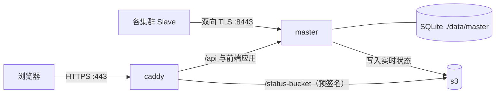

# 在容器中部署主服务

本指南使用 Docker Compose 在您自己的 Linux 主机上运行 Slurm Portal 主服务，无需注册 Cloudflare 账户。相关编排与脚本位于 [`deploy/compose/master`](https://github.com/TING-HiuYu/SlurmPortal/tree/main/deploy/compose/master)：

| 服务名 | 镜像 | 职责说明 |
| --- | --- | --- |
| `caddy` | `caddy:2.10.2-alpine` | 面向浏览器的 HTTPS 反向代理，自动签发与续期证书 |
| `master` | 基于 [`master.Dockerfile`](https://github.com/TING-HiuYu/SlurmPortal/blob/main/deploy/docker/master.Dockerfile) 构建 | 门户主服务：API、前端界面、保存在 `./data/master` 下的 SQLite 数据库 |
| `s3` | `rustfs/rustfs:1.0.3` | 保存集群实时状态的 S3 兼容对象存储 |
| `s3-setup` | `amazon/aws-cli` | 一次性初始化容器：创建状态存储桶 |



随后每个集群运行一个 slave 代理：[集群 Slave 代理](slaves.md)。

## 前置准备 {#what-you-need}

- 一台安装了 Docker Engine 与 Compose 插件并已克隆本仓库的 Linux 主机。
- 一个解析到该主机的域名（本指南以 `portal.example.org` 为例）：
  - 向用户开放 **80 与 443** 端口（Caddy 通过它们自动申请 Let's Encrypt 证书）；
  - 仅向各集群开放 **8443** 端口（供 slave 与网关凭客户端证书连接）。
- 如需先在单机上快速试用，可直接将主机名设为 `localhost`：Caddy 会使用内置本地 CA 签发证书（浏览器首次访问时信任即可）。

## 1. 初始化配置 {#1-set-up}

```sh
cd deploy/compose/master
./init.sh portal.example.org
```

`init.sh` 负责完成首次初始化，且绝不会覆盖已存在的密钥文件：

| 生成路径 | 内容说明 |
| --- | --- |
| `.env`（权限 `0600`） | 自动生成的会话密钥、`PKI_MASTER_KEY`、S3 密钥以及首次管理员密码（仅在终端打印一次） |
| `secrets/certs/` | 同步端口专用的私有 CA，以及主服务面向 `portal.example.org` 的服务端证书 |
| `data/` | 数据库、S3 对象与 Caddy 证书的持久化目录，属主为当前运行用户 |

容器以当前宿主机用户 UID（`.env` 中的 `PORTAL_UID`）运行，便于直接读取与备份数据文件。

如果集群 slave 将通过其他主机名或内网 IP 连接同步端口，请将它们一并传给 `init.sh`：
`./init.sh portal.example.org sync.example.org 192.0.2.10`。

## 2. 注册集群 {#2-register-the-clusters}

```sh
./add-cluster.sh cluster1 "Cluster 1"
./add-cluster.sh cluster2 "Cluster 2"
```

对每个集群，`add-cluster.sh` 会自动：

- 使用私有 CA 签发一张客户端证书；
- 将集群追加至 `.env` 的 `CLUSTERS`，并将其证书指纹加入 `SYNC_CLIENT_FINGERPRINTS`；
- 在 `secrets/clusters/<id>/` 下生成包含 `client.crt`、`client.key`、`master-ca.crt` 与 `README.txt`（内含该集群 `slave.yml` 配置片段）的证书包。

通过 `scp -r` 将生成的证书包复制到对应集群的控制节点，后续在[集群 Slave 代理](slaves.md)中使用。

## 3. 启动服务 {#3-start}

```sh
docker compose up -d
docker compose ps        # master reports (healthy) after a few seconds
```

首次启动会编译前端与后端程序，耗时数分钟。当状态显示为 `(healthy)` 后，打开 `https://portal.example.org`，使用 `init.sh` 打印的密码以 `admin` 身份登录。随后从 `.env` 中删除 `BOOTSTRAP_ADMIN_PASSWORD` 行并再次执行 `docker compose up -d`。

接着按[门户初始化配置](portal-setup.md)（或参阅[SaaS 指南第 5 步](master-saas.md#5-first-configuration-in-the-portal)）完成初始化设置：

1. 创建 SSH CA。
2. 创建主 POSIX 组。
3. 添加邮件服务商。

## 环境变量说明 {#settings}

所有配置保存在 `.env` 中，修改后执行 `docker compose up -d` 生效：

| 变量名 | 含义说明 |
| --- | --- |
| `PORTAL_HOST` | 用户访问的域名，用于申请 Caddy 证书及拼接状态链接 |
| `HTTP_PORT`、`HTTPS_PORT`、`SYNC_PORT` | 对外映射的端口（默认 `80`、`443`、`8443`） |
| `PORTAL_URL` | 当 `HTTPS_PORT` 不是 `443` 时浏览器使用的完整访问地址（如 `https://portal.example.org:4443`），确保预签名状态链接包含端口号 |
| `LDAP_BASE_DN`、`LDAP_USER_DN` | 写入各集群的默认 LDAP 目录结构 |
| `PLUGINS_ENABLED` | 启用的插件列表（见[插件系统](../dev/plugins.md)）；Cloudflare 专属插件在此不适用 |
| `CLUSTERS`、`SYNC_CLIENT_FINGERPRINTS` | 由 `add-cluster.sh` 自动维护 |
| `WEB_ACCESS_CONFIG`、`PLUGIN_WEB_ACCESS_TICKET_KEY` | Web 终端网关配置与票据签名密钥：详见[Web 访问网关](gateway.md)与[可选组件](optional.md#web-terminal-files-and-transfers) |
| `AUDIT_MAX_RECORDS` | 审计日志最大保留记录数 |

主服务同样支持[本地开发指南](../dev/development.md#settings)中列出的所有环境变量，直接追加至 `.env` 即可。

### 与 SaaS 主服务的区别 {#differences-from-the-saas-master}

- **快照哈希获取方式：** Slave 直接通过 `8443` 同步端口向主服务查询快照哈希，无需配置 DNS 记录（在 `slave.yml` 中设置 `dns-name: ""`）。
- **反向代理信任：** 主服务信任来自 Caddy 的 `X-Forwarded-Proto`（`BEHIND_TLS_PROXY`），其自身的 `8080` 端口不对外暴露，确保只有 Caddy 能够访问它。请勿将 `8080` 端口映射到宿主机公网。
- **状态存储同源代理：** 实时状态保存在 `s3` 容器中，浏览器通过 Caddy 在同源路径 `https://portal.example.org/slurm-portal-status/…` 下读取，无需配置跨域（CORS）规则。

## 数据备份 {#backups}

所有持久化文件均位于 `deploy/compose/master/` 目录下：

| 路径 | 内容与备份要求 |
| --- | --- |
| `.env` 与 `secrets/` | 核心密钥与同步 CA。**请务必妥善离线备份，其中 `PKI_MASTER_KEY` 加密了所有 CA 私钥。** |
| `data/master/` | SQLite 数据库（停止容器后复制，或在线执行 `sqlite3 data/master/portal.db ".backup copy.db"`） |
| `data/s3/` | 仅保存短期实时状态，丢失后会在下一轮上报时自动重建 |

## 升级版本 {#updating}

```sh
git pull
docker compose up -d --build
```

数据库迁移遵循纯增量原则，旧版本镜像仍可安全运行在升级后的数据库之上。
