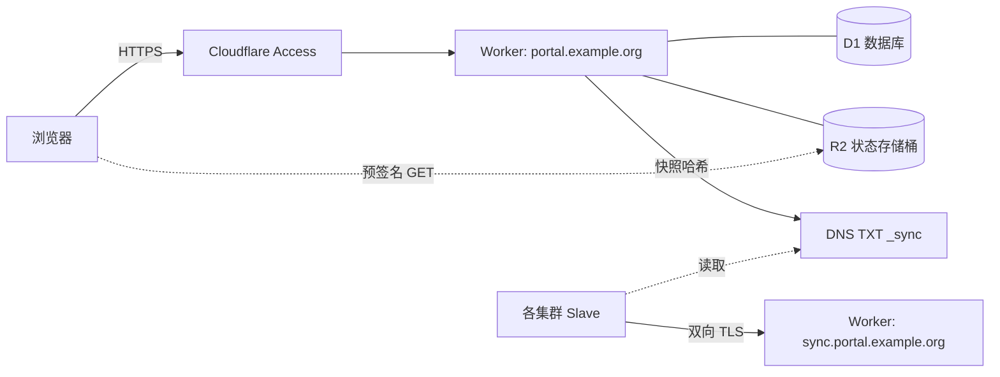

# 在 Cloudflare 上部署主服务（SaaS）

本指南将 Slurm Portal 主服务部署在 Cloudflare 无服务器平台上：由 Worker 提供 API 与前端静态资源，D1 作为关系型数据库，R2 保存集群实时状态，浏览器域名由 Cloudflare Access 保护，另设一个专供集群代理连接的双向 TLS 域名。全程无需维护任何服务器，空闲站点成本极低（见[运行成本](#cost)）。随后每个集群只需运行一个 slave 代理：[集群 Slave 代理](slaves.md)。

如果您更倾向于在自有服务器上部署，请改用[容器主服务](master-container.md)。



## 前置准备 {#what-you-need}

- 拥有一个已托管您域名（本指南以 `example.org` 为例）的 Cloudflare 账户，并开通 Workers、D1、R2、Zero Trust（Access）及客户端证书（mTLS）功能。
- 本地已安装 Go 1.26、Node.js 22 并可使用 `npx wrangler@4`（首次使用请执行 `npx wrangler@4 login` 登录）。
- 规划两个子域名：一个供用户浏览器访问（`portal.example.org`），另一个仅供集群代理同步使用（`sync.portal.example.org`）。

## 1. 创建 Cloudflare 云资源 {#1-create-the-cloudflare-resources}

在 `deploy/worker` 目录下创建 D1 数据库、R2 存储桶并配置跨域规则：

```sh
cd deploy/worker
cp wrangler.example.toml wrangler.toml           # local config; ignored by git

npx wrangler@4 d1 create slurm-portal            # copy the returned database_id into wrangler.toml
npx wrangler@4 r2 bucket create slurm-portal-status
# Browsers read status objects directly from R2: allow your portal origin.
sed -i 's#https://portal.example.org#https://portal.your-domain#' r2-cors.json
npx wrangler@4 r2 bucket cors set slurm-portal-status --file r2-cors.json
```

随后在 Cloudflare 控制台完成以下配置：

| 资源项 | 控制台位置 | 配置说明 |
| --- | --- | --- |
| R2 API 令牌 | **R2 → Manage API tokens** | 创建两个仅限该存储桶的令牌：一个具备 **Object Read & Write** 权限（供主服务写入状态），另一个具备 **Object Read only** 权限（供生成浏览器读取链接）。记录各自的 Access Key ID 与 Secret 供第 3 步使用。 |
| 快照 TXT 记录 | **DNS → Records** | 创建一条名为 `_sync.portal.example.org`、类型为 `TXT`、初始内容为 `v2:0` 的记录，并记下其 **Record ID**（可从 DNS API 或控制台日志获取）。 |
| DNS API 令牌 | **My Profile → API Tokens** | 创建仅具备当前域名 **Zone → DNS → Edit** 权限的令牌，供主服务更新 `_sync` TXT 记录。 |
| 客户端证书 | **SSL/TLS → Client Certificates** | 在 **Hosts** 下添加 `sync.portal.example.org`，为每个集群（及每个网关）各签发一张客户端证书并保存证书与私钥。 |
| WAF 防护规则 | **Security → WAF → Custom rules** | 拦截匹配 `(http.host eq "sync.portal.example.org" and not cf.tls_client_auth.cert_verified)` 的请求。 |
| Access 应用 | **Zero Trust → Access → Applications** | 创建 Self-hosted 应用，域名仅填 `portal.example.org`（切勿包含同步主机名），配置登录策略并记下 **AUD 标签**与团队域名。 |

计算每张客户端证书的 SHA-256 指纹（主服务凭该指纹识别集群）：

```sh
openssl x509 -in cluster1.crt -outform DER | openssl dgst -sha256 -r | cut -d' ' -f1
```

## 2. 填写 wrangler.toml {#2-fill-in-wranglertoml}

将 `wrangler.toml` 中的所有 `<占位符>` 替换为您的实际参数：

| 配置项 | 填写内容 |
| --- | --- |
| `routes` | 您的两个域名（浏览器域名与同步域名） |
| `LDAP_BASE_DN`、`LDAP_USER_DN` | 集群 OpenLDAP 使用的目录后缀与用户分支（若个别集群不同，可在 slave 端配置重写） |
| `SYNC_HOSTNAME`、`SYNC_DNS_NAME` | 同步主机名与 `_sync` TXT 记录名 |
| `CLOUDFLARE_ZONE_ID`、`CLOUDFLARE_RECORD_ID` | 域名概览页的 Zone ID 与第 1 步 TXT 记录的 Record ID |
| `SYNC_CLIENT_FINGERPRINTS` | 所有集群与网关客户端证书指纹，以英文逗号分隔 |
| `CLUSTERS` | 每个集群一个 `{"id","name","fingerprint"}` 对象，其中 `id` 必须与该集群 `slave.yml` 中的 `cluster-id` 一致 |
| `PLUGINS_CONFIG` | Access 团队域名与 AUD 标签、Cloudflare 账户 ID 及 R2 存储桶名称 |
| `[[d1_databases]]` | 第 1 步创建的 D1 `database_id` |

各插件详细配置说明见[插件系统](../dev/plugins.md)；不需要的插件可直接从 `PLUGINS_ENABLED` 中移除。

## 3. 写入敏感密钥（Secrets） {#3-set-the-secrets}

```sh
cd deploy/worker
put() { printf '%s' "$2" | npx wrangler@4 secret put "$1" -c wrangler.toml; }
put JWT_KEYS "k1:$(openssl rand -base64 32)"
put JWT_ACTIVE_KID k1
put PKI_MASTER_KEY "$(openssl rand -base64 32)"        # also store it somewhere safe offline
put BOOTSTRAP_ADMIN_USERNAME admin
put BOOTSTRAP_ADMIN_PASSWORD "$(openssl rand -base64 18)"   # note it; delete the secret after first sign-in
put CLOUDFLARE_API_TOKEN '<DNS edit token>'
put PLUGIN_WEB_ACCESS_TICKET_KEY "$(openssl rand -base64 32)"
put PLUGIN_CURRENT_STATUS_R2_ACCESS_KEY_ID '<read & write key id>'
put PLUGIN_CURRENT_STATUS_R2_SECRET_ACCESS_KEY '<read & write secret>'
put PLUGIN_CURRENT_STATUS_R2_READ_ACCESS_KEY_ID '<read-only key id>'
put PLUGIN_CURRENT_STATUS_R2_READ_SECRET_ACCESS_KEY '<read-only secret>'
```

:::warning
请务必在离线安全位置备份一份 `PKI_MASTER_KEY`。它用于加密封存 D1 中的所有 CA 私钥与服务商密钥；一旦丢失，已创建的 CA 将无法解密。
:::

## 4. 构建并发布 {#4-build-and-deploy}

```sh
cd deploy/worker
./build.sh                                     # Go → dist/main.wasm, and web/dist
npx wrangler@4 deploy -c wrangler.toml
```

在浏览器中打开 `https://portal.example.org`，通过 Cloudflare Access 验证后使用 `admin` 与初始密码登录门户。登录成功后，请立即删除初始密码密钥：`npx wrangler@4 secret delete BOOTSTRAP_ADMIN_PASSWORD -c wrangler.toml`。

如需通过命令行运行自动化冒烟测试（启用 Access 时需提供服务令牌）：

```sh
BASE=https://portal.example.org ADMIN_PASSWORD=… CF_ACCESS_CLIENT_ID=… CF_ACCESS_CLIENT_SECRET=… node smoke.mjs
```

## 5. 在门户中完成首次初始化配置 {#5-first-configuration-in-the-portal}

参阅[门户初始化配置](portal-setup.md)完成以下设置：

1. **证书颁发机构：** 创建或导入供各集群信任的 SSH CA。
2. **用户组：** 至少创建一个 POSIX 组，并设置默认主目录根路径与登录 Shell。
3. **邮件服务：** 添加 SMTP 或 REST 邮件服务商并发送测试邮件，随后按需开启作业结束、文件传输与密码验证码通知。
4. **OAuth 连接器（可选）：** 如需启用 GitHub 登录，创建回调地址为 `https://portal.example.org/api/v2/oauth/callback/github` 的 GitHub OAuth 应用，将其客户端密钥写入 Worker Secret（`OAUTH_GITHUB_CLIENT_SECRET`），并运行 `node connector-github.mjs`。

## 6. 接入集群 {#6-connect-the-clusters}

对每个集群，按[集群 Slave 代理](slaves.md)指南部署，并在 `slave.yml` 中使用以下参数：

| `slave.yml` 配置键 | 取值 |
| --- | --- |
| `master-url` | `https://sync.portal.example.org` |
| `dns-name` | `_sync.portal.example.org` |
| `tls.server-name` | `sync.portal.example.org` |
| `tls.ca-file` | 不设置（Cloudflare 边缘证书已由系统根证书信任） |
| `cluster-id` | 在 `CLUSTERS` 中为该集群配置的 `id` |
| `tls.cert-file`、`tls.key-file` | 为该集群签发的 Cloudflare 客户端证书与私钥 |

## 升级与备份 {#updating}

```sh
git pull
cd deploy/worker && ./build.sh && npx wrangler@4 deploy -c wrangler.toml
```

新版本首次启动时会自动执行纯增量数据库迁移，因此随时可通过 `npx wrangler@4 rollback` 安全回滚至上一版本。日常数据库导出备份命令为：`npx wrangler@4 d1 export slurm-portal --remote --output backup.sql`。

## 运行成本 {#cost}

Cloudflare 按 Worker 请求数与 CPU 时间、D1 读写行数及 R2 操作次数计费。系统从架构上将各项消耗保持在极低水平：

- 前端静态资源由 Workers Static Assets 直接提供，不计入 Worker 请求。
- Slave 通过 DNS 读取快照哈希，仅在哈希变化时才下载快照。
- 每个集群的实时状态合并为单个 R2 对象，由浏览器直接从 R2 读取。
- 审计日志受 `AUDIT_MAX_RECORDS` 容量限制，且正常的周期性机器上报不写审计表。
