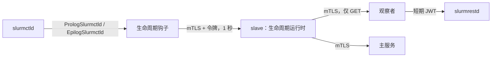

# 作业通知与可选组件

以下两项扩展功能需要在基础 slave 之外额外部署配套组件：

| 功能 | 涉及组件 | 运行节点 |
| --- | --- | --- |
| [作业完成邮件与 GPU 用量统计](#job-e-mail-and-gpu-usage) | 生命周期钩子、观察者、slave 生命周期运行时 | `ctl` |
| [Web 终端、文件管理与跨集群传输](#web-terminal-files-and-transfers) | Web 访问网关（前置 Nginx，亦可参阅[独立网关指南](gateway.md)） | `login` |

两项功能均使用在[集群 Slave 代理指南](slaves.md#1-build-the-programs)中编译好的二进制文件（位于 `ctl` 的 `/root/SlurmPortal/bin` 下）。请在同一个 `root` Shell 中依次执行各小节命令，以便复用前文定义的变量 `C` 与函数 `fp`。

## 作业完成邮件与 GPU 用量统计 {#job-e-mail-and-gpu-usage}

当作业结束时，Slurm Portal 可以向作业所有者发送汇总邮件，并按作业统计 GPU 使用率。为了确保 Slurm 调度器绝不因等待门户而阻塞，这项工作由 `ctl` 上的三个组件协同完成：



| 组件 | 运行用户 | 持有的凭据 |
| --- | --- | --- |
| 生命周期钩子（Hook） | `slurm`（由 `slurmctld` 启动） | 钩子客户端证书及生命周期运行时的写入令牌 |
| 生命周期运行时 | `slurm-portal`（内置于 slave 进程） | 回调服务端证书，以及访问观察者的客户端证书 |
| 观察者（Observer） | `slurm` | Slurm JWT 密钥（唯一与 `slurmrestd` 通信的组件） |

前置条件：已按前文部署 [slurmrestd](slurmrestd.md) 且运行 Slurm 26.05+。

### 1. 安装二进制与脚本 {#1-install-the-programs}

```sh
cd /root/SlurmPortal
install -m 0755 bin/slurm-lifecycle-hook bin/slurm-notify-observer /usr/local/libexec/go-ldap-admin/
install -m 0755 deploy/lifecycle/prolog-slurmctld deploy/lifecycle/epilog-slurmctld /usr/local/libexec/go-ldap-admin/
```

### 2. 签发内部 mTLS 证书 {#2-certificates}

三个组件之间通过一个小型私有 CA 进行双向 TLS 认证（运行时与观察者同在 `ctl` 上监听，共用一张服务端证书）：

```sh
sh deploy/certs/issue.sh init-ca /root/lifecycle-certs
sh deploy/certs/issue.sh master /root/lifecycle-certs 127.0.0.1 ctl
sh deploy/certs/issue.sh client /root/lifecycle-certs hook
sh deploy/certs/issue.sh client /root/lifecycle-certs slave
```

### 3. 配置并启动观察者（Observer） {#3-the-observer}

```sh
C=/root/lifecycle-certs
fp() { openssl x509 -in "$1" -outform DER | sha256sum | cut -d' ' -f1; }

install -d -m 0700 -o slurm -g slurm /etc/go-ldap-admin/observer
install -m 0600 -o slurm -g slurm $C/ca.crt $C/master.crt $C/master.key /etc/go-ldap-admin/observer/
cat > /etc/go-ldap-admin/job-notify-observer.yaml <<YAML
listen: 127.0.0.1:6830
server-tls:
  cert-file: /etc/go-ldap-admin/observer/master.crt
  key-file: /etc/go-ldap-admin/observer/master.key
  ca-file: /etc/go-ldap-admin/observer/ca.crt
  client-fingerprints: [$(fp $C/clients/slave.crt)]
upstream-url: http://127.0.0.1:6820
jwt-key-file: /var/lib/slurm/slurmctld/jwt_hs256.key
YAML
chown slurm:slurm /etc/go-ldap-admin/job-notify-observer.yaml
chmod 0600 /etc/go-ldap-admin/job-notify-observer.yaml
cp deploy/lifecycle/slurm-notify-observer.service /etc/systemd/system/
systemctl daemon-reload
systemctl enable --now slurm-notify-observer
```

观察者仅响应来自 slave 客户端证书的单作业只读 `GET` 请求，并为每次请求签发一个短期 Slurm JWT 令牌。

### 4. 启用 Slave 生命周期运行时 {#4-the-slaves-lifecycle-runtime}

```sh
install -d -m 0700 -o slurm-portal -g slurm-portal /etc/slurm-portal/lifecycle
install -m 0600 -o slurm-portal -g slurm-portal $C/ca.crt $C/master.crt $C/master.key \
  $C/clients/slave.crt $C/clients/slave.key /etc/slurm-portal/lifecycle/
cat > /etc/slurm-portal/lifecycle.yaml <<YAML
cluster-id: cluster1
listen: 127.0.0.1:6831
callback-tls:
  cert-file: /etc/slurm-portal/lifecycle/master.crt
  key-file: /etc/slurm-portal/lifecycle/master.key
  ca-file: /etc/slurm-portal/lifecycle/ca.crt
  client-fingerprints: [$(fp $C/clients/hook.crt)]
slurm-url: https://127.0.0.1:6830
slurm-tls:
  cert-file: /etc/slurm-portal/lifecycle/slave.crt
  key-file: /etc/slurm-portal/lifecycle/slave.key
  ca-file: /etc/slurm-portal/lifecycle/ca.crt
  server-name: ctl
tokens-file: /var/lib/slurm-portal/lifecycle-tokens.json
plugins:
  job-email: true
  resources:
    enabled: true
YAML
chown slurm-portal:slurm-portal /etc/slurm-portal/lifecycle.yaml
chmod 0600 /etc/slurm-portal/lifecycle.yaml
echo "lifecycle-file: /etc/slurm-portal/lifecycle.yaml" >> /etc/slurm-portal/slave.yml
systemctl restart slurm-portal-slave
```

首次启动时，生命周期运行时会自动创建包含随机写入令牌的 `lifecycle-tokens.json`。

对于包含 GPU 节点的集群，请同时在 `lifecycle.yaml` 中配置 `gres-indices-are-nvml` 或 `gpu-uuid-mapping`（详见[集群代理配置参考](../dev/agents.md#runtime-configuration-lifecycle-file-in-the-slave)），以确保 Slurm GRES 序号准确对应物理 NVML GPU。

### 5. 配置生命周期钩子（Hook） {#5-the-hook}

```sh
install -d -m 0700 -o slurm -g slurm /etc/go-ldap-admin/hook
install -m 0600 -o slurm -g slurm $C/ca.crt $C/clients/hook.crt $C/clients/hook.key /etc/go-ldap-admin/hook/
python3 -c 'import json,sys; print(json.load(open(sys.argv[1]))["read_write"], end="")' \
  /var/lib/slurm-portal/lifecycle-tokens.json > /etc/go-ldap-admin/hook/token
chown slurm:slurm /etc/go-ldap-admin/hook/token
chmod 0600 /etc/go-ldap-admin/hook/token
cat > /etc/go-ldap-admin/lifecycle-hook.yaml <<YAML
url: https://127.0.0.1:6831
tls:
  cert-file: /etc/go-ldap-admin/hook/hook.crt
  key-file: /etc/go-ldap-admin/hook/hook.key
  ca-file: /etc/go-ldap-admin/hook/ca.crt
  server-name: ctl
write-token-file: /etc/go-ldap-admin/hook/token
YAML
chown slurm:slurm /etc/go-ldap-admin/lifecycle-hook.yaml
chmod 0600 /etc/go-ldap-admin/lifecycle-hook.yaml
```

将 Prolog 与 Epilog 钩子写入 `/etc/slurm/slurm.conf`，分发至所有节点并重载配置：

```ini
PrologSlurmctld=/usr/local/libexec/go-ldap-admin/prolog-slurmctld
EpilogSlurmctld=/usr/local/libexec/go-ldap-admin/epilog-slurmctld
```

```sh
for host in node1 login; do scp /etc/slurm/slurm.conf root@$host:/etc/slurm/; done
scontrol reconfigure
```

钩子最多等待 1 秒且始终以状态码 `0` 退出：即使配置缺失或 slave 停止运行，作业调度也不会受到任何影响。（如果您的集群已有自定义的 `PrologSlurmctld` 脚本，只需在原脚本末尾调用该钩子即可。）

### 6. 在门户中开启通知 {#6-in-the-portal}

1. **邮件服务：** 添加 SMTP 或 REST 邮件服务商并发送测试邮件。
2. **作业通知：** 开启通知开关，选择邮件服务商并按需调整邮件模板。

运行时长超过 **60 秒**的作业在结束时会自动触发通知邮件。

### 验证是否生效 {#check-it-works}

以门户用户身份提交一个运行超过 1 分钟的作业，或在作业结束后直接模拟触发钩子：

```sh
sudo -u slurm SLURM_JOB_ID=<id> SLURM_JOB_SLUID=<sluid> \
  /usr/local/libexec/go-ldap-admin/slurm-lifecycle-hook --event ending   # prints nothing when accepted
```

门户的 **近期资源汇总（Recent resource summary）** 页面会列出该作业，用户会收到通知邮件，同时主服务的审计日志中会记录来自该集群的 `POST /sync/v2/job-completions`。

| 常见问题 | 排查方法 |
| --- | --- |
| `lifecycle event was not accepted` | 运行时未启动（`slave.yml` 缺少 `lifecycle-file`）、令牌文件未更新，或钩子证书指纹不在 `client-fingerprints` 中 |
| `lifecycle hook configuration unavailable` | `/etc/go-ldap-admin/lifecycle-hook.yaml` 缺失，或属主不是 `slurm` / 权限不是 `0600` |
| 无资源汇总且未发邮件 | 检查 `journalctl -u slurm-notify-observer`，确认 `slurmrestd` 正常响应 `v0.0.45`，且作业运行时长超过 60 秒 |

## Web 终端、文件管理与跨集群传输 {#web-terminal-files-and-transfers}

Web 访问网关运行在登录节点上，让用户在浏览器中使用终端、SFTP 文件浏览器与跨集群 `rsync` 传输，所有操作均以用户本人身份通过 SSH 完成（完整独立指南亦可参阅[Web 访问网关](gateway.md)）。

### 1. 在主服务上授权网关 {#1-on-the-master}

网关需要一张主服务信任的客户端证书，主服务则需要一把用于签发票据的私钥。

**容器主服务**（在 `deploy/compose/master` 目录下）：

```sh
sh ../../certs/issue.sh client secrets/certs cluster1-login
FP=$(openssl x509 -in secrets/certs/clients/cluster1-login.crt -outform DER | sha256sum | cut -d' ' -f1)
cat >> .env <<ENV
PLUGIN_WEB_ACCESS_TICKET_KEY=$(openssl rand -base64 32)
WEB_ACCESS_CONFIG={"ticket-key-id":"web-access-1","gateways":[{"fingerprint":"$FP","cluster-id":"cluster1","gateway-id":"cluster1-login","instance-id":"cluster1-login"}]}
ENV
sed -i "s/^PLUGINS_ENABLED=.*/&,web-access/" .env
sed -i "s/^SYNC_CLIENT_FINGERPRINTS=.*/&,$FP/" .env
docker compose up -d
```

将 `secrets/certs/clients/cluster1-login.crt`、`.key` 与 `secrets/certs/ca.crt` 复制到 `login` 节点。

**Serverless 主服务：** 在 Cloudflare 控制台为网关签发一张客户端证书，将 32 字节随机数的 Base64 写入 Worker Secret `PLUGIN_WEB_ACCESS_TICKET_KEY`，在 `PLUGINS_ENABLED` 中加入 `web-access`，并在 `PLUGINS_CONFIG` 中添加带该证书指纹的 `web-access` 配置块。

随后以管理员身份登录门户，访问 `GET /api/v2/web-access/keys` 读取密钥 `web-access-1` 的公钥参数 `x`。

### 2. 在登录节点上部署网关 {#2-on-the-login-node}

```sh
useradd --system --user-group --no-create-home --shell /usr/sbin/nologin web-access-gateway
install -d -m 0755 /usr/local/libexec/go-ldap-admin
install -m 0755 gateway /usr/local/libexec/go-ldap-admin/web-access-gateway   # built on ctl
# container master only: trust its private CA for the sync port
cp ca.crt /usr/local/share/ca-certificates/slurm-portal-sync-ca.crt && update-ca-certificates

D=/etc/go-ldap-admin/web-access-gateway
install -d -m 0750 -o root -g web-access-gateway $D
install -m 0640 -o root -g web-access-gateway cluster1-login.crt $D/master-client.crt.pem
install -m 0600 -o web-access-gateway -g web-access-gateway cluster1-login.key $D/master-client.key.pem
```

网关在本地回环地址上启用 TLS 监听，前置 Nginx 负责提供公网证书。将本地上游 TLS 证书与私钥放置在 `$D/https.crt.pem` 与 `$D/https.key.pem`（属主为 `web-access-gateway`，私钥权限 `0600`），然后编写 `/etc/go-ldap-admin/web-access-gateway.yaml`：

```yaml title="/etc/go-ldap-admin/web-access-gateway.yaml"
gateway_id: cluster1-login
instance_id: cluster1-login
cluster_id: cluster1
listen: "127.0.0.1:19934"
tls_certificate: /etc/go-ldap-admin/web-access-gateway/https.crt.pem
tls_key: /etc/go-ldap-admin/web-access-gateway/https.key.pem
callback_listen: "127.0.0.1:19935"
allowed_origins:
  - https://portal.example.org
ticket_public_keys:
  web-access-1: <the x value from /api/v2/web-access/keys>
user_ca_keys_file: /srv/slurm-portal-trust/current/ssh/trusted-user-ca-keys.pub
file_root: /home
clusters:
  - id: cluster1
    ssh_address: "127.0.0.1:22"
state_directory: /var/lib/go-ldap-admin-web-access-gateway
master_origin: https://portal.example.org:8443
master_client_certificate: /etc/go-ldap-admin/web-access-gateway/master-client.crt.pem
master_client_key: /etc/go-ldap-admin/web-access-gateway/master-client.key.pem
```

（对于 Serverless 主服务，`master_origin` 填 `https://sync.portal.example.org`。）

```sh
chown web-access-gateway:web-access-gateway /etc/go-ldap-admin/web-access-gateway.yaml
chmod 0600 /etc/go-ldap-admin/web-access-gateway.yaml
cp /root/SlurmPortal/deploy/gateway/web-access-gateway.service /etc/systemd/system/
systemctl daemon-reload
systemctl enable --now web-access-gateway
curl -sk https://127.0.0.1:19934/readyz        # {"code":0,"data":{"status":"ready"}} once registered
```

**配置 Nginx：** 用户浏览器直接访问 `https://login.example.org`。请参考 [`nginx.conf.example`](https://github.com/TING-HiuYu/SlurmPortal/blob/main/deploy/gateway/nginx.conf.example) 配置受信任的 HTTPS 证书并将请求反向代理至 `https://127.0.0.1:19934`（开启 WebSocket 升级），同时务必将门户域名加入 Nginx 的 CORS 白名单映射。

### 3. 在门户中启用集群 Web 访问 {#3-in-the-portal}

进入 **集群 Web 访问（Cluster web access）**，为 `cluster1` 填写网关地址（`https://login.example.org`）、SSH CA、目标 SSH 地址与端口（`127.0.0.1`、`22`）及允许访问的角色。保存后页面会显示网关已注册并将状态标记为 **就绪（Ready）**，用户工作台中随即出现 **Web 终端** 与 **文件管理**。

### 验证是否生效 {#check-it-works-1}

以门户用户身份登录，打开 **Web 终端** 并选择 `cluster1`，即可在用户主目录下打开交互式 Shell；打开 **文件管理** 即可浏览主目录文件。

| 常见问题 | 排查方法 |
| --- | --- |
| `/readyz` 返回 `registration_unavailable` | 网关无法连接 `master_origin`，或主服务未配置该网关的证书指纹 |
| `config_mismatch` | 网关配置文件中的 ID 与主服务的 `WEB_ACCESS_CONFIG` / `PLUGINS_CONFIG` 不一致 |
| 浏览器提示 `"Failed to fetch"` | Nginx CORS 映射缺少门户域名，或网关 HTTPS 证书不受浏览器信任 |
| `credential_invalid` / `ticket_invalid` | 门户中选择的 SSH CA 不在 `user_ca_keys_file` 中，或票据密钥 ID 不匹配 |

## 下一步 {#next}

继续阅读[端到端验证](verify.md)。
