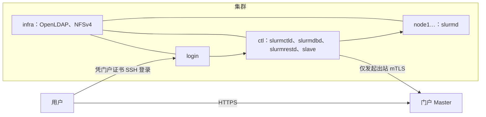

# 站点规划

本指南将在 **Ubuntu 24.04 LTS** 上搭建一套完整的生产级 Slurm 集群并接入 Slurm Portal。如果您已有现成的 Slurm 集群，可以直接跳至缺失的环节——大多数存量集群只需从 [OpenLDAP](openldap.md) 与 [SSSD 与 SSH](sssd-ssh.md) 开始。

## 节点角色规划 {#the-hosts}

| 角色 | 本指南使用的主机名 | 运行的服务 |
| --- | --- | --- |
| **控制节点（Controller）** | `ctl` | `munge`、`slurmctld`、`slurmdbd` + MariaDB、`slurmrestd`、Slurm Portal **slave** 代理及生命周期观察者 |
| **基础设施节点（Infrastructure）** | `infra` | OpenLDAP（`slapd`）以及导出 `/home` 与信任目录的 NFSv4 服务端 |
| **计算节点（Compute Nodes）** | `node1`、`node2`、… | `munge`、`slurmd` 与 `sssd` |
| **登录节点（Login Node）** | `login` | `munge`、Slurm 客户端工具、`sssd`、面向用户的 `sshd` 及可选的 **Web 访问网关** |

在小型站点中，`infra` 可以合并到控制节点 `ctl` 上运行；但如果您使用标准触发器脚本自动创建用户主目录，运行 slave 的主机上的 `/home` 必须是一个 NFSv4 挂载点。



## 准备工作 {#before-you-start}

- **操作系统：** 所有主机均安装 **Ubuntu 24.04 LTS** 并完成系统更新（`sudo apt update && sudo apt full-upgrade -y`）。
- **主机名解析：** 每台主机均能通过内部 DNS 或一致的 `/etc/hosts` 解析集群内所有主机的短名称与完整域名（`*.example.org`）：

  ```text title="/etc/hosts"
  @@
  ```

- **时间同步：** 所有节点时钟保持同步（执行 `timedatectl` 显示 `System clock synchronized: yes`）；Munge 凭据与短期证书均依赖准确的时钟。
- **管理权限：** 从 `ctl` 可通过 `root` SSH 免密登录其余节点，以便分发密钥、软件包与配置文件。本指南中的命令默认在 `root` Shell（`sudo -i`）下执行。
- **示例参数替换：** 本指南使用集群 ID `cluster1`、LDAP 后缀 `dc=example,dc=org` 与门户域名 `portal.example.org`，实际部署时请统一替换为您自己的名称。

## 网络端口矩阵 {#network}

| 源端 | 目标端 | 端口 | 用途 |
| --- | --- | --- | --- |
| 所有集群节点 | `ctl` | `6817/tcp` | `slurmctld` 控制节点通信 |
| `ctl` 与计算节点 | 计算节点 | `6818/tcp` | `slurmd` 计算节点守护进程 |
| `ctl` | `ctl`（本地回环） | `6819/tcp` | `slurmdbd` 记账守护进程 |
| 所有集群节点 | `infra` | `389/tcp`（StartTLS）/ `636/tcp` | OpenLDAP 目录查询 |
| 所有集群节点 | `infra` | `2049/tcp` | NFSv4 共享存储挂载 |
| 终端用户 | `login` | `22/tcp`（可选 `443/tcp`） | 用户 SSH 登录（及可选的 Web 访问网关） |
| `ctl`、`login` | 主服务同步地址 | `443/tcp` 或 `8443/tcp` | Slave 与网关向主服务发起的出站 mTLS 连接 |

门户主服务从不主动向集群发起连接。除面向外部用户的登录节点外，集群其余节点均无需暴露在公网上。

## UID 与 GID 号段规划 {#ids}

| 号段范围 | 用途说明 |
| --- | --- |
| `< 1000` | 系统服务账户（`munge`、`slurm-portal` = `990`；此外 `slurm` = `64030`） |
| `1000`–`9999` | 本地操作系统管理员账户 |
| `≥ 10000` | 由 Slurm Portal 统一创建与管理的 POSIX 用户与用户组 |

门户从 `10000` 起单调递增分配 UID 与 GID，且永不复用已分配的编号。标准触发器会自动忽略低于 `10000` 的账户，确保集群本地系统账户安全无虞。

## 选择主服务运行方式 {#choose-a-master}

集群侧配置对两种主服务完全通用，但由于 slave 的连接参数取决于主服务类型，请在此先行确定：

| 对比维度 | [Serverless（Cloudflare）](master-saas.md) | [容器自托管（Docker Compose）](master-container.md) |
| --- | --- | --- |
| 运行位置 | Cloudflare Workers、D1、R2 与 Access | 任意安装了 Docker 的 Linux 主机 |
| 运维工作 | 管理 Cloudflare 账户设置 | 维护宿主机、容器升级与本地磁盘备份 |
| Slave 感知变更方式 | 查询 DNS TXT 记录 | 每分钟向主服务发起一次 HTTPS 请求 |

## 部署步骤顺序 {#the-order}

1. [Munge](munge.md)：集群共享认证密钥。
2. [Slurm](slurm.md)：控制节点与计算节点服务。
3. [记账服务](accounting.md)：MariaDB 与 `slurmdbd`。
4. [slurmrestd](slurmrestd.md)：带 JWT 认证的 REST API。
5. [OpenLDAP](openldap.md)：供 slave 写入的目录服务。
6. [SSSD 与 SSH](sssd-ssh.md)：节点上的 LDAP 身份解析与证书登录配置。
7. [共享主目录与信任文件](shared-home.md)：承载 `/home` 与信任文件的 NFSv4 共享存储。
8. 部署主服务：[Serverless](master-saas.md) 或 [容器](master-container.md)。
9. [门户初始化配置](portal-setup.md)：创建 SSH CA、POSIX 组预设、邮件服务与 OAuth。
10. 在 `ctl` 上部署 [集群 Slave 代理](slaves.md)。
11. [作业通知与 GPU 监控](optional.md)及[Web 访问网关](gateway.md)。
12. [端到端验证](verify.md)。
