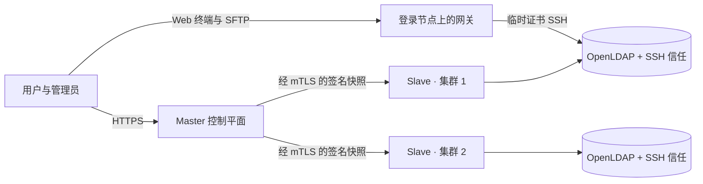

# 开发 Wiki

本 Wiki 详细阐述 Slurm Portal 的内部架构与工程实现：各个可执行程序的职责、HTTP 请求经过的架构分层、集群增量同步协议、关系型数据模型以及密码学信任体系。在修改跨越组件边界的代码之前，建议先阅读相关章节。如果您的目标是部署与运维集群，请直接参阅[部署 Wiki](../deploy/README.md)。

## Slurm Portal 是什么 {#what-slurm-portal-is}

Slurm Portal 是面向多集群 Slurm HPC 环境的统一身份认证、访问控制与运维控制平面，作为以下核心数据的唯一真实数据源（Single Source of Truth）：

- **POSIX 账号、用户组与树形组织架构**（具备跨集群全局一致的 UID 与 GID）；
- **基于角色的访问控制（RBAC）**（内置基于角色等级的防提权约束）；
- **单向密码哈希**（门户登录使用 Argon2id，OpenLDAP 使用 SHA-512 crypt）；
- **SSH 与 X.509 证书颁发机构（CA）**、用户证书及吊销列表。

中心的 **master（主服务）** 负责维护上述状态；部署在各集群上的轻量级 **slave（从属代理）** 通过双向 TLS（mTLS）拉取签名快照，并将其增量同步至集群本地的 OpenLDAP 目录、SSH 信任文件及 Slurm 记账关联。由于每个集群均保有完整的本地目录与信任文件，即便与主服务暂时失联，各集群依然可以独立完成用户登录与作业调度。

在此核心之上，编译期内置的插件系统进一步提供了 GitHub OAuth 与 Cloudflare Access 登录、作业完成与文件传输邮件通知、集群与队列实时监控、近 7 天 GPU 资源统计，以及由登录节点 **Web 访问网关**驱动的浏览器终端与文件管理器。



## 阅读指南 {#reading-guide}

| 如果您希望…… | 推荐起始页面 |
| --- | --- |
| 了解系统全景结构与双运行时拓扑 | [系统架构与基础设施](architecture.md) |
| 追踪一次 HTTP 请求从边缘网关到数据库的完整流程 | [请求生命周期](request-lifecycle.md) |
| 理解身份与证书变更如何安全同步至各集群 | [同步协议](sync-protocol.md) |
| 深入了解某一架构分层 | [HTTP 与边缘层](layer-http.md) · [身份与访问层](layer-access.md) · [领域模块层](layer-domain.md) · [插件系统](plugins.md) · [数据模型](data-model.md) · [存储层](layer-storage.md) |
| 了解或修改 slave、网关或 Slurm 钩子 | [集群代理程序](agents.md) |
| 了解或修改 React 前端单页应用 | [Web 前端应用](web-app.md) |
| 审阅威胁模型、密钥体系与签名算法 | [安全模型](security.md) · [密码学与签名](cryptography.md) |
| 查阅 HTTP 接口定义 | [API 参考](api-reference.md) |
| 快速定位代码文件 | [项目目录结构](project-layout.md) |
| 在本地构建、运行与测试代码 | [本地开发指南](development.md) |

## 核心术语表 {#glossary}

| 术语 | 定义 |
| --- | --- |
| **Master（主服务）** | 中心控制平面，承载 HTTP API、React 前端界面与主数据库。可作为 Cloudflare Worker（`cmd/worker`）或原生容器（`cmd/server`）运行。 |
| **Slave（集群代理）** | 部署在每个集群上的守护进程（`cmd/slave`），负责将主服务快照增量应用至本地 OpenLDAP、写出 SSH 信任世代、运行触发器并上报集群监控数据。 |
| **Gateway（Web 访问网关）** | 部署在登录节点上的守护进程（`cmd/gateway`），以当前登录用户的身份通过 SSH 提供浏览器终端、SFTP 文件管理与跨集群 `rsync` 传输。 |
| **Lifecycle Hook（生命周期钩子）** | 由 Slurm `PrologSlurmctld` / `EpilogSlurmctld` 调用的轻量级失败放行程序（`cmd/slurm-lifecycle-hook`），在作业启动或结束时通知 slave。 |
| **Observer（通知观察者）** | 运行在 Slurm 控制节点上的只读 mTLS 代理（`cmd/slurm-notify-observer`），使用短期 JWT 查询本地 `slurmrestd`，从而避免让 slave 持有高权限的 Slurm JWT 密钥。 |
| **Snapshot（快照）** | 包含所有用户、用户组、成员关系、受信 CA、吊销记录与用户证书的自包含 JSON 文档，以其 SHA-256 摘要作为**快照哈希**。 |
| **Trust Generation（信任世代）** | 由 slave 写出的按内容哈希命名的不可变信任目录；`current` 符号链接通过原子替换始终指向最新世代。 |
| **Trigger（触发器）** | 当用户或组成员关系发生变更时由 slave 按序执行的幂等外部命令（例如调用 `slurm_trigger.py` 创建 Slurm 记账账户与 NFSv4 主目录）。 |
| **Principal（主体）** | 绑定在请求上下文中的已认证调用方身份——既可以是携带实时角色列表的用户，也可以是通过客户端证书指纹认证的机器节点。 |
| **Permission（路由权限）** | 每条 HTTP 路由必须显式声明的访问级别：`Public`（公开）、`Authenticated`（已登录）、`Peer`（机器 mTLS）或 `Policy(object, action)`（策略授权）。 |
| **Rank（角色等级）** | 角色的数值型优先级（`sort`，`1`–`999`，数值越小等级越高，`1` 为超级管理员）。任何调用方均不得修改等级高于或等于自己的用户与角色。 |
| **Plugin（插件）** | 编译期链入二进制、通过配置项 `PLUGINS_ENABLED` 按需启用的功能模块。 |
| **Sync Host（同步端点）** | 专门提供 `/sync/*` 机器接口并强制校验客户端证书的独立主机名（或独立 mTLS 端口）。 |
| **Mail Hub（邮件中枢）** | 核心邮件发送服务（`internal/mail`），插件按服务商名称通过它调用 SMTP、REST 或邮件池发送模板邮件。 |

## 仓库目录速览 {#repository-at-a-glance}

```text
cmd/          Entrypoints: worker (Wasm master), server (native master), slave, gateway, hook, observer, and CLI tools
internal/     Go packages organized by architectural layer
migrations/   Embedded, additive-only SQLite/D1 schema migrations applied in order at startup
web/          React 19 + Ant Design 6 single-page application
deploy/       Docker Compose stacks, Dockerfiles, Cloudflare Worker shell, and cluster helper scripts
docs/         Markdown source for the Developer and Deployment Wikis
site/         Docusaurus documentation website and Simplified Chinese translations
```

各目录与 Go 包的详细说明请参阅[项目目录结构](project-layout.md)。
