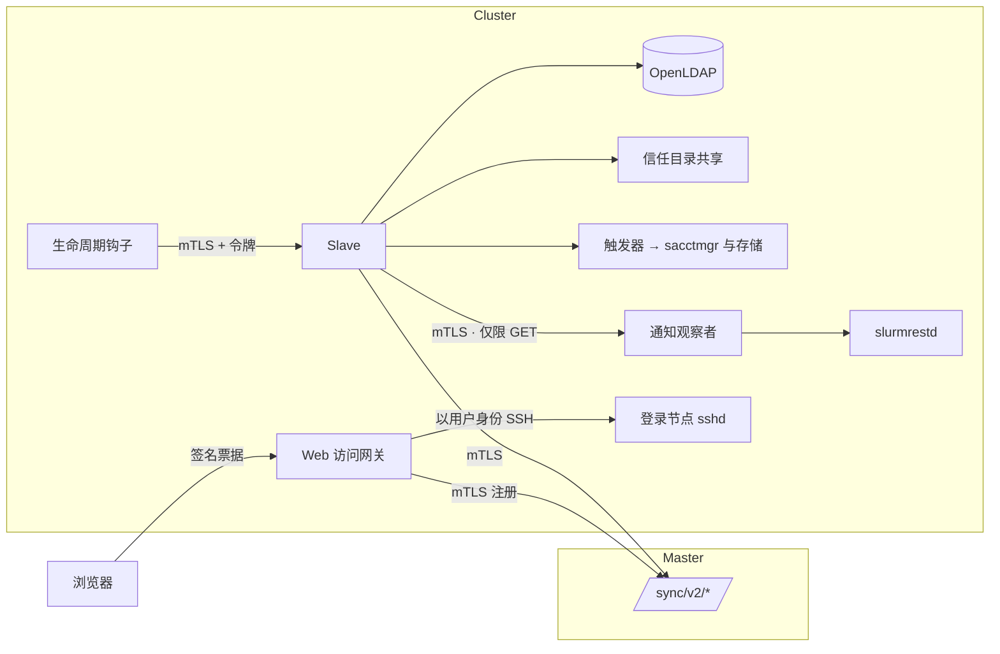
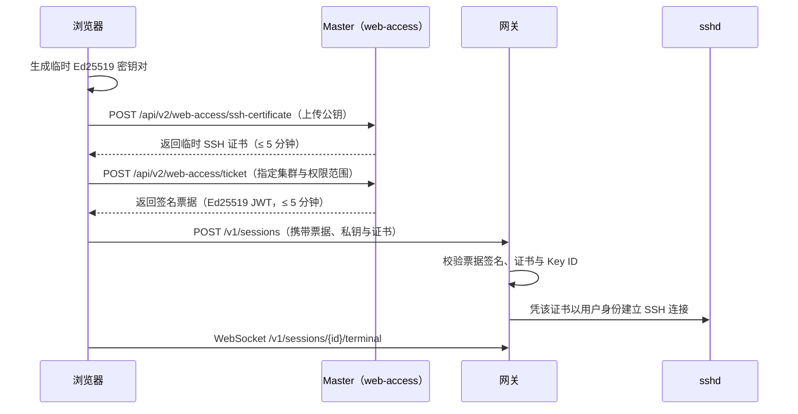

# 集群代理程序

主服务（Master）从不主动登录集群。安装在各集群上的轻量级**代理程序（Agents）**通过双向 TLS（mTLS）主动连接主服务并完成集群本地操作。本页介绍每个代理程序的职责、通信协议与配置参考。

| 代理程序 | 入口目录 | 运行位置 | 是否必选 |
| --- | --- | --- | --- |
| **Slave** | `cmd/slave` | 每个集群部署一个实例，紧邻 OpenLDAP | 必选 |
| **Host Bridge（主机桥）** | `cmd/host-bridge` | 容器化 slave 内部 | 仅在容器内运行触发器时需要 |
| **Web 访问网关** | `cmd/gateway` | 集群登录节点 | 可选（用于 Web 终端、文件管理与跨集群传输） |
| **生命周期钩子** | `cmd/slurm-lifecycle-hook` | Slurm 控制节点（`PrologSlurmctld` / `EpilogSlurmctld`） | 可选（用于作业完成邮件与 GPU 用量统计） |
| **通知观察者** | `cmd/slurm-notify-observer` | Slurm 控制节点 | 可选（与生命周期钩子配套使用） |



每个代理程序均使用独立的客户端证书向主服务证明身份。主服务仅凭证书 SHA-256 指纹（`CLUSTERS`、`web-access.gateways`）识别代理节点，因此即便配置文件泄露，只要没有对应的私钥也无法冒充集群。

## Slave {#slave}

Slave 负责让单个集群与主服务保持同步。除了运行[同步协议](sync-protocol.md)中描述的对账循环外，它还负责：

- 发布供 `sshd` 读取的 SSH 信任文件；
- 在账户变更时执行触发器脚本；
- 上报节点、队列与资源状态；
- 在启用时承载作业生命周期运行时（发送作业完成邮件与采集 GPU 用量）。

### 命令行参数 {#command}

```sh
slave -config /etc/go-ldap-admin/slave.yml   # run continuously as a daemon
slave -once                                   # execute a single sync check and exit
slave -plan …                                 # offline dry-run rehearsal (see Sync Protocol)
```

配置文件权限必须为 `0600`，且遇到未知配置键会立即报错退出，避免因拼写错误导致配置被静默忽略。

### 配置参考 {#configuration-reference}

| 配置键 | 默认值 | 含义说明 |
| --- | --- | --- |
| `master-url` | — | 主服务同步端点地址（如 `https://sync.example.org`），兼容旧键名 `main-url` |
| `cluster-id` | — | 集群 ID，必须与主服务上绑定到该客户端证书的集群 ID 一致 |
| `dns-name` | — | 存放快照哈希的 DNS TXT 记录名；留空时改为调用 `GET /sync/v2/snapshot-hash` |
| `dns-server` | 系统默认 | 自定义 DNS 解析服务器（`IP` 或 `IP:端口`） |
| `check-interval` | `60s` | 两次同步检查之间的间隔时间 |
| `check-timeout` | `10m` | 单次同步检查（含 LDAP 写入与触发器执行）的超时上限 |
| `dns-timeout` | `5s` | 单次 DNS 查询超时上限 |
| `health-listen` | `127.0.0.1:8081` | 本地健康检查监听地址 |
| `state-dir` | — | 保存 `applied.json`、脏标记与触发器队列的本地目录 |
| `trust-dirs` | — | 发布不可变信任世代的一个或多个目标目录 |
| `trigger-file` | — | 触发器定义文件（YAML）路径 |
| `source-base-dn` / `local-base-dn` / `local-group-dn` | — | LDAP DN 后缀重写规则（详见[同步协议](sync-protocol.md#what-a-slave-does-on-each-check)） |
| `limits.max-user-deletions` | `5` | 单次同步允许删除的最大用户数，超出则拒绝执行 |
| `limits.allow-ca-removal` | `false` | 是否允许在同步中移除当前已受信的 SSH CA |
| `tls.cert-file`、`tls.key-file` | — | Slave 的客户端证书与私钥（私钥权限须为 `0600`） |
| `tls.ca-file`、`tls.server-name` | 系统 CA | 验证主服务证书所用的根 CA 与服务器名称 |
| `ldap.url`、`ldap.bind-dn`、`ldap.password-file` | — | 本地 OpenLDAP 连接参数；非回环地址必须使用 `ldaps://` 或开启 `start-tls: true` |
| `cluster-status`、`resource-status` | 关闭 | 节点与资源状态上报的采集命令与间隔 |
| `current-status.enabled`、`.interval` | 关闭、`1m` | 启用写入 R2 / S3 的综合实时状态采集 |
| `lifecycle-file` | — | 指定生命周期运行时配置文件路径以启用该功能 |

带详细注释的完整示例见 `deploy/slave/slave.yml.example`。

### 健康检查接口 {#health}

| 接口 | 返回说明 |
| --- | --- |
| `GET /healthz` | 进程存活期间始终返回 `200` |
| `GET /readyz` | 最近一次同步干净完成时返回 `200`；状态为脏或最近一次检查失败时返回 `503` |

建议将 systemd、Docker 或外部监控探针指向 `/readyz`。

### 主机桥（Host Bridge） {#host-bridge}

运行在容器内的 slave 无法直接调用宿主机的 `sacctmgr` 或设置文件系统 ACL。此时可通过 `host-bridge` 触发器使用专用密钥 SSH 到控制节点宿主机并运行 `slurm_trigger.py`。事件数据通过 **标准输入（stdin）** 传递，绝不将用户名等字段拼接到远程 Shell 命令行中，从根本上杜绝命令注入风险。

## Web 访问网关（Web-access Gateway） {#web-access-gateway}

Web 访问网关承载浏览器终端、文件浏览器与跨集群 `rsync` 传输。所有操作均以当前登录用户的身份通过原生 SSH 会话执行，因此集群上的文件权限、配额与审计行为与普通 SSH 登录完全一致。

### 会话建立流程 {#how-a-session-opens}



网关在建立连接前严格校验以下三项内容：

- **网关票据：** 必须由 `ticket_public_keys` 中的公钥验证通过 Ed25519 签名、签发给当前 `cluster_id`、有效期不超过 5 分钟，且权限范围（Scope）与当前操作匹配。
- **SSH 证书：** 必须由 `user_ca_keys` 中的受信 CA 签发、与请求随附的私钥严格配对、有效期不超过 300 秒，且包含 `permit-pty`。
- **证书 Key ID：** 格式必须为 `web-access/<cluster>/access/user:<id>/<serial>`，任何跨集群或跨用户的证书均会被拒绝。

临时私钥仅在会话存活期间保存在网关内存中，绝不写入磁盘。

| 权限范围（Scope） | 允许的操作 |
| --- | --- |
| `session:create` | 创建与关闭 SSH 会话 |
| `terminal` | 连接终端 WebSocket |
| `sftp` | 浏览目录与下载文件 |
| `transfer` | 发起跨集群 `rsync` 传输 |
| `transfer:read` | 查询传输状态与日志 |

### 网关接口列表 {#endpoints}

| 路由 | 用途 |
| --- | --- |
| `GET /healthz`、`GET /readyz` | 存活与就绪检查（距离上次成功向主服务注册超过 180 秒时 `/readyz` 返回失败） |
| `POST /v1/sessions` | 建立 SSH 会话 |
| `DELETE /v1/sessions/{id}` | 关闭会话 |
| `GET /v1/sessions/{id}/terminal` | 交互式终端流（WebSocket，`xterm-256color`） |
| `POST /v1/sessions/{id}/files/list` | 列出目录内容 |
| `POST /v1/sessions/{id}/files/download-ticket`、`GET /v1/downloads/{id}` | 签发并使用一次性文件下载链接 |
| `POST /v1/sessions/{id}/transfers`、`GET /v1/transfers/{id}[/logs]` | 发起并查看跨集群文件传输 |
| `POST /v1/diagnostics`、`GET /v1/diagnostics/socket` | 供门户**运行诊断**页面调用的连通性探测接口 |

任何包含查询字符串（Query String）或来源不在 `allowed_origins` 白名单内的请求均会被拒绝。

### 自动注册 {#registration}

网关在启动时及运行期间会周期性调用 `POST /sync/v2/web-access/register`，上报自身 ID、当前构建支持的功能及受信 SSH CA 公钥。主服务将其记录在 `v2_gateway_registrations` 中，仅在注册有效期内向用户展示该集群的 Web 终端与文件入口。

### 网关配置参考 {#configuration-reference-1}

| 配置键 | 默认值 | 含义说明 |
| --- | --- | --- |
| `gateway_id`、`instance_id`、`cluster_id` | — | 网关标识；`cluster_id` 必须与票据一致 |
| `listen`、`tls_certificate`、`tls_key` | — | 监听地址与 TLS 证书（通常在 Nginx 后方监听本地回环） |
| `allowed_origins` | — | 允许跨域访问的门户源地址列表 |
| `ticket_public_keys` | — | 主服务提供的 `kid: base64 Ed25519 公钥` 映射 |
| `user_ca_keys` / `user_ca_keys_file` | — | 允许签发临时会话证书的 SSH CA 公钥 |
| `clusters` | — | 各可达集群的 SSH 地址列表 |
| `file_root`、`state_directory` | — | 文件浏览起始路径与传输状态保存目录 |
| `master_origin`、`master_client_certificate`、`master_client_key` | — | 连接主服务的双向 TLS 参数（兼容旧名 `main_*`） |
| `callback_listen` | — | 本地 `rsync` 进程汇报完成状态的回环地址 |
| `max_sessions` | `128` | 全局最大并发会话数 |
| `max_sessions_per_user` | `4` | 单用户最大并发会话数 |
| `session_idle_seconds` | `1800` | 空闲会话自动断开秒数 |
| `max_transfers` | `128` | 最大并发传输任务数 |
| `max_download_bytes` | `1 TiB` | 单文件最大下载体积 |

带完整注释的配置示例见 `deploy/gateway/gateway.yaml.example`。执行 `systemctl reload web-access-gateway`（发送 `SIGHUP`）可在不中断现有会话的情况下热重载配置与 TLS 证书。

## 生命周期钩子与观察者 {#lifecycle-hook-and-observer}

作业结束邮件与单作业 GPU 用量统计需要在作业开始和结束时感知状态，由三个组件分工协作，确保 Slurm 调度器绝不因等待门户而阻塞：

| 组件 | 职责 | 绝不执行的操作 |
| --- | --- | --- |
| `slurm-lifecycle-hook`（`PrologSlurmctld` / `EpilogSlurmctld`） | 携带 `SLURM_JOB_ID` 向 slave 发送 `starting` 或 `ending` 事件，超时设为 1 秒（最长 2 秒），且始终以状态码 `0` 退出 | 不查询 Slurm、不发邮件、不阻塞重试 |
| 生命周期运行时（内置于 slave） | 将事件排入内存队列、查询作业详情、每 15 秒（5–300 秒）采样一次 GPU 用量，并向主服务上报邮件事件与资源摘要 | 不持有 Slurm JWT 密钥 |
| `slurm-notify-observer`（控制节点，以 `slurm` 用户运行） | 持有 Slurm JWT 密钥，通过双向 TLS 响应 slave 发起的作业与节点只读 `GET` 查询 | 不接受任何写请求 |

钩子采用**失败放行（Fail-open）**设计：即使配置缺失、slave 停止运行或请求超时，也只会记录日志并正常放行作业。

### 钩子配置（`/etc/go-ldap-admin/lifecycle-hook.yaml`，权限 `0600`） {#hook-configuration-etcgo-ldap-adminlifecycle-hookyaml-0600}

| 配置键 | 含义说明 |
| --- | --- |
| `url` | Slave 生命周期监听器的 `https://…` 地址 |
| `tls.cert-file`、`tls.key-file` | 钩子的客户端证书与私钥 |
| `write-token-file` | 生命周期运行时接受的本地写入令牌文件 |
| `timeout` | 请求超时时间，默认 `1s`，最大 `2s` |

### 运行时配置（Slave 中的 `lifecycle-file`） {#runtime-configuration-lifecycle-file-in-the-slave}

| 配置键 | 默认值 | 含义说明 |
| --- | --- | --- |
| `cluster-id` | — | 与主服务一致的小写集群 ID |
| `listen`、`callback-tls` | — | 接收钩子回调的监听地址与 mTLS 配置 |
| `slurm-url`、`slurm-tls` | — | 观察者的 HTTPS 地址与客户端 mTLS 配置 |
| `tokens-file` | — | 允许的钩子令牌文件路径 |
| `plugins.job-email` | `false` | 是否启用作业结束邮件上报 |
| `plugins.resources.enabled`、`.sample-interval-seconds` | `false`、`15` | 是否启用按作业统计的 GPU 用量采样及采样间隔 |
| `gres-indices-are-nvml`、`gpu-uuid-mapping` | `false`、— | Slurm GRES 序号到物理 NVML GPU 的映射策略（需按站点硬件核对） |
| `max-jobs` | `1000` | 同时跟踪的最大运行中作业数 |
| `max-retained-report-bytes` | `64 MiB` | 内存中暂存待发送报告的体积上限 |
| `resolve-workers` | `2` | 并发查询作业详情的工作协程数 |

具体安装步骤详见[作业通知与 GPU 监控](../deploy/optional.md)与[Web 访问网关](../deploy/gateway.md)。

## 下一步阅读 {#next-steps}

- [同步协议](sync-protocol.md)：了解 slave 在每轮同步检查中的详细行为。
- [密码学与签名](cryptography.md)：了解代理证书与网关票据的签名验证机制。
