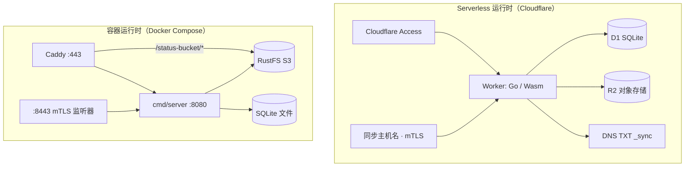
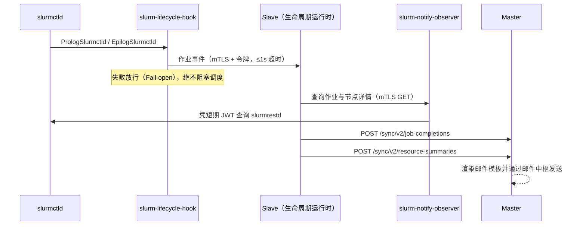
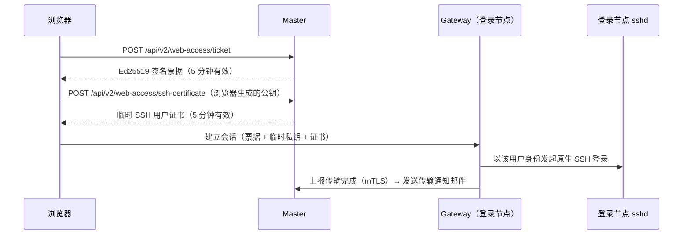

# 系统架构

本页介绍 Slurm Portal 的整体架构：包含哪些可执行程序、各自运行在何处、跨网络边界如何通信，以及请求在主服务（Master）内部的流转过程。

架构图同时提供[交互式网页版本](https://ting-hiuyu.github.io/SlurmPortal/architecture.html)，由 [Archify](https://github.com/tt-a1i/archify) 根据 [diagrams/architecture.archify.json](https://github.com/TING-HiuYu/SlurmPortal/blob/main/docs/diagrams/architecture.archify.json) 渲染生成，图中每个模块均标注了对应的源码文件路径。

## 系统组件 {#components}

整个系统的所有程序均由同一个 Go 模块构建，共享内部包定义，从根本上确保了快照格式、权限标识符与配置校验规则在主服务与各集群代理之间绝对一致。

| 组件 | 入口目录 | 运行位置 | 核心职责 |
| --- | --- | --- | --- |
| **Master（主服务）** | `cmd/worker`（Wasm）或 `cmd/server`（原生） | Cloudflare Worker + D1，或 Linux 主机 + SQLite | 控制平面 HTTP API、登录认证、身份管理、PKI、插件宿主与审计日志 |
| **Web 前端应用** | `web/`（React 19、Ant Design 6） | 与主服务同源托管的静态资源 | 面向管理员的控制台与面向普通用户的自助工作台 |
| **Slave（集群代理）** | `cmd/slave` | 每个集群部署一个实例，紧邻 OpenLDAP | 将快照同步至 OpenLDAP、发布 SSH 信任文件、执行触发器、上报集群状态并承载作业生命周期运行时 |
| **Gateway（Web 网关）** | `cmd/gateway` | 各集群的登录节点 | 提供浏览器终端、SFTP 文件管理及跨集群 `rsync` 文件传输 |
| **Lifecycle Hook（生命周期钩子）** | `cmd/slurm-lifecycle-hook` | Slurm 控制节点（Prolog / Epilog） | 在不阻塞作业调度的前提下向 slave 上报作业启动与结束事件 |
| **Observer（观察者）** | `cmd/slurm-notify-observer` | Slurm 控制节点 | `slurmrestd` 前置的只读 mTLS 代理，确保 slave 无需持有 Slurm JWT 密钥 |
| **Host Bridge（主机桥）** | `cmd/host-bridge` | 容器化 slave 内部及宿主机 | 当 slave 运行在容器内时，通过 SSH 在宿主机上安全执行触发器脚本 |
| **迁移与校验工具** | `cmd/migration-check`、`cmd/convert-passwords`、`slave -plan` | 运维人员工作站 | 预演并校验 v1 数据库升级、转换旧版可逆密码、离线预演首次 LDAP 同步 |

## Master 控制平面 {#master-control-plane}

### 运行时形态 {#runtime-environments}

在 Cloudflare Serverless 部署模式下，`deploy/worker/worker.js` 作为包裹 Go WebAssembly 程序的轻量级 JavaScript 宿主外壳：

- 加载由 `cmd/worker` 编译生成的 `main.wasm`，并将 WebAssembly 无法直接调用的平台能力注入 Go 运行时：
  - Cloudflare D1 数据库桥接（`d1-bridge.js`）；
  - 基于 `cloudflare:sockets` 的出站 SMTP 连接桥接（`smtp-bridge.js`）；
  - 经 Cloudflare 验证的机器调用方客户端证书指纹（`edge.js`）。
- 静态前端文件（`web/dist`）由 Cloudflare Workers Static Assets 直接响应，不触发 Worker 执行；仅 `/api/*`、`/sync/*` 与 `/healthz` 会进入 Worker（见 `wrangler.toml` 中的 `run_worker_first`）。
- 每 5 分钟运行一次 Cron 触发器（`App.Tick`），用于在 X.509 吊销列表（CRL）到期前自动重签，并兜底发布最新快照哈希。
- 每次写操作成功后，通过 `ctx.waitUntil` 异步调用 `App.Publish` 立即发布最新快照哈希，无需阻塞客户端响应。

在容器化自托管模式下，`cmd/server` 使用标准 `database/sql` 与纯 Go 实现的 SQLite 原生运行同一个 `internal/app`（详见[容器主服务](../deploy/master-container.md)）：

- 直接托管 `STATIC_DIR` 下的前端静态资源，并支持单页应用（SPA）路由回退；
- 在独立的双向 TLS 监听端口（`SYNC_LISTEN`，默认 `8443`）上提供 `/sync/*` 机器接口；
- 当部署在 Caddy 反向代理之后时（`BEHIND_TLS_PROXY=true`），信任 `X-Forwarded-Proto: https`；
- 通过进程内定时器执行周期性维护任务，并在每次写操作后自动更新快照哈希。

## 基础设施对比 {#infrastructure-comparison}

两种部署方式运行完全相同的 `internal/app` 核心代码，提供一致的 API 与业务功能，仅边缘接入层与存储后端实现不同。

| 对比维度 | Serverless（Cloudflare） | 容器自托管（Docker Compose） |
| --- | --- | --- |
| 计算运行时 | Cloudflare Worker（`cmd/worker`，WebAssembly） | `cmd/server` 原生 Linux 容器 |
| 关系型数据库 | Cloudflare D1 | `data/master/` 下的 SQLite 文件（启用 WAL 模式） |
| 实时状态对象存储 | Cloudflare R2 | RustFS（或任意兼容 S3 的存储），由 Caddy 在 `/<bucket>/` 下反向代理 |
| 浏览器 TLS 与接入防护 | Cloudflare 边缘证书 + 可选 Cloudflare Access | Caddy（自动签发 Let's Encrypt 或本地 CA 证书） |
| 机器同步端点 | 独立主机名 `SYNC_HOSTNAME` + Cloudflare mTLS 与 WAF 规则 | 独立端口 `8443`，由 `cmd/server` 原生校验双向 TLS（`SYNC_CLIENT_CA_FILE`） |
| 快照哈希发现机制 | 查询 DNS TXT 记录（`_sync.<domain>`） | 经 mTLS 调用 `GET /sync/v2/snapshot-hash` |
| 周期性后台任务 | Cloudflare Cron 触发器（每 5 分钟） | 进程内 Go 定时器 |
| 数据备份方式 | `wrangler d1 export` 与 D1 Time Travel | 备份 `data/` 与 `secrets/` 目录文件 |

### 网络通信矩阵 {#network-flows}

| 源端 → 目标端 | 端口 | 协议 |
| --- | --- | --- |
| 浏览器 → 门户主服务 | `443` | HTTPS |
| 浏览器 → 实时状态对象（R2 / S3） | `443` | HTTPS（预签名 `GET` 链接） |
| 浏览器 → Web 访问网关 | `443` | HTTPS + WebSocket（`WSS`） |
| Slave、网关 → 主服务同步端点 | `443`（Serverless）/ `8443`（容器） | 带客户端证书的双向 TLS（mTLS） |
| Slave → DNS 解析器 | `53` | DNS `TXT` 查询（仅 Serverless 模式） |
| Slave → 集群 OpenLDAP | `389`（StartTLS）或 `636`（LDAPS） | LDAP |
| 生命周期钩子 → Slave；Slave → 观察者 | 本地回环 / 配置端口 | 带客户端证书的双向 TLS（mTLS） |
| Web 访问网关 → 登录节点 `sshd` | `22` | SSH |

主服务绝不主动向集群发起连接。集群只需具备访问主服务的出站 HTTPS 权限；若启用 Web 终端，则还需向用户开放登录节点的入站 `443` 端口。

### Serverless 成本优化设计 {#serverless-cost-optimization}

Cloudflare 按 Worker 请求数与 CPU 时间、D1 读写行数以及 R2 操作次数计费。Slurm Portal 在架构层面将各项开销降至最低：

- **静态资源零 Worker 调用：** 前端静态资源由 Workers Static Assets 直接托管，不计入 Worker 请求数。
- **空闲集群零 Worker 请求：** Slave 每分钟仅执行一次 DNS TXT 查询，仅在快照哈希变化时才请求 Worker。
- **实时状态直通对象存储：** Slave 将实时状态直接写入 R2，浏览器通过 15 分钟有效期的预签名链接直接从 R2 读取，全程不经过 D1 数据库。
- **常规心跳免写审计日志：** 标记为 `Routine: true` 的周期性机器上报仅在失败时才记录审计日志。
- **全索引覆盖与容量封顶：** 高频查询全部命中索引，审计日志表大小受 `AUDIT_MAX_RECORDS` 严格限制（详见[存储层](layer-storage.md#cost-aware-queries)）。

## Master 内部结构 {#inside-the-master}

单个请求的详细执行步骤请参阅[请求生命周期](request-lifecycle.md)。

### 请求处理管线 {#request-pipeline}

`app.New` 构建统一的 `httpx.Router`，所有请求依次经过以下中间件链：

1. `httpx.WithScope`：分配或沿用请求 ID（`X-Request-Id`）并初始化请求上下文作用域。
2. `telemetry.HTTPMiddleware`：在启用遥测插件时为每个请求创建追踪 Span。
3. `httpx.Recover`：捕获 panic，记录带请求 ID 的错误日志并返回 `500`。
4. `httpx.SecurityHeaders`：写入 `nosniff`、禁止 iframe 嵌套、全拒绝 CSP 与 `no-store` 缓存头。
5. `httpx.RateLimit`：基于客户端 IP 的令牌桶限流。
6. `httpx.CORS`：严格校验 `CORS_ORIGINS` 白名单。
7. **写操作追踪器**：标记 `/sync/` 之外成功的非 `GET` 请求，触发后续快照哈希发布。
8. `audit.Middleware`：将每一次变更请求（含被拒绝的越权请求）追加写入 SHA-256 哈希链审计日志。

随后，路由器在执行业务处理函数前完成身份认证与路由权限检查：

- **人类用户**凭会话令牌（`authn.JWT`）认证。
- **机器节点**凭客户端证书（原生使用 `authn.TLSPeer`，Worker 上使用 `authn.BridgePeer`）认证。
- 每条路由必须声明 `Public`、`Authenticated`、`Peer` 或 `Policy(object, action)` 权限之一，否则路由器在启动时直接 panic。角色权限策略每 10 秒从数据库自动刷新一次。

业务处理函数返回统一的 `apperr.Error`，包含 HTTP 状态码、稳定的机器错误码与可读错误消息。

### 核心模块与插件 {#core-modules-and-plugins}

以下核心领域模块始终启用：

| 包路径 | 核心职责 |
| --- | --- |
| `internal/domain/identity` | 用户、POSIX/组织用户组、角色、UID/GID 分配及基于等级的防提权校验 |
| `internal/domain/auth` | 密码登录、令牌刷新与注销、修改密码及邮箱重置验证码 |
| `internal/domain/pki` | SSH 与 X.509 CA 管理、用户证书签发/轮换/吊销及 CRL 签名 |
| `internal/audit` | 只追加、SHA-256 哈希链防篡改、带容量上限的审计日志 |
| `internal/mail` | 邮件中枢：管理命名的 SMTP、REST 与邮件池服务商并统计每日发送量 |
| `internal/replication` | 构建供 slave 同步的集群快照并发布快照哈希 |
| `internal/legacyimport` | 一次性导入 `go-ldap-admin` v1 的存量配置与历史记录 |

其余扩展能力（GitHub OAuth、Cloudflare Access、集群与资源状态页、作业通知、Web 访问网关、运行诊断与 OpenTelemetry 遥测）均以插件形式实现。插件在编译期注册、通过配置启用，并通过 `plugin.Host` 访问路由器和核心模块。详见[插件系统](plugins.md)与[数据模型](data-model.md)。

### 存储抽象层 {#storage-abstraction}

所有 SQL 操作均通过仅包含 `Query`、`Exec` 和原子批处理 `Batch` 三个方法的 `store.Store` 接口完成，底层提供两套实现：

- `store.SQL`：基于标准 `database/sql` 与纯 Go `modernc.org/sqlite`；
- `store/d1`：通过 JavaScript 桥调用 Cloudflare D1。

两套实现均须通过 `store/storetest` 一致性测试套件。数据库迁移脚本位于 `migrations/`，内嵌于二进制并在启动时按序执行（`store.Migrate`）。首条迁移 `0000_legacy_base.sql` 即 `go-ldap-admin` v1 的原始表结构，因此 v2 可直接打开并升级 v1 数据库。

## 集群状态同步 {#cluster-synchronization}

主服务将数据库状态汇编为一份自包含的**快照**（包含用户、用户组、成员关系、CA、吊销记录与证书），并发布其 SHA-256 哈希。各集群的 slave 每分钟检查一次该哈希；仅当哈希变化时，slave 才通过双向 TLS 下载完整快照，经过安全防线检查后将差异写入 OpenLDAP、生成新的不可变 SSH 信任世代并运行触发器。

详见[同步协议](sync-protocol.md)。

## 作业生命周期与 GPU 监控管线 {#job-lifecycle--gpu-telemetry-pipeline}

Slave 内部的生命周期运行时（`internal/lifecycle/runtime`）将事件推入有界内存事件总线（`internal/lifecycle/eventbus`），由两个内置消费者处理：

- `jobdoneemail`：在作业结束时查询详情并上报主服务发送通知邮件；
- `resources`：在作业运行期间周期性采样 NVML GPU 使用率，并在作业结束时上报单作业资源摘要。

## Web 访问架构 {#web-access-architecture}

Web 访问网关使用主服务的 Ed25519 公钥校验每个请求，自身从不以特权身份直接读写用户文件：在线终端、SFTP 文件浏览与跨集群 `rsync` 传输全部通过以用户本人身份登录的 SSH 会话完成。

## 下一步阅读 {#next-steps}

- [请求生命周期](request-lifecycle.md)：深入追踪单个请求经过的每一层。
- [同步协议](sync-protocol.md)：了解集群如何安全同步主服务快照。
- [数据模型](data-model.md)：查看完整的数据库表结构与实体关系。
- [集群代理程序](agents.md)：了解 slave、网关、生命周期钩子与观察者的配置细节。
- [安全模型](security.md)：审阅系统信任边界与安全防护机制。
