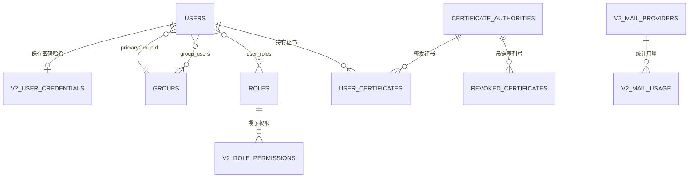

# 分层：数据模型与表结构

Slurm Portal 将所有控制平面状态保存在单个兼容 SQLite 的关系型数据库中（Serverless 模式使用 Cloudflare D1，容器模式使用本地 SQLite）。本页介绍核心实体关系、表结构规范、POSIX ID 分配不变量，以及 v2 表结构如何在完全兼容 `go-ldap-admin` v1 的基础上进行平滑扩展。

**相关代码包：** `migrations`、`internal/domain/*`、`internal/store`。

## 实体关系总览 {#entity-relationship-overview}

## 表结构演进策略 {#schema-organization}

迁移脚本位于 `migrations/0000_legacy_base.sql` 至 `0016_*.sql`，在服务启动时按编号顺序自动应用（`store.Migrate`）：

- **v1 兼容基线（`0000_legacy_base.sql`）：** 完整保留 `go-ldap-admin` v1 的核心表名（`users`、`groups`、`group_users`、`roles`、`user_roles`、`certificate_authorities`、`user_certificates`、`revoked_certificates`、`oauth_connectors`），使 v2 可以直接打开并原地升级存量 v1 数据库。
- **纯增量 v2 迁移（`0001`–`0016`）：** 通过纯增量 DDL 新增 `v2_*` 表与扩展列（如 `primary_group_id`、`home_root`、`default_shell`），确保在需要版本回滚时旧版程序依然能够安全运行在已迁移的数据库之上。

## 身份与 RBAC 核心表 {#identity--rbac-tables}

| 表名 | 主键 | 关键字段与业务不变量 |
| --- | --- | --- |
| `users` | `id` | `username`（唯一 POSIX 用户名）、`uid_number`（唯一且 ≥ 10000）、`primary_group_id`（关联某个 `posixGroup`）、`home_directory`、`login_shell`、`user_dn`、`status`（`1` = 启用，`2` = 禁用）、`source`（`platform`、`oauth`、`cloudflare-access`） |
| `groups` | `id` | `group_name`、`group_dn`、`group_type`（`cn` 或 `ou`）、`group_class`（`posixGroup` 或 `groupOfUniqueNames`）、`gid_number`（POSIX 组唯一）、`parent_id`（树形父节点）、`home_root`、`default_shell` |
| `group_users` | `(group_id, user_id)` | 用户与用户组（含主 POSIX 组、附加 POSIX 组及组织架构节点）的多对多关联表 |
| `roles` | `id` | `keyword`（唯一策略标识）、`name`、`sort`（数值等级 `1`–`999`，`1` 为最高权限）、`status` |
| `user_roles` | `(user_id, role_id)` | 用户与角色的多对多分配表 |
| `v2_role_permissions` | `(role, object, action)` | 显式 `(object, action)` 权限授权表，由 `authz.Casbin` 加载评估 |
| `posix_id_counters` | `kind`（`uid` / `gid`） | 从 `10000` 起步的单调递增分配器；即使账号或组被删除，已分配的编号也永不复用 |

## 认证与凭据表 {#authentication--credential-tables}

| 表名 | 主键 | 用途说明 |
| --- | --- | --- |
| `v2_user_credentials` | `user_id` | 保存 `app_hash`（门户登录 Argon2id 哈希）与 `ldap_hash`（OpenLDAP `{CRYPT}$6$` SHA-512 哈希）。若 `ldap_hash` 为空，slave 会保留 LDAP 中原有的 `userPassword` 不变。 |
| `v2_revoked_tokens` | `jti` | 已注销或已刷新的会话令牌 ID，保留至其自然过期时间 `expires_at` 后由定时任务清理。 |
| `v2_password_resets` | `user_id` | 6 位数字密码重置验证码的 HMAC-SHA256 摘要，附带 `expires_at`、`resend_after` 与尝试次数 `attempts`。 |
| `oauth_connectors` | `id` | GitHub OAuth 连接器配置、加密保存的客户端密钥及有序 JSON 准入规则。 |
| `oauth_states` | `state_hash` | OAuth 防跨站伪造（CSRF）状态令牌的 SHA-256 摘要（有效期 10 分钟）。 |

## PKI 与证书表 {#pki--certificate-tables}

| 表名 | 主键 | 用途说明 |
| --- | --- | --- |
| `certificate_authorities` | `id` | SSH 与 X.509 CA。`private_key_enc` 保存经 `PKI_MASTER_KEY`（绑定 CA 身份作为 AAD）AES-256-GCM 封存的私钥；X.509 CA 还保存最新签名的 `crl_pem` 与 `crl_next_update`。 |
| `user_certificates` | `id` | 已签发的 30 天 SSH 证书与 1 年 X.509 用户证书（含 `ca_id`、`user_id`、`serial_number`、`public_key`、`cert_data`、`expires_at`、`revoked_at`），绝不保存用户私钥。 |
| `revoked_certificates` | `(ca_id, serial_number)` | 已吊销证书序列号、吊销时间 `revoked_at` 与原因 `reason`，随每次快照下发以生成 OpenSSH KRL 与 X.509 CRL。 |

## 运维、邮件与插件表 {#operations-mail-and-plugin-tables}

| 表名 | 主键 | 用途说明 |
| --- | --- | --- |
| `v2_audit_log` | `seq` | 只追加审计日志，包含 `actor_id`、`actor`、`action`、`target`、`outcome`、`status`、`request_id`、`trace_id`、`prev_hash` 与 `hash`（SHA-256 哈希链），受 `AUDIT_MAX_RECORDS` 容量限制。 |
| `v2_sync_state` | `key` | 记录最近一次已发布的快照哈希（`published_hash`），避免在数据未变时重复更新 DNS TXT 记录。 |
| `v2_mail_providers` | `name` | 命名的邮件服务商（`smtp`、`rest`、`pool`），包含 JSON 配置与经 `secretbox` 加密封存的密钥。 |
| `v2_mail_usage`、`v2_mail_pool_usage` | `(day, provider, purpose)` | 按日期、服务商、邮件池成员与业务用途统计的每日邮件投递计数。 |
| `v2_notification_config`、`v2_password_mail_config` | `id`（`1`） | 作业完成通知与密码验证码邮件的全局配置及 HTML 模板。 |
| `v2_job_notifications` | `(cluster_id, job_id)` | 已完成 Slurm 作业的邮件通知去重与投递记录。 |
| `v2_cluster_reports` | `(cluster_id, kind)` | 每个集群最新的节点状态（`cluster-status`）与资源队列报告（`resource-status`）。 |
| `v2_resource_summaries` | `(cluster_id, job_id)` | 单作业 GPU 使用率汇总数据，驱动近 7 天资源监控图表。 |
| `v2_web_access_config` | `cluster_id` | 各集群的 Web 访问网关地址、SSH CA 选择、目标 SSH 主机/端口、允许访问的角色列表及传输邮件模板。 |
| `v2_gateway_registrations` | `gateway_id` | 各登录节点网关上报的心跳时间、实例 ID、受信 CA 指纹及支持的功能集合。 |
| `v2_transfer_events` | `id` | 已完成的跨集群 `rsync` 文件传输记录。 |

## 下一步阅读 {#next-steps}

- [存储层](layer-storage.md)：了解 `store.Store` 如何在 SQLite 与 Cloudflare D1 上执行查询与原子批处理。
- [同步协议](sync-protocol.md)：了解上述数据表如何序列化为集群同步快照。
