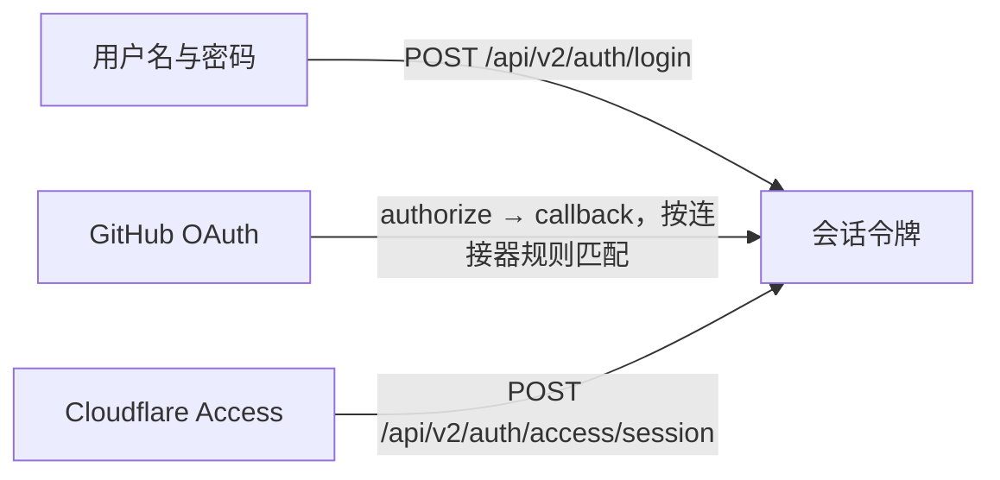

# 分层：身份与访问层

本层为每一个 HTTP 请求回答两个核心问题：**调用方是谁**（身份认证，Authentication）以及**是否有权执行该操作**（权限授权，Authorization），同时通过严格的角色等级约束防止任何形式的权限提升。

**相关代码包：** `internal/authn`、`internal/authz`、`internal/domain/identity`、`internal/domain/auth`，以及 `oauth` 和 `cloudflare-access` 插件。

## 调用方主体（Principal） {#principals}

经过认证的调用方表示为绑定在请求上下文中的 `authn.Principal`：

| 字段 | 含义 |
| --- | --- |
| `UserID`、`Username` | 用户账号 ID 与用户名（机器调用方为 `0` 与 `peer:<名称>`） |
| `Roles` | 角色标识符列表，每次请求均从数据库实时加载 |
| `Source` | 认证来源：`password`、`oauth`、`cloudflare-access`，机器调用方为 `peer-mtls` |
| `TokenID` | 会话令牌 ID（`jti`，用于吊销），机器调用方为客户端证书指纹 |

业务处理器通过 `authn.FromContext(r.Context())` 读取当前主体。

## 身份认证（Authentication） {#authentication}

### 人类用户：会话令牌 {#users-session-tokens}

所有用户登录方式最终都会签发同一格式的会话令牌（由 `authn.JWT` 生成）：

| 属性 | 规格说明 |
| --- | --- |
| 格式与算法 | JWT，强制使用 `HS256` |
| 载荷声明（Claims） | `iss`（`AUTH_ISSUER`）、`aud`（`AUTH_AUDIENCE`）、`sub`（用户 ID）、`jti`（令牌 ID）、`iat`、`nbf`、`exp`、`src`（登录来源） |
| 有效期 | `auth.token-ttl`，默认 12 小时，最长 168 小时 |
| 签名密钥 | `JWT_KEYS`（`kid:base64,…`）；新令牌使用 `JWT_ACTIVE_KID` 签名，其余密钥继续用于校验存量令牌 |
| 传输方式 | 通过 `Authorization` 请求头携带 Bearer 令牌；前端保存在 `localStorage` 中 |

在每次请求中，`JWT.Authenticate` 依次执行以下校验：

1. 校验签名、算法（仅接受 `HS256`）、签发者、受众与过期时间；
2. 查询 `v2_revoked_tokens` 吊销表（退出登录或刷新令牌时写入），确认 `jti` 未被吊销；
3. 从数据库实时加载用户的**当前状态与角色列表**（`identity.Directory.LoadPrincipal`）。

得益于第 3 步，一旦禁用某个用户或移除其角色，权限变更在下一次请求时立即生效，无需等待令牌自然过期。

### 登录方式 {#ways-to-sign-in}



- **本地密码（`domain/auth`）：** 恒定时间 Argon2id 校验，对不存在的用户名同样执行伪校验（`password.VerifyDummy`）以消除计时侧信道；15 分钟内连续失败 5 次即触发临时封禁；强制要求 HTTPS。
- **GitHub OAuth（`plugins/oauth`）：** 每个连接器配置有序准入规则（允许所有人、邮箱/用户名通配符、或 GitHub 组织成员身份）。首条命中的规则决定是否允许登录，以及新账号默认分配的主 POSIX 组、附加组与角色。账号邮箱取自 GitHub 已验证的主邮箱。
- **Cloudflare Access（`plugins/cfaccess`）：** 使用团队公钥（缓存 5 分钟）与应用 AUD 标签校验 Access JWT，再按邮箱映射门户账号。

### 机器调用方：客户端证书 {#machines-client-certificates}

Slave 与网关从不使用用户令牌。声明为 `authz.Peer()` 的路由使用对端证书认证器：

- 在 Cloudflare 上，`authn.BridgePeer` 仅信任由 Cloudflare 验证客户端证书后经 Worker 宿主注入的指纹，绝不从普通 HTTP 头读取。
- 在原生容器模式下，`authn.TLSPeer` 直接从 TLS 连接提取已验证的叶子证书；若配置了 `SYNC_CLIENT_FINGERPRINTS`，证书指纹必须在白名单内。

随后，各插件将证书指纹映射至具体的集群（`CLUSTERS`）或网关（`web-access.gateways`），并忽略请求体中自报的身份字段。

## 权限授权（Authorization） {#authorization}

### 路由权限级别 {#permissions-on-routes}

| 权限声明 | 允许访问的调用方 |
| --- | --- |
| `authz.Public()` | 所有调用方（无需登录） |
| `authz.Authenticated()` | 任意已登录的正常状态用户 |
| `authz.Peer()` | 持有已验证客户端证书的机器节点 |
| `authz.Policy(object, action)` | 拥有任意角色被授予 `object:action` 权限的已登录用户 |

权限对象（`object`）为逻辑领域名称而非 URL：`user`、`group`、`role`、`pki`、`mail`、`notification`、`oauth`、`web-access`、`audit`、`diagnostics`、`resource-monitor`。操作（`action`）包括 `read`、`create`、`update` 与 `delete`；`*` 通配所有对象或操作。

### 角色策略评估 {#role-policies}

权限授权记录保存在 `v2_role_permissions`（`role, object, action`）表中，由 `authz.Casbin` 按以下模型评估：

```ini
[request_definition]
r = sub, obj, act
[policy_definition]
p = sub, obj, act
[policy_effect]
e = some(where (p.eft == allow))
[matchers]
m = r.sub == p.sub && (r.obj == p.obj || p.obj == "*") && (r.act == p.act || p.act == "*")
```

只要调用方持有的**任一**角色匹配策略即可放行。`authz.Refreshing` 最多每 10 秒从数据库重载一次策略，既保证了策略修改快速生效，又避免了每次请求查询策略表。升级自 `go-ldap-admin` v1 的数据库会在首次启动时自动导入旧版 `casbin_rule` 表（`authz.ImportLegacy`）。

### 角色等级（Rank）：防止越权提权 {#ranks-no-escalation}

每个角色都设有一个数值等级（`sort`，取值 `1`–`999`，数值越小等级越高，`1` 代表超级管理员）。`domain/identity` 中的所有写操作均通过 `Service.actor` 强制执行防提权检查：

| 操作类型 | 防提权规则 |
| --- | --- |
| 修改、禁用或删除用户 | 调用方的最高角色等级必须严格高于目标用户的最高角色等级 |
| 创建、修改或删除角色 | 目标角色的等级必须严格低于调用方的最高角色等级 |
| 为用户分配角色 | 只能分配等级严格低于调用方自身的其它角色 |
| 为角色授予权限 | 只能授予调用方本人已持有的 `object:action` 权限，且除非调用方为等级 `1`，否则严禁授予 `*` |

因此，拥有部分权限的课题组管理员可以安全地委派权限，但永远无法给自己或他人赋予超出自身范围的权限。

### 前端菜单可见性 {#what-the-browser-sees}

`GET /api/v2/me/access` 返回当前启用的插件列表与当前用户持有的权限集合，前端应用据此动态生成侧边栏菜单并隐藏无权访问的页面。这仅用于优化交互体验，服务端在每次接口调用时都会重新完整校验权限。

## 密码存储与重置 {#passwords}

| 属性 | 规格说明 |
| --- | --- |
| 门户登录哈希 | Argon2id：2 轮迭代、19 MiB 内存、1 线程、随机盐（PHC 字符串格式） |
| OpenLDAP 哈希 | `{CRYPT}$6$…`（SHA-512 crypt，100,000 轮），由各集群 slave 写入 `userPassword` |
| 密码长度限制 | 10–128 个字符 |
| 密码重置验证码 | 6 位数字邮件验证码，仅存储 HMAC 摘要；10 分钟有效，重发间隔 1 分钟，最多允许尝试 5 次 |
| 数据库存储位置 | `v2_user_credentials`（`app_hash`、`ldap_hash`）；系统中绝不保存明文或可逆加密密码 |

当 `ldap_hash` 为空时，slave 会保留 OpenLDAP 目录中原有的 `userPassword` 不变，从而让从旧系统导入的存量账号在用户首次于门户内修改密码前依然可以正常使用原有密码登录集群。

## 下一步阅读 {#next-steps}

- [密码学与签名](cryptography.md)：汇总系统中所有密钥、算法与轮换方式。
- [领域模块层](layer-domain.md)：深入了解用户、用户组、角色、证书、邮件与审计模块。
