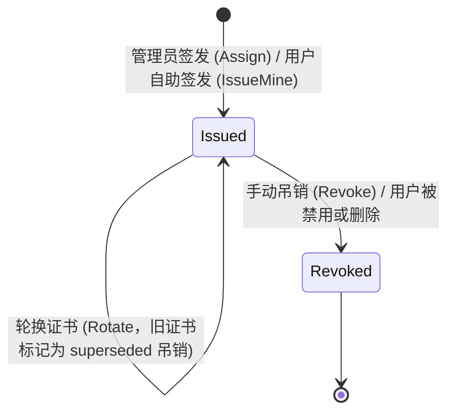

# 分层：领域模块层

领域模块承载无论启用哪些插件都始终存在的核心业务规则：账号与用户组管理、密码认证、PKI 证书管理、邮件中枢以及防篡改审计日志。各扩展插件通过 `plugin.Host` 构建在这些核心模块之上。

| 代码包 | 核心职责 |
| --- | --- |
| `internal/domain/identity` | 用户、POSIX 与组织用户组、角色、UID/GID 分配及角色等级校验 |
| `internal/domain/auth` | 密码登录、会话令牌刷新与注销、密码修改与重置验证码 |
| `internal/domain/pki` | 证书颁发机构（CA）与用户证书全生命周期管理 |
| `internal/mail` | 邮件中枢：服务商管理、模板渲染与投递计数 |
| `internal/audit` | 基于 SHA-256 哈希链的防篡改审计日志 |
| `internal/legacyimport` | 一次性导入 `go-ldap-admin` v1 存量配置与历史数据 |

## 身份管理（Identity） {#identity}

### 用户（Users） {#users}

每个用户包含用户名（合法的 POSIX 名称，最长 50 个字符）、UID、唯一的一个**主 POSIX 组**、任意数量的附加组以及一个或多个角色。个人资料字段（昵称、邮箱、手机号、工号/学号、通讯地址等）映射为对应的 LDAP 属性。

- **UID 与 GID 分配：** 从计数器表（`posix_id_counters`）自 `10000` 起单调递增分配，一经分配永不复用或更改，确保共享存储上的文件归属关系长期稳定。创建时也支持手动指定编号。
- **主组预设（Presets）：** POSIX 组可配置主目录根路径（`homeRoot`）与默认登录 Shell（`defaultShell`）。新建用户若归属该主组，将自动获得 `<homeRoot>/<username>` 主目录与预设 Shell；未配置时回退至 `directory.default-shell`。
- **账号状态：** `active`（正常）或 `disabled`（禁用）。禁用或删除用户时，会通过 PKI 模块注册的 `OnDeactivate` 钩子在同一次原子批处理中自动吊销该用户的所有有效证书。
- **账号来源：** 区分门户内创建的 `platform` 账号与通过第三方登录（`oauth`、`cloudflare-access`）按连接器规则自动创建的账号。

### 用户组（Groups） {#groups}

| 类型 | LDAP 对象类 | 用途 |
| --- | --- | --- |
| POSIX 组（`groupClass: posixGroup`） | `posixGroup`（含 `gidNumber` 与 `memberUid`） | 控制 Unix 文件权限，可作为用户的主 POSIX 组 |
| 组织架构（`groupClass: groupOfUniqueNames`） | `groupOfUniqueNames`（含 `uniqueMember`） | 通过 `parentId` 构成部门/课题组树形结构 |

`groupType` 指定条目的 RDN 属性（`cn` 或 `ou`）。成员变更通过 `POST /api/v2/groups/{id}/members` 在单次批处理中完成增删；用户的主 POSIX 组不可被移除。

### 角色（Roles） {#roles}

每个角色包含策略关键字（`keyword`）、名称、等级（`sort`）与状态，其授权策略保存在 `v2_role_permissions` 表中。关于等级与防提权规则，详见[身份与访问层：角色等级](layer-access.md#ranks-no-escalation)。

## 登录与密码认证（Auth） {#auth}

`domain/auth` 负责所有与密码认证相关的流程：

| 流程 | 路由 | 说明 |
| --- | --- | --- |
| 密码登录 | `POST /api/v2/auth/login` | Argon2id 校验，带防暴力破解限流，仅限 HTTPS |
| 刷新令牌 | `POST /api/v2/auth/refresh` | 签发新令牌并同时吊销旧令牌 |
| 退出登录 | `POST /api/v2/auth/logout` | 将当前令牌 ID 写入 `v2_revoked_tokens` 直至其自然过期 |
| 修改密码 | `PUT /api/v2/me/password` | 凭当前密码或邮箱验证码修改个人密码 |
| 忘记密码重置 | `…/password-reset/request` → `…/confirm` | 发送 6 位数字邮件验证码，服务端仅保存由当前活跃 JWT 密钥派生的 HMAC |
| 管理员重置密码 | `POST /api/v2/users/{id}/password-reset` | 生成随机临时密码并仅在响应中返回一次 |

设置或修改密码时，`password.Derive` 会同时计算门户哈希（Argon2id）与 LDAP 哈希（SHA-512 crypt），随后由各集群 slave 将 LDAP 哈希写入 OpenLDAP 的 `userPassword` 属性。

## PKI 证书中心 {#pki}

门户内置面向各集群的证书颁发机构（CA）。

### 证书颁发机构（CA） {#certificate-authorities}

| 类型 | 创建方式 | 用途 |
| --- | --- | --- |
| SSH（`ssh`） | 门户内生成（Ed25519）或外部导入 | 签发用于 SSH 登录的用户证书；其公钥会写入每个集群的 `TrustedUserCAKeys` |
| X.509（`x509`） | 外部导入（证书 + 私钥） | 签发用户客户端证书；签名后的 CRL 会同步发布至各集群 |

CA 私钥使用 `PKI_MASTER_KEY` 通过 AES-256-GCM 加密封存，并将 CA 身份标识作为附加认证数据（AAD）绑定，防止密文被跨行替换。私钥永不离开主服务，`GET /api/v2/pki/cas` 绝不返回私钥内容。

### 用户证书生命周期 {#user-certificates}

| 属性 | SSH 用户证书 | X.509 用户证书 |
| --- | --- | --- |
| 密钥对算法 | Ed25519，由门户生成 | ECDSA P-256，由门户生成 |
| 有效期 | 30 天 | 1 年（不超过所属 CA 自身到期时间） |
| 身份标识 | Key ID 与 Principal 均为用户名 | Subject `CN = 用户名`，含客户端认证扩展用途 |
| 私钥交付方式 | 证书与私钥仅在签发响应中返回一次，服务端不留存 | 同左 |
| 吊销机制 | 序列号写入各集群 slave 生成的 KRL 文件 | 序列号写入 CA 的 CRL（有效期 48 小时，剩余不足 12 小时时由定时任务自动重签） |

签发、轮换与吊销操作均在单个原子 `store.Batch` 中执行，避免出现半完成状态。浏览器 Web 终端会话则使用由 `web-access` 插件为浏览器端临时密钥签发的 5 分钟短期证书。

## 邮件中枢（Mail Hub） {#mail-hub}

各业务插件从不直接连接 SMTP 服务器，而是统一调用 `h.Mail.Send(ctx, providerName, mail.Message{…})`（传空字符串 `""` 代表使用默认服务商）。

| 服务商类型 | 代码包 | 发送方式 |
| --- | --- | --- |
| `smtp` | `internal/mail` | 支持 STARTTLS 或隐式 TLS 的 SMTP；在 Cloudflare 上通过 `smtp-bridge.js` 调用 `cloudflare:sockets` |
| `rest` | `internal/mail` | 任意 HTTP 邮件 API，以类 cURL 请求模板配合占位符与加密密钥描述 |
| `pool` | `plugins/mailpool` | 按优先级配额、轮询或权重在多个成员服务商之间分发邮件，支持自动故障切换 |

- 服务商凭据均使用 `PKI_MASTER_KEY`（`internal/secretbox`）加密保存，绝不向客户端明文返回。
- 每次投递均按日期、服务商与业务用途计入 `v2_mail_usage`。
- **模板引擎（`mail.Template`）：** 支持 `{{ path.to.value }}` 占位符，并在正文中自动执行 HTML 转义；每个通知功能均声明允许使用的变量根路径，保存配置时自动拒绝未授权的变量名。

## 审计日志（Audit） {#audit}

每一次产生状态变更的请求（无论成功执行还是被权限守卫拒绝）都会被记录到 `v2_audit_log`。

| 字段 | 含义 |
| --- | --- |
| `seq`、`time` | 单调递增序号与时间戳 |
| `actorId`、`actor` | 操作者 ID 与名称 |
| `action` | HTTP 方法与路由模式（如 `POST /api/v2/users`） |
| `target` | 操作目标（如 `user:alice`，由处理器通过 `httpx.SetTarget` 设置） |
| `outcome`、`status` | 执行结果与 HTTP 状态码 |
| `requestId`、`traceId` | 用于关联服务端日志与链路追踪的标识 |
| `prevHash`、`hash` | SHA-256 哈希链：每条记录的哈希覆盖自身所有字段及上一条记录的 `hash` |

- **完整性校验：** `GET /api/v2/audit/verify` 从头遍历哈希链并报告首条链接断裂或哈希不匹配的记录，使数据库中任何篡改或删行行为无所遁形。
- **容量上限控制：** 配置 `AUDIT_MAX_RECORDS` 后，超出上限时每写入一条新记录即自动淘汰最旧的一条，链校验则从当前保留的最早记录开始。
- **免记范围：** 普通 `GET` 查询（除非处理器显式标记需审计）及成功的周期性机器上报不写入审计日志。

## 旧版数据导入（Legacy Import） {#legacy-import}

当在 `go-ldap-admin` v1 数据库上首次启动时，`legacyimport.Run` 会一次性幂等导入：

- 旧版 Web 访问设置；
- 旧版作业通知设置（导入后默认处于禁用状态，待重新配置邮件服务商后启用）；
- 历史 GPU 作业统计记录。

由于 v2 直接兼容 v1 的基础表结构（`migrations/0000_legacy_base.sql`），用户、用户组、角色、CA 与证书均直接从原有表中读取。

## 下一步阅读 {#next-steps}

- [插件系统](plugins.md)：了解构建在核心模块之上的扩展功能。
- [数据模型](data-model.md)：查看完整的数据库表结构与实体关系。
- [存储层](layer-storage.md)：了解领域模块如何访问底层数据库。
