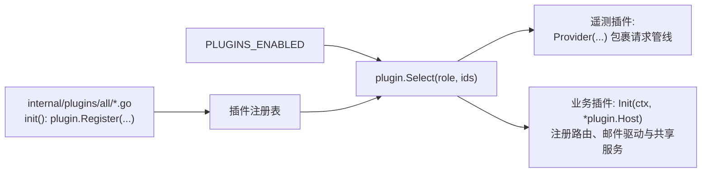

# 插件系统

主服务（Master）中除核心领域模块（身份、认证、PKI、审计与邮件中枢）以外的所有扩展功能均以插件形式实现。本页介绍插件系统的构建、配置与装配机制，列出全部内置插件，并演示如何编写一个新插件。

## 插件系统的工作机制 {#how-the-plugin-system-works}

插件采用**编译期链入、运行期按配置启用**的设计，不在运行时动态加载外部代码。



1. **编译期注册：** `internal/plugins/all/` 下的每个文件通过条件编译标签（如 `//go:build !no_oauth`）引入一个插件包，并在 `init()` 中调用 `plugin.Register`。如需构建不含某插件的精简二进制，只需传入对应标签：
   `go build -tags no_oauth ./cmd/server`。
2. **按角色筛选：** `PLUGINS_ENABLED` 按启动顺序列出要启用的插件 ID。若遇到未知 ID、重复 ID 或不支持当前进程角色（`standalone`、`master`、`slave` 或 `gateway`）的插件，`plugin.Select` 会在启动时立即报错退出。
3. **严格配置解析：** `PLUGINS_CONFIG` 是以插件 ID 为键的 JSON 或 YAML 对象。每个插件通过 `Host.Decode` 仅解析属于自己的配置段，并拒绝任何未知字段。密钥严禁直接写入 `PLUGINS_CONFIG`，必须从以 `PLUGIN_` 或 `OAUTH_` 开头的环境变量读取（或在配置值中写 `env:变量名` 引用）。
4. **生命周期管理：** 遥测插件最先启动，以便其追踪提供方包裹整个请求管线；随后各业务插件依次执行 `Init(ctx, *plugin.Host)`；进程退出时按逆序调用 `Close`。

### 插件宿主（`plugin.Host`） {#what-a-plugin-receives}

`plugin.Host`（`internal/plugin/plugin.go`）向插件暴露以下能力：

| 字段 | 用途 |
| --- | --- |
| `Router` | 注册 HTTP 路由（每条路由必须显式声明权限） |
| `Store` | 数据库接口（底层为 D1 或 SQLite） |
| `Identity`、`PKI`、`Tokens`、`Audit` | 核心领域模块服务 |
| `Mail` | 通过指定服务商发送邮件，或注册新的邮件服务商类型（如 `pool`） |
| `Secrets` | 加解密保存在数据库中的敏感凭据 |
| `Clusters` | 已注册的集群列表及其客户端证书 SHA-256 指纹 |
| `Services` | 插件间按需查找的共享服务注册表 |
| `Getenv`、`Decode`、`Origins`、`Telemetry`、`Role` | 环境变量读取、配置解码、CORS 源列表、遥测接口与当前进程角色 |

`Services` 使插件之间能够解耦协作而无需依赖固定的初始化顺序。例如，`current-status` 插件注册一个读取最新 R2 状态快照的 `Reader`，而 `diagnostics` 插件在生成诊断报告时按需查找并调用该接口。

### 插件开发规范 {#rules-every-plugin-follows}

- 每条路由必须声明 `authz.Public()`、`Authenticated()`、`Peer()` 或 `Policy(object, action)`。机器接口放在 `/sync/` 下，浏览器接口放在 `/api/v2/` 下。
- 周期性机器上报接口务必设置 `Routine: true`，使其仅在失败时写入审计日志，从而控制审计表体积与 D1 写入开销。
- 表结构变更必须新增编号文件 `migrations/00NN_<name>.sql`，严禁修改已有的迁移文件。
- 所有出站邮件必须通过 `Host.Mail` 发送，以确保按服务商与用途准确统计发送量。

## 内置插件一览 {#built-in-plugins}

所有内置插件均运行在 `master`（及 `standalone`）角色上。

| 插件 ID | 代码包 | 功能说明 | 配置项（`PLUGINS_CONFIG`） | 关联密钥环境变量 |
| --- | --- | --- | --- | --- |
| `oauth` | `plugins/oauth` | GitHub OAuth 登录。每个连接器包含有序规则（所有人、邮箱/用户名通配符、GitHub 组织），决定谁可登录及新账号默认加入的用户组与角色 | `frontend-origin` | 每个连接器的客户端密钥：`env:OAUTH_…` 或加密存于数据库 |
| `cloudflare-access` | `plugins/cfaccess` | 使用 Cloudflare Access 身份换取门户会话令牌（`/api/v2/auth/access/session`） | `team-domain`、`applications[]`（`origin`、`path-prefix`、`aud`） | — |
| `cluster-status` | `plugins/clusterstatus` | 接收 slave 推送的节点状态并提供**集群状态**页面 | `stale-seconds` | — |
| `resource-status` | `plugins/resourcestatus` | 接收 slave 推送的资源容量、空闲资源与作业队列 | `stale-seconds` | — |
| `current-status` | `plugins/currentstatus` | 每个集群在 R2/S3 中维护一个综合实时状态对象，浏览器通过预签名链接直接读取 | `account-id`（R2）或 `endpoint`（任意 S3）、`public-endpoint`、`bucket`、`stale-seconds`、`link-seconds` | `PLUGIN_CURRENT_STATUS_R2_*`（读写密钥与只读密钥） |
| `resource-monitor` | `plugins/resourcemonitor` | 保存单作业 GPU 用量摘要并提供全站与个人近 7 天 GPU 统计图表 | — | — |
| `job-notification` | `plugins/jobnotification` | 作业结束邮件通知：模板编辑、实时预览、测试发送与自动投递 | 保存在数据库中（管理后台配置） | — |
| `mail-pool` | `plugins/mailpool` | 注册 `pool` 邮件服务商类型：按优先级配额、轮询或权重在成员服务商间分发邮件并支持故障切换 | 保存在数据库中（**邮件服务**页面） | — |
| `web-access` | `plugins/webaccess` | 签发网关票据与 5 分钟临时 SSH 证书、管理网关注册并发送传输完成邮件 | `ticket-key-id`、`gateways[]`（`fingerprint`、`cluster-id`、`gateway-id`、`instance-id`） | `PLUGIN_WEB_ACCESS_TICKET_KEY` |
| `diagnostics` | `plugins/diagnostics` | 只读检查所有依赖（数据库、slave 上报、网关、邮件通道）的健康拓扑 | `stale-seconds` | — |
| `telemetry-otel` | `plugins/otel` | 以 OTLP/HTTP JSON 格式导出链路追踪与指标 | `endpoint`、`headers`、`service-name`、`timeout`、`max-spans` | 请求头密钥通过 `env:NAME` 引用 |
| `telemetry-cloudflare` | `plugins/cftelemetry` | 以结构化 JSON 日志输出追踪与指标，可选写入 Analytics Engine | `max-spans`、`analytics-engine` | — |

### 配置示例 {#example}

```sh
PLUGINS_ENABLED=oauth,cloudflare-access,current-status,cluster-status,resource-status,resource-monitor,job-notification,mail-pool,web-access,diagnostics
PLUGINS_CONFIG='{
  "cloudflare-access": {"team-domain": "example.cloudflareaccess.com",
                        "applications": [{"origin": "https://portal.example.org", "path-prefix": "/", "aud": "…"}]},
  "current-status":    {"account-id": "…", "bucket": "slurm-portal-status"},
  "web-access":        {"ticket-key-id": "web-access-v2",
                        "gateways": [{"fingerprint": "…", "cluster-id": "cluster1", "gateway-id": "cluster1-login", "instance-id": "cluster1-login"}]}
}'
```

完整的 Serverless 配置示例见 `deploy/worker/wrangler.example.toml`；容器主服务配置见 `deploy/compose/master`（`.env` 与 `compose.yaml`）。

## Slave 侧采集器 {#slave-side-collectors}

部分监控功能由两端共同配合完成：**主服务插件**负责存储与展示，**slave 采集器**负责在集群本地采集上报。Slave 侧在 `slave.yml` 中配置：

| `slave.yml` 配置段 | 代码包 | 采集内容 |
| --- | --- | --- |
| `cluster-status` | `plugins/clusterstatus`（`Collector`） | 调用 `scontrol show nodes` 采集节点状态 |
| `resource-status` | `plugins/resourcestatus`（`Collector`） | 调用 `scontrol` 与 `squeue` 采集资源与队列 |
| `current-status` | `plugins/currentstatus`（`Collector`） | 将上述两项合并为单个状态对象上传至 R2 / S3 |
| `lifecycle-file` | `internal/lifecycle/*` | 接收生命周期钩子事件，驱动作业完成邮件与 GPU 用量采样 |

## 编写一个新插件 {#writing-a-plugin}

1. 创建 `internal/plugins/<name>/plugin.go`：

   ```go
   @@
   ```

2. 在 `internal/plugins/all/hello.go` 中注册该插件：

   ```go
   @@
   ```

3. 如需新增数据表，添加 `migrations/00NN_hello.sql`。
4. 如需在前端添加管理页面，将其注册到 `web/src/routes.jsx` 并标注 `meta: { plugin: "hello" }`，使菜单仅在插件已启用且用户拥有对应权限时展示。
5. 使用 `internal/testutil` 提供的内存数据库编写单元测试。
6. 在 `tools/apidoc/descriptions.go` 中补充新路由说明并运行 `go run ./tools/apidoc`。
