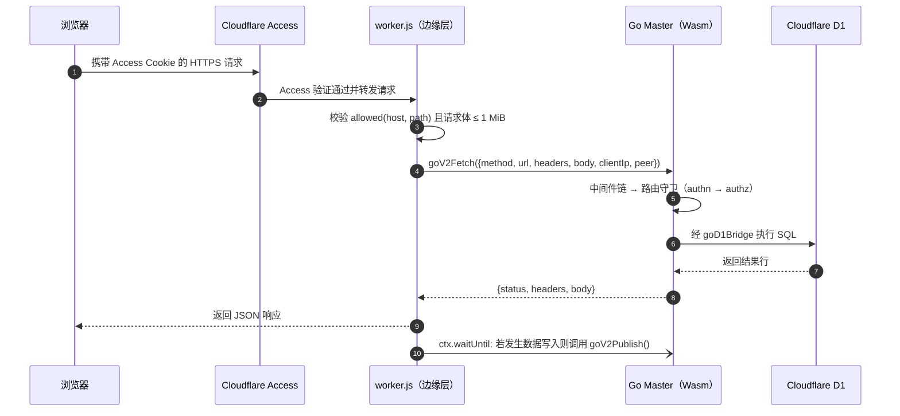
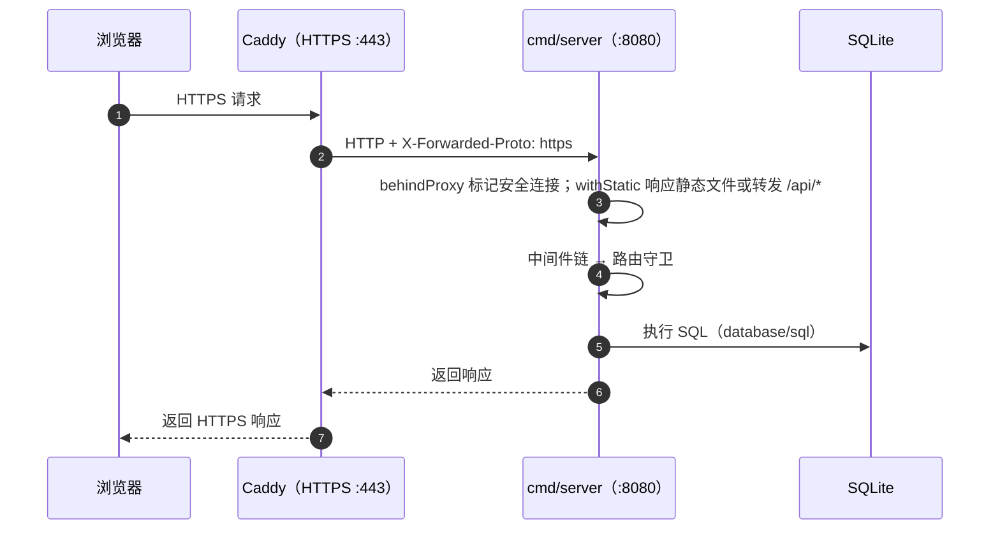
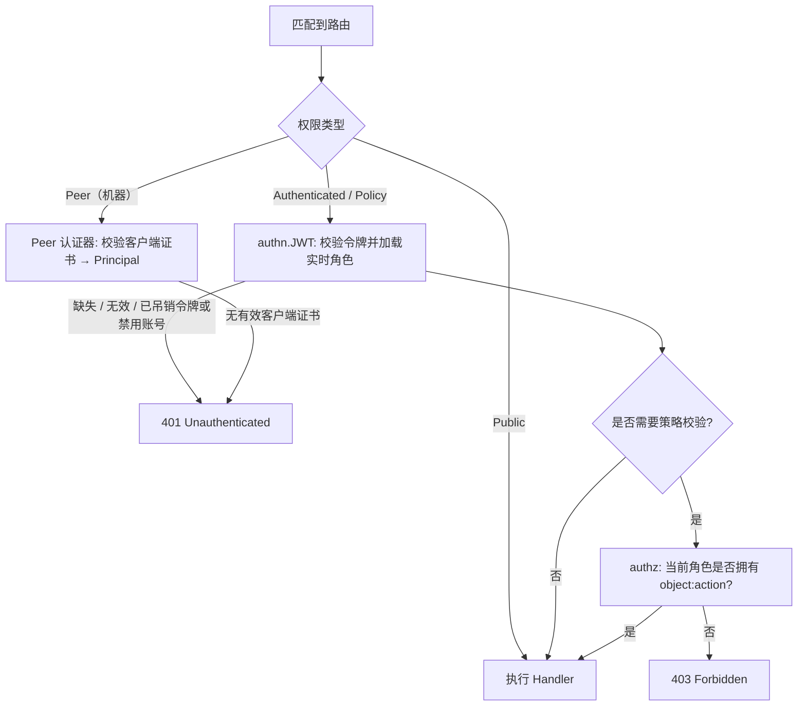

# 请求生命周期

本页追踪一次 HTTP 请求从边缘接入层进入 Go 主服务、访问数据库并返回响应的完整历程，同时涵盖 Cloudflare Serverless 与容器自托管两种运行时。

## 流程概览 {#the-short-version}

1. **边缘接入层（Edge）** 校验当前主机名是否允许访问目标路径，并将请求转交至 Go 核心：
   - 在 Cloudflare 上由 Worker 宿主脚本 `deploy/worker/worker.js` 处理；
   - 在容器环境中由 Caddy 与 `cmd/server` 处理。
2. **中间件链（Middleware Chain）** 依次注入请求 ID、链路追踪 Span、panic 恢复、安全响应头、IP 令牌桶限流、CORS 校验、写操作标记及审计钩子。
3. **路由器与路由守卫（Router & Guard）** 匹配路由模式，认证调用方身份（`Principal`），并校验路由声明的访问权限。
4. **业务处理器（Handler）**（领域模块或插件）严格解析 JSON 请求体、执行业务规则校验，并通过 `store.Store` 读写数据库。
5. **响应与快照发布** 统一输出 JSON 响应；若请求修改了数据，主服务会在响应后异步发布新的快照哈希，以便各集群及时同步变更。

## 在 Cloudflare（SaaS）上 {#on-cloudflare-saas}

| 阶段 | 代码位置 | 处理逻辑 |
| --- | --- | --- |
| 主机名隔离 | `deploy/worker/edge.js` `allowed()` | `/sync/*` 路由仅在 `SYNC_HOSTNAME` 上提供；其他所有路由禁止在 `SYNC_HOSTNAME` 上访问，违者直接返回 `404`。 |
| 请求体大小限制 | `deploy/worker/worker.js` | 超过 1 MiB 的请求体在进入 Go/Wasm 前直接返回 `413`。 |
| Isolate 冷启动 | `deploy/worker/worker.js` `boot()` | 新 Isolate 上的首个请求负责启动 Go 程序：执行数据库迁移、初始化插件并加载权限策略。并发请求等待启动完成；若启动卡死超过 5 秒则由后续请求接管重试。 |
| 机器身份传递 | `deploy/worker/edge.js` `verifiedPeer()` | 在同步主机名上，将 Cloudflare 验证通过的客户端证书 SHA-256 指纹作为 `peer` 传给 Go，Go 仅通过 `authn.BridgePeer` 读取该身份。 |
| 客户端 IP 提取 | `deploy/worker/worker.js` | 提取 `CF-Connecting-IP` 供限流器与审计日志使用。 |
| 写后哈希发布 | `deploy/worker/worker.js` | 若请求产生了数据写入（`goV2TakeWrites`），在响应发出后通过 `waitUntil` 异步发布最新快照哈希，不增加响应延迟。 |

## 在容器环境中 {#in-containers}

机器调用方不经过 Caddy：slave 与网关直接连接 `cmd/server` 的独立双向 TLS 监听端口（`SYNC_LISTEN`，端口 `8443`），该端口仅暴露 `/sync/*` 与 `/healthz`。数据写入由 `cmd/server/main.go` 中每 5 秒运行一次的定时器检测并更新快照哈希。

## Go 内部处理流程 {#inside-go}

### 1. 中间件链 {#1-middleware-chain}

在 `internal/app/app.go` 中按从外到内的顺序注册（详见[HTTP 与边缘层](layer-http.md)）：

| 顺序 | 中间件 | 作用 |
| --- | --- | --- |
| 1 | `httpx.WithScope` | 沿用格式合法的 `X-Request-Id` 或生成新 ID，创建供后续各层共享的请求级作用域 |
| 2 | `telemetry.HTTPMiddleware` | 当启用遥测插件时，为每个请求创建链路追踪 Span |
| 3 | `httpx.Recover` | 捕获 panic，记录错误日志并返回 `500` |
| 4 | `httpx.SecurityHeaders` | 注入 `nosniff`、`X-Frame-Options: DENY`、`no-referrer`、`no-store` 及全拒绝 CSP 响应头 |
| 5 | `httpx.RateLimit` | 按客户端 IP 执行令牌桶限流（默认 20 次/秒，突发 200） |
| 6 | `httpx.CORS` | 仅放行 `CORS_ORIGINS` 中显式配置的源 |
| 7 | 写操作追踪 | 记录 `/sync/` 以外成功的非 `GET` 请求，以便触发快照哈希重发布 |
| 8 | `audit.Middleware` | 在处理器返回后，为所有变更请求（无论成功或被拒绝）追加一条哈希链审计记录 |

### 2. 路由守卫 {#2-route-guard}

`httpx.Router.guard`（`internal/httpx/router.go`）包裹每一条注册路由（详见[身份与访问层](layer-access.md)）：

路由器在启动阶段拒绝注册任何未声明权限的路由，从机制上杜绝因遗漏权限配置而暴露未受保护接口的可能。

### 3. 业务处理器与模块 {#3-handler-and-modules}

处理器归属于核心领域模块或插件（见[领域模块层](layer-domain.md)与[插件系统](plugins.md)），统一遵循以下规范：

- 使用 `httpx.DecodeJSONLimit` 严格解析 JSON：拒绝未知字段并限制请求体大小；
- 校验业务不变量（如角色等级防提权规则与主 POSIX 组约束）；
- 通过 `store.Store` 读写数据，多条关联更新放入同一个原子 `Batch`；
- 对可预期的业务错误返回结构化的 `apperr.Error`。

### 4. 存储层 {#4-storage}

`store.Store` 在 Cloudflare D1 与原生 SQLite 之上提供统一的访问接口（详见[数据模型](data-model.md)与[存储层](layer-storage.md)）。

### 5. 响应序列化 {#5-response}

`httpx.WriteJSON` 输出 `{"data": …}`；`httpx.WriteError` 将任意错误转换为对应状态码与 `{"error": {"code", "message", "requestId"}}`。`5xx` 内部错误会附带请求 ID 记录到服务端日志，绝不向客户端泄露内部堆栈或实现细节。

## 机器请求处理 {#machine-requests}

Slave 与网关携带客户端证书调用 `/sync/*` 路由。路由守卫使用机器对端认证器（Peer Authenticator）替代用户令牌认证器；各插件随后根据证书 SHA-256 指纹映射对应的集群或网关身份（`CLUSTERS`、`web-access.gateways`），完全忽略请求体中自称的身份标识。高频周期性上报路由标记为 `Routine: true`，仅在失败时写入审计日志。

## 下一步阅读 {#next-steps}

- [HTTP 与边缘层](layer-http.md)
- [身份与访问层](layer-access.md)
- [同步协议](sync-protocol.md)：快照哈希发布后的集群同步流程
