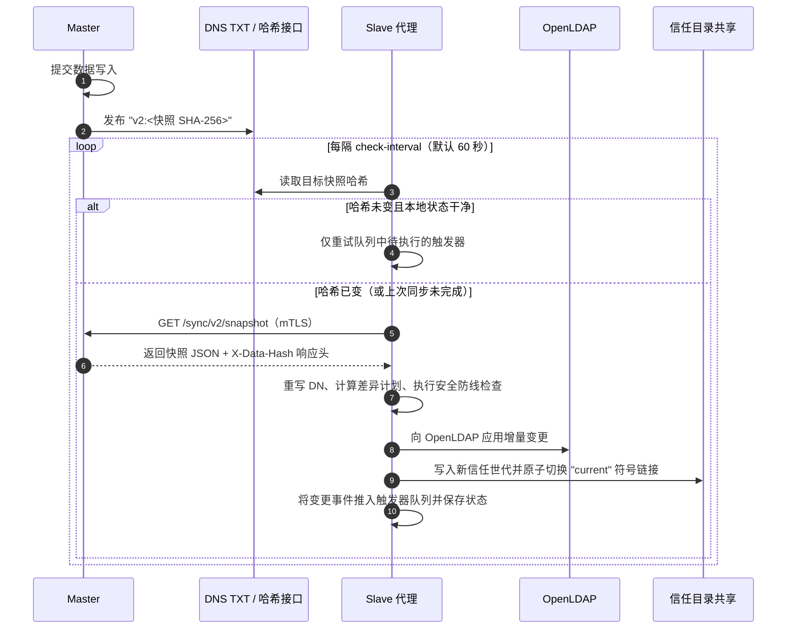

# 同步协议

本页阐述主服务（Master）上的数据变更如何安全送达每一个集群：主服务发布什么内容、slave 在每轮检查中执行哪些步骤，以及防止异常同步锁死集群的安全防线（Guard）。

**相关代码包：** `internal/replication`（主服务侧）与 `internal/slave`（集群侧）。

## 协议总览 {#overview}



## 快照结构（Snapshot） {#the-snapshot}

`replication.Load` 从主服务数据库构建出一份自包含的完整快照，仅包含集群运行所需的最小数据集：

| 字段 | 内容说明 |
| --- | --- |
| `version` | 同步协议版本号（`2`） |
| `baseDn` | 主服务配置的 LDAP 基准后缀（`LDAP_BASE_DN`） |
| `users` | 用户 ID、用户名、DN、姓名、邮箱、工号/学号、手机号、UID、GID、主目录、登录 Shell、地址、所属部门及 LDAP 密码哈希 |
| `groups` | 用户组 ID、组名、DN、RDN 属性（`cn` 或 `ou`）、对象类（`posixGroup` 或 `groupOfUniqueNames`）、GID 及父节点 ID |
| `memberships` | `(用户组 ID, 用户 ID)` 成员映射对 |
| `cas` | 已启用的受信 CA：SSH 公钥、X.509 证书及其最新签名的 CRL |
| `sshRevocations` | 按 CA 分组的已吊销 SSH 证书序列号，用于编译生成 KRL |
| `userCertificates` | 用户当前有效的 X.509 证书，用于写入 LDAP 的 `userCertificate;binary` 属性 |

**一致性快照哈希：** 快照哈希是快照 JSON 序列化字节流的 SHA-256 摘要（`Snapshot.Hash`）。`replication.Load` 会连续读取两次数据库并比对摘要，确保在高并发写入期间生成的快照绝不会出现前后半截不一致的撕裂状态。

## 发布快照哈希 {#publishing-the-hash}

| 主服务运行模式 | Slave 如何获知最新快照哈希 |
| --- | --- |
| Cloudflare（Serverless） | `replication.DNSPublisher` 在哈希发生变更时（比对 `v2_sync_state`）通过 Cloudflare API 将 `v2:<hash>` 写入指定的 DNS TXT 记录（`SYNC_DNS_NAME`），slave 直接通过 DNS 解析读取。 |
| 容器自托管 | 无需配置 DNS 记录。将 `slave.yml` 中的 `dns-name` 设为空字符串 `""`，slave 会通过双向 TLS 调用 `GET /sync/v2/snapshot-hash`。 |

主服务在每次写操作完成后及周期性定时任务中发布哈希。采用 DNS 模式时，无变更的集群每分钟仅产生一次轻量级 DNS 查询，对主服务零请求开销。

## Slave 每轮检查的执行步骤 {#what-a-slave-does-on-each-check}

`slave.Replicator.Check`（`internal/slave/replicator.go`）按严格顺序执行以下 11 个步骤：

1. **读取目标哈希：** 若目标哈希与本地已应用的哈希一致，且上一轮同步正常完成，则直接跳至第 11 步处理待执行触发器。
2. **下载并校验快照：** 调用 `GET /sync/v2/snapshot`（上限 64 MiB），计算响应体 SHA-256 并校验其与 `X-Data-Hash` 响应头完全一致。
3. **重写 LDAP DN：** 当集群本地目录后缀与主服务不同时，自动将 `source-base-dn` 重写为 `local-base-dn`，并可将用户组重定向至 `local-group-dn`。
4. **标记本地状态为脏（Dirty）：** 在修改外部系统前先落盘脏标记；若进程在此后任意时刻异常退出，下一轮检查将自动重跑完整同步。
5. **首次同步基线对齐：** 在首次接管目录时（尚无 `applied.json`），读取当前 OpenLDAP 目录与已发布的信任文件，仅纳入主服务托管的条目作为比对基线。集群本地自建条目及已有的 `userPassword`（当门户中 `ldap_hash` 为空时）保持原样不动，从而在无差异目录上实现零修改、零触发器风暴的平滑接管。
6. **安全防线校验（Guard）：** 若同步计划存在以下高危操作，`slave.Guard` 将直接拒绝执行：
   - 单次删除的用户数超过 `limits.max-user-deletions`（默认 `5`）；
   - 移除当前已受信的 SSH CA（除非显式配置了 `limits.allow-ca-removal: true`）。
7. **对账更新 OpenLDAP：** 按最小差异执行条目的增删改、更新密码哈希与用户证书，并同步组成员关系（POSIX 组使用 `memberUid`，组织架构使用 `uniqueMember`）。非主服务托管的条目及 slave 自身的绑定 DN 永不触碰。
8. **发布信任文件：** 将最新信任世代写入 `trust-dirs` 中的所有目标目录（见下文）。
9. **生成触发器事件：** 比对新旧两份快照的语义差异，将变更事件写入持久化触发器队列。
10. **原子保存状态：** 原子化写入 `applied.json`（记录已应用的哈希与快照内容），随后清除脏标记。
11. **按序执行触发器：** 按先进先出（FIFO）顺序执行队列中的触发器命令。

任一步骤失败都会保留脏标记并使 `/readyz` 返回 `503`，由下一轮检查自动重试。

### 离线预演（Plan 模式） {#offline-rehearsal}

`slave -plan` 可针对快照文件（或数据库副本）与 `slapcat` 导出的 LDIF 文件离线运行第 2–6 步，全程不修改真实 LDAP，直接输出将要执行的所有 LDAP 写操作及安全防线检查结果（`"safe": true`）。在存量目录上首次启动 slave 前，请务必先运行该模式进行预演。

## 信任文件目录结构 {#trust-files}

`slave.PublishTrust` 每次都会写出一个以内容哈希命名的不可变**世代（Generation）**目录，随后原子化切换 `current` 符号链接：

```text
<trust-dir>/
  current -> 3f9a…                        # atomic symlink to the active generation
  3f9a…/
    ca-bundle.pem                         # Trusted X.509 CA certificates
    crl/ca-<id>.pem                       # Signed X.509 CRL per CA
    ssh/trusted-user-ca-keys.pub          # Referenced by sshd TrustedUserCAKeys
    ssh/revoked.krl                       # Referenced by sshd RevokedKeys (compiled via ssh-keygen -k)
```

`sshd` 始终通过 `current/…` 读取信任文件，因此绝不会读到写了一半的文件。如需紧急回滚，只需将 `current` 重新指向旧世代目录即可。

## 触发器机制（Triggers） {#triggers}

Slave 将新旧快照之间的差异转换为标准生命周期事件：

| 事件名称 | 触发时机 |
| --- | --- |
| `user.created`、`user.updated`、`user.deleted` | 托管用户账号新增、属性变更或删除 |
| `group.created`、`group.updated`、`group.deleted` | 托管用户组新增、属性变更或删除 |
| `membership.added`、`membership.removed` | 用户加入或移出用户组 |

`trigger-file` 中定义的每个触发器可订阅若干事件，并将事件 JSON 替换命令参数中的 `%DATA%` 后执行：

- **持久化队列：** 每个 `(事件, 触发器)` 组合在状态目录下保存为独立文件，严格按顺序投递。
- **失败阻塞与重试：** 投递失败的事件会留在队首并阻塞后续事件，确保账户与组变更绝不乱序执行。因此，触发器脚本必须具备幂等性（可安全重复执行）。
- **`currentUserOnly` 过滤：** 可选跳过在最新快照中已被删除或改名的用户的历史排队事件。

`deploy/triggers/slurm_trigger.py` 是官方标准触发器，负责调用 `sacctmgr` 同步 Slurm 关联账户并初始化 NFSv4 主目录。

## 状态与监控上报 {#status-reports}

通过同一个双向 TLS 客户端，slave 还会向主服务推送以下监控数据：

| 上报内容 | 路由 | 主服务存储方式 |
| --- | --- | --- |
| 综合实时状态（节点、资源、队列） | `PUT /sync/v2/current-status` | R2 / S3 中每个集群保存为一个 JSON 对象 |
| 节点健康状态 | `POST /sync/v2/cluster-status` | 数据库中每个集群保留最新一行 |
| 资源容量与作业队列 | `POST /sync/v2/resource-status` | 数据库中每个集群保留最新一行 |
| 作业完成通知 | `POST /sync/v2/job-completions` | 渲染模板并发送作业完成邮件 |
| 单作业 GPU 用量摘要 | `POST /sync/v2/resource-summaries` | 保存至数据库，用于近 7 天 GPU 统计图表 |

主服务仅根据客户端证书的 SHA-256 指纹识别上报来自哪个集群。

## 下一步阅读 {#next-steps}

- [集群代理程序](agents.md)：查看 slave 的完整配置项与健康检查接口。
- [密码学与签名](cryptography.md)：了解保护同步通道的证书与签名机制。
